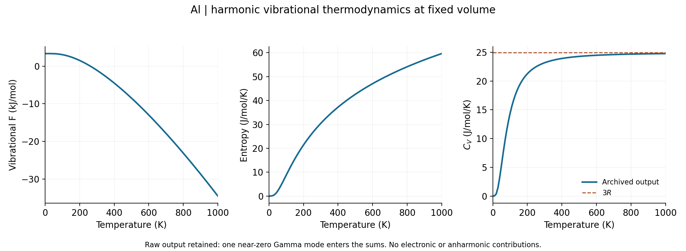

.. _al-gpaw-phonons:

Aluminium phonons and vibrational thermodynamics with GPAW
==========================================================

This exercise follows the completed ``GPAW/al-phonon`` case from
``example-runs-Va5NDWGi``. It connects a relaxed fcc structure, displaced-cell
forces, three acoustic phonon branches, a phonon density of states (DOS), and
harmonic thermal properties. It also shows why a tiny negative frequency at
Gamma and a thermal-property warning need different interpretations.

The calculation completed successfully. Its data are suitable for learning the
workflow, but supercell, electronic sampling and displacement convergence have
not been established. Treat the numbers below as recorded example results.

Prepare and run
---------------

Use an environment with Nanoworks, GPAW, GPAW PAW datasets and Phonopy installed;
see :doc:`../installation`. Start with ``nanoworks/examples/Al-phonon`` in your
current source checkout. Copy ``Al-phonon.py`` and
``Al_mp-134_primitive.cif`` to a fresh directory, then run:

.. code-block:: console

   $ dftsolve -E GPAW -p 8 -i Al-phonon.py -g Al_mp-134_primitive.cif --check
   $ dftsolve -E GPAW -p 8 -i Al-phonon.py -g Al_mp-134_primitive.cif

``--check`` verifies prerequisites without running DFT. The second command
relaxes the cell, computes displaced-supercell forces, and exports phonon and
thermal results. A fresh directory avoids substituting old force caches for
the calculation you intend to validate. Change the MPI process count to suit
your machine.

The recorded run used Nanoworks 27.2.0rc0, GPAW 26.7.0, ASE 3.29.0 and
Phonopy 4.8.6 with eight processes. Its exact source commit and PAW dataset
release were not recorded, so the package version alone does not identify a
fully pinned computational environment.

.. list-table:: Settings in the recorded input and force log
   :header-rows: 1
   :widths: 42 58

   * - Setting
     - Value
   * - Electronic approximation
     - Non-spin-polarized PBE, plane waves, 700 eV
   * - Ground-state electronic grid
     - Gamma-centred 5 x 5 x 5
   * - Force electronic grid
     - 5 x 5 x 5 on the displaced supercell
   * - Occupations
     - Fermi–Dirac, width 0.05 eV
   * - Geometry optimization
     - LBFGS, force tolerance 0.05 eV/angstrom; three normal strains relaxed
   * - Supercell and displacement
     - 2 x 2 x 2 primitive cells, eight atoms; 0.001 angstrom
   * - Translational constraint
     - ``Phonon_acoustic_sum_rule = True``
   * - Phonon DOS / thermal mesh
     - 21 x 21 x 21; 286 irreducible points, weights sum to 9261
   * - Band path
     - Gamma–X–K–Gamma–L; 61 points per segment
   * - Thermal range
     - 0–1000 K in 10 K steps, fixed relaxed volume

The electronic k-point grids and the phonon q-point mesh serve different
purposes. Increasing the 21 x 21 x 21 mesh improves reciprocal-space integration
of the existing force constants; it does not improve the underlying DFT forces
or replace a larger supercell.

Inspect the structure and force constants
-----------------------------------------

The one-atom primitive cell retains equal edges and 60-degree angles after
relaxation. Its final edge is 2.880492 angstrom, corresponding to a conventional
fcc lattice parameter of 4.073630 angstrom and a volume of
16.899929 cubic angstrom per atom. The final diagonal stress printed by GPAW
is approximately -0.000218 eV/cubic angstrom (about +0.035 GPa hydrostatic
pressure). This residual and the geometry tolerance should be tightened for a
quantitative lattice or phonon benchmark.

The exported final CIF uses a P1 representation. The lattice and atomic basis
still describe fcc Al, and Phonopy identifies Fm-3m (225); the CIF label alone
does not demonstrate a symmetry-breaking relaxation.

Both the final ground-state and displaced-cell electronic calculations report
SCF convergence. Symmetry reduces this example to one displaced supercell.
The saved force-constant array has compact shape ``(1, 8, 3, 3)`` in
eV/angstrom squared. Its SHA256 agrees with the result summary, and summing
over the supercell index leaves a maximum component of approximately
``2.8e-16`` eV/angstrom squared after the acoustic sum rule. This checks
translational consistency, not force convergence.

Read the phonon spectrum
------------------------

.. figure:: ../_static/examples/al-gpaw-phonons.png
   :alt: Three acoustic Al phonon branches along Gamma X K Gamma L and a phonon DOS in inverse THz per primitive cell.
   :width: 100%

   Redrawn directly from the exported band YAML and DOS DAT, without smoothing
   or rescaling. The one-atom primitive cell has three branches, all acoustic.
   Degenerate branches overlap along parts of the path.

The band DAT and YAML agree within ``5.1e-7`` THz / inverse angstrom, their
different printing precisions. The maximum sampled band frequency is
9.549451 THz at L. At X the frequencies are 4.904776, 4.904776 and
8.791436 THz; at L they are 3.633585, 3.633585 and 9.549451 THz.

The three Gamma frequencies in the result summary are approximately
``[-5.00e-8, -3.63e-8, +5.30e-8]`` THz. These values are negligible numerical
residuals of zero-frequency translations. No mode below -0.1 THz occurs on the
sampled mesh, and its lowest non-Gamma frequency is 0.541558 THz. This supports
the absence of a resolved instability in this sampled, finite-supercell model;
it does not prove stability at every wave vector or at converged settings.

The trapezoidal integral of the tabulated DOS is 3.001219 modes per primitive
cell, close to the expected three. The small difference reflects numerical
integration of the exported DOS grid. Its negative-frequency axis padding has
zero DOS and is not evidence for an unstable branch.

Phonopy 4.8.6 reports that its default ``primitive_matrix='auto'`` selected a
cyclic permutation of this primitive basis. The saved YAML records that basis.
Keep the YAML with the numerical tables when reusing this data; reduced
q-coordinates are tied to the reciprocal basis.

Interpret the thermal properties
--------------------------------

   Original thermal DAT values. The dashed line is the three-mode classical
   limit, 3R, approximately 24.9434 J/(mol K). The near-zero Gamma-mode
   contribution discussed below is retained in these curves.

.. list-table:: Recorded harmonic vibrational values, per mole of one-atom primitive cells
   :header-rows: 1

   * - Temperature (K)
     - F (kJ/mol)
     - S (J/mol/K)
     - Cv (J/mol/K)
   * - 0
     - 3.347567
     - 0
     - 0
   * - 300
     - -1.098341
     - 30.440177
     - 23.179575
   * - 1000
     - -34.534169
     - 59.644347
     - 24.773717

At zero temperature F is the zero-point vibrational energy. Entropy and heat
capacity vanish in the output; Cv approaches 3R as temperature rises. These
are harmonic vibrational contributions at fixed volume. They exclude the
static DFT energy, electronic thermal contributions, expansion and
anharmonicity. In particular, these curves are not a prediction of measured
Cp or of solid Al remaining stable across the entire plotted range.

.. important::

   The archived YAML has ``exclude_gamma_acoustic: false`` and integrates
   27781 of 27783 weighted modes. Two tiny negative Gamma frequencies are
   omitted by the zero-frequency cutoff, while the tiny positive one enters
   the thermal sum. Phonopy explicitly warns about this numerical artifact.

   That mode contributes approximately -0.01777 kJ/mol to F at 1000 K
   (about -0.184 meV per atom), +0.01866 J/(mol K) to S, and
   +0.000898 J/(mol K) to Cv. Thus a negligible Gamma frequency can still
   affect thermodynamics through the logarithm of its frequency.

The download includes an independent weighted harmonic reconstruction using
the constants of Phonopy 4.8.6. It reproduces the archived F, S and Cv within
``1.3e-6`` in their respective displayed units, allowing for table rounding.
It also writes a **separately named** table with all three Gamma translations
excluded. This is a postprocessing comparison on the same finite mesh;
it is not a new DFT calculation or a mesh-converged correction. The plotted
and quoted reference values above remain the original output.

For a dedicated Phonopy thermal analysis, its documented
``EXCLUDE_GAMMA_ACOUSTIC`` setting removes these translations without changing
other low-frequency modes. This is a Phonopy setting, not a Nanoworks input
keyword. Verify the mesh and supercell convergence before interpreting small
free-energy differences. See the `Phonopy thermal settings
<https://phonopy.github.io/phonopy/setting-tags.html#exclude-gamma-acoustic>`_
and `harmonic thermodynamic formulas
<https://phonopy.github.io/phonopy/formulation.html#thermodynamic-properties>`_.

Download and redraw
-------------------

:download:`Download inputs, force constants, DAT/YAML results and plotting script <../_static/examples/al-gpaw-phonons-reference.zip>`.
Extract the archive, install ``numpy``, ``matplotlib`` and ``PyYAML`` in an
analysis environment, then run:

.. code-block:: console

   $ python plot_phonons.py

This produces both tutorial figures, ``checks.json`` and the separate
``thermal-without-gamma.dat`` comparison. It does not run GPAW or alter the
archived data. ``SHA256SUMS`` records the distributed source files.
The band, DOS, mesh, thermal YAML/DAT and compact force constants are preserved;
large electronic state files are not required for these plots.

Before using the result quantitatively, vary the force cutoff, electronic
grid and smearing, displacement size and supercell independently; tighten the
relaxed-cell criterion and converge the thermal q-point mesh. A smooth curve,
an enforced acoustic sum rule and successful exit codes are useful checks,
but none establishes numerical convergence by itself.
