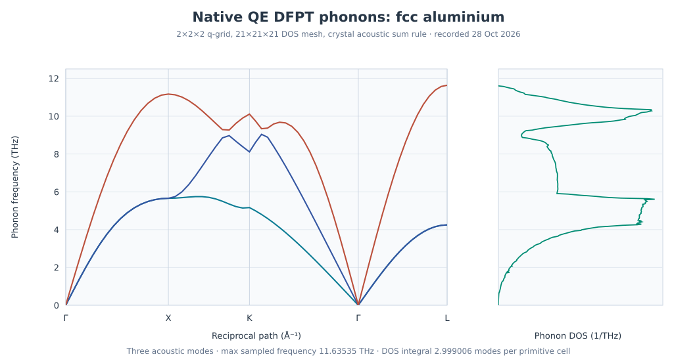

Aluminium phonons with native Quantum ESPRESSO DFPT
===================================================

.. note::

   This example explains the Quantum ESPRESSO DFPT phonon workflow.
   Its illustrative numerical settings require convergence checks
   before quantitative materials predictions.

This example uses the native Quantum ESPRESSO DFPT sequence
``ph.x``, ``q2r.x`` and ``matdyn.x``. The same bundled input
also supports a separate GPAW finite-displacement workflow;
see :doc:`al-gpaw-phonons`. The two workflows are **not**
controlled engine-to-engine benchmarks.

Run the example
---------------

First install the examples with ``nanoworks --install-examples``,
if needed. Separately install supported QE executables
``pw.x``, ``ph.x``, ``q2r.x`` and ``matdyn.x``, and the
required QE pseudopotentials. See :ref:`tutorial-examples-setup`.

.. code-block:: console

   $ cd ~/.nanoworks/examples/Al-phonon
   $ dftsolve -E QE -p 4 -i Al-phonon.py -g Al_mp-134_primitive.cif --check
   $ dftsolve -E QE -p 4 -i Al-phonon.py -g Al_mp-134_primitive.cif

The ``-E QE`` override is needed because the example input
sets ``Engine='GPAW'``. Change the process count as appropriate.
The process count is machine-dependent and does not change the meaning of the phonon q-grid.

Read the native QE settings
---------------------------

The one-atom fcc Al primitive cell uses PBE, a 700 eV
wavefunction cutoff, a density cutoff four times larger,
a Gamma-centered 5 x 5 x 5 electronic mesh and 0.05 eV
Fermi-Dirac occupation width. The run includes variable-cell
BFGS relaxation and then DFPT phonons.

.. list-table:: Generated QE phonon workflow
   :header-rows: 1
   :widths: 30 35 35

   * - Program
     - Example setting
     - Role
   * - ``pw.x``
     - ``vc-relax`` with full cell freedom
     - Relaxation of the primitive cell
   * - ``ph.x``
     - ``nq1=nq2=nq3=2``, ``tr2_ph=1e-12``
     - Dynamical matrices on a 2 x 2 x 2 q-grid
   * - ``q2r.x``
     - ``zasr='no'``
     - Transform the eight-q-point dynamical matrices
   * - ``matdyn.x`` bands
     - ``asr='crystal'``, 61 samples
     - Gamma-X-K-Gamma-L acoustic dispersion
   * - ``matdyn.x`` DOS
     - ``nk1=nk2=nk3=21``
     - Fourier-interpolated phonon DOS
   * - Thermal stage
     - 0 to 1000 K in steps of 10 K
     - Harmonic vibrational thermal output

QE uses the ``Phonon_supercell`` dimensions to choose the
native DFPT q-grid, **not** to build finite-displacement
supercells. ``Phonon_qpts_x/y/z`` set the denser
DOS/interpolation mesh. The GPAW-only
``Phonon_PW_cutoff`` and ``Phonon_kpts_x/y/z``
settings are ignored by QE DFPT, which reuses
the ground-state electronic cutoff and k-point mesh.

Check the ``q2r.x`` output for successful Fourier transformation of all
q-grid dynamical matrices. The ``matdyn.x`` stage applies the crystal
acoustic sum rule when generating the interpolated dispersion. Its warning that Born effective
charges were not found (and TO-LO splitting was absent)
does not indicate failed metallic-Al DFPT.

Relaxed lattice and force/stress checks
---------------------------------------

The initial primitive-cell edge was about 2.855955 angstrom;
the final edge is **2.876684 angstrom**, with approximately
60-degree angles. It corresponds to conventional fcc
a = **4.068246 angstrom**. The exported CIF has a P1
serialization; the geometry still describes an fcc primitive
basis.

The variable-cell BFGS stage completed after three steps.
The final QE SCF shows residual diagonal stresses of only
**0.04 to 0.05 kbar**, and printed atomic forces of zero.
Thus the stored geometry passes the new final-SCF
force and unrestricted-cell stress sanity checks.
This is not a substitute for cutoff and k-grid convergence.

Interpret the phonon dispersion and DOS
---------------------------------------

   Drawn from the original 61-point band and 389-point DOS
   tables. No smoothing or numerical re-interpolation was applied.

The one-atom primitive cell has **three acoustic branches**.
Both Gamma points, at indices 0 and 45, have frequencies
zero to the printed precision. At X (index 15), the
three branches are **5.656085**, **5.656805** and
**11.169239 THz**. The largest sampled frequency is
**11.635350 THz**, at L (index 60).

The tabulated DOS integrates to **2.99900626 modes per
primitive cell** using trapezoidal integration, close to
three expected vibrational degrees of freedom. The
single Al atom's projected DOS matches the total
DOS to the precision of the projection output.

No negative frequencies occur on the sampled path,
but the DFPT mesh is coarse. Neither this observation
nor mode-count normalization proves that the
interpolated branches are converged or globally stable.
Nanoworks reports positive thermal-integration mode
weight **2.99900620** and tiny excluded non-positive
weight **0.00000007**.

.. important::

   The raw ``ph.x`` Gamma dynamical matrix gave three acoustic
   frequencies of **-0.148327, -0.145642 and -0.145642 THz**.
   The saved ``matdyn.x`` band frequencies are zero because
   ``asr='crystal'`` imposes translational invariance.
   This corrects the displayed acoustic sum rule but does not
   independently demonstrate converged input force constants.
   The separate :doc:`si-qe-dfpt-phonons` tutorial shows the
   analogous effect for diamond Si.

Vibrational thermodynamics
--------------------------

The data include 101 rows from 0 to 1000 K. Free energy
and internal energy are in kJ/mol; entropy and
constant-volume heat capacity are in J/(mol K).

.. list-table:: Original QE harmonic vibrational values
   :header-rows: 1

   * - Temperature
     - F (kJ/mol)
     - S (J/mol K)
     - Cv (J/mol K)
   * - 0 K
     - 4.043007
     - 0
     - 0
   * - 300 K
     - 0.401673
     - 26.281186
     - 22.413652
   * - 1000 K
     - -29.921447
     - 55.105251
     - 24.687907

The 0 K value is the harmonic zero-point vibrational
energy. The high-temperature Cv approaches the
three-mode 3R limit of about 24.9434 J/(mol K).
These are fixed-volume harmonic contributions;
they exclude electronic excitations, thermal expansion
and anharmonicity and must not be equated to measured Cp.

The corresponding GPAW finite-displacement example uses a different
force-constant method, sampling and PAW representation. Numerical differences
between the two examples cannot be attributed to one engine without a
matched and converged comparison.

Before using DFPT results in a materials study
----------------------------------------------

A valid phonon workflow requires separate checks of the electronic
ground state and the lattice response. Begin by converging the equilibrium
cell, residual forces and stresses, electronic cutoff, occupations and
k-point sampling. Then vary the **DFPT q-point grid** and the
interpolation/DOS grid independently. In a metal, electronic smearing
can noticeably affect phonon frequencies and must also be tested.

At Gamma, compare the raw dynamical-matrix acoustic frequencies with
the sum-rule-corrected values. An acoustic sum rule enforces translation
invariance; it must not conceal large residual forces or incorrect
force constants. Finally, use the mode count (three modes per atom) as
a DOS normalization check, not as evidence of full frequency convergence.

Reproduce the reference plots and numerical checks
--------------------------------------------------

:download:`QE Al band table <../_static/examples/al-qe-dfpt-band-thz.dat>` |
:download:`QE Al DOS <../_static/examples/al-qe-dfpt-dos-thz.dat>` |
:download:`QE Al thermal table <../_static/examples/al-qe-dfpt-thermal.dat>` |
:download:`QE Al final CIF <../_static/examples/al-qe-dfpt-final.cif>`.

.. code-block:: python

   import numpy as np

   band = np.loadtxt("al-qe-dfpt-band-thz.dat", skiprows=1)
   dos = np.loadtxt("al-qe-dfpt-dos-thz.dat", skiprows=1)
   thermal = np.loadtxt("al-qe-dfpt-thermal.dat", skiprows=1)

   assert band.shape == (61, 7)
   assert dos.shape == (389, 3)
   assert thermal.shape == (101, 5)

   assert np.max(np.abs(band[[0, 45], 4:])) < 1e-8
   integral = np.sum(np.diff(dos[:, 0]) *
                     (dos[1:, 1] + dos[:-1, 1]) / 2)
   print("Phonon modes per primitive cell:", integral)
   print("300 K Cv (J/mol K):", thermal[30, 4])

The reference tables can be inspected without running QE.
The downloadable files preserve the numerical inputs for these checks.
