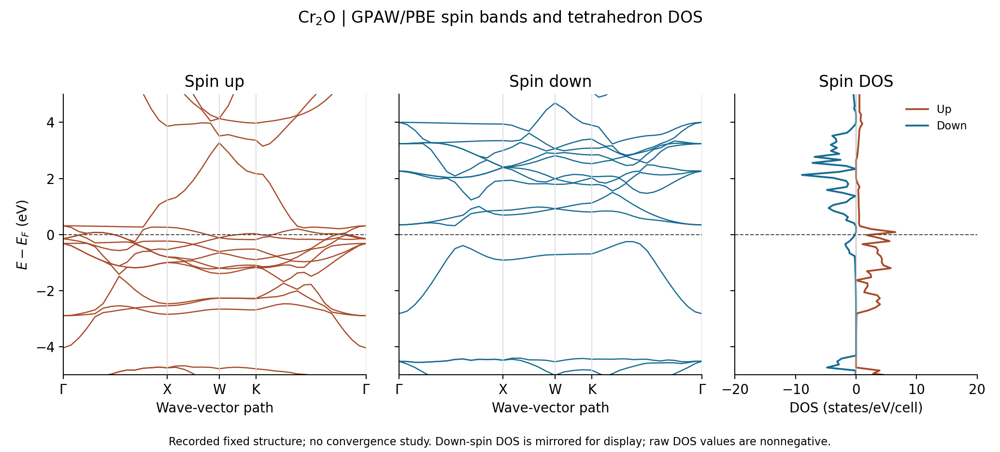
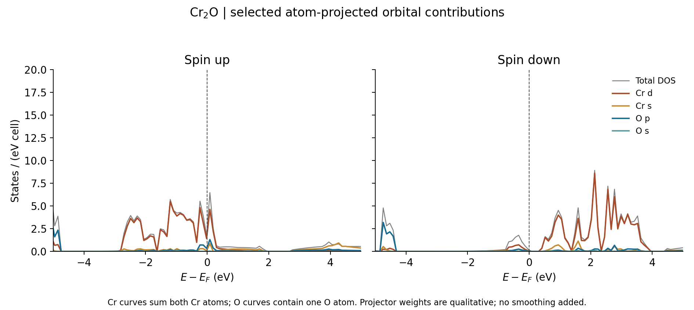

Cr2O: spin bands, tetrahedron DOS and density checks with GPAW
==============================================================

This tutorial follows the completed ``GPAW/cr2o-spin`` case in
``example-runs-Va5NDWGi``. It uses the existing ``Cr2O-spin`` example to
connect spin-resolved bands, atomic orbital projections and real-space spin
densities. It also illustrates two interpretation traps: a gap along a
symmetry path need not be a gap over the Brillouin zone, and a pseudo-density
polarization ratio need not be a physically bounded local polarization.

The recorded calculation completed successfully. Its electronic exports are
internally consistent, but its settings have not been converged. The fixed
geometry and one initial magnetic configuration do not establish the stable
structure or lowest-energy magnetic order of Cr2O.

Prepare and run
---------------

Use Nanoworks with GPAW, its PAW datasets and the plotting dependencies;
see :doc:`../installation`. Copy ``Cr2O.py`` and
``Cr2O_mp-1206821_primitive.cif`` from
``nanoworks/examples/Cr2O-spin`` in your current source checkout into a fresh
working directory. Then run:

.. code-block:: console

   $ dftsolve -E GPAW -p 8 -i Cr2O.py -g Cr2O_mp-1206821_primitive.cif --check
   $ dftsolve -E GPAW -p 8 -i Cr2O.py -g Cr2O_mp-1206821_primitive.cif

The first command checks prerequisites; the second runs ground, DOS, band,
projected-band and density stages. Adapt the process count to your machine.
The output directory is ``Cr2O_mp-1206821_primitive/``.

The source run was performed on 28 October 2026 with Nanoworks 27.2.0rc0,
GPAW 26.7.0, ASE 3.29.0 and eight processes. Its input and starting CIF match
the repository files checked when preparing this tutorial. The run did not
record its exact source commit or PAW package release.

.. list-table:: Recorded settings
   :header-rows: 1
   :widths: 43 57

   * - Setting
     - Value
   * - Geometry
     - Fixed three-atom fcc primitive cell, two Cr and one O
   * - Primitive cell edge and angles
     - 4.04962458 angstrom, 60 degrees
   * - Electronic approximation
     - PBE, plane waves, 340 eV; no Hubbard U, no SOC
   * - Electronic sampling
     - Density 2.5, Gamma-centred; effective 5 x 5 x 5 grid
   * - Ground occupations
     - Fermi–Dirac, width 0.05 eV
   * - Initial moments
     - +1 Bohr magneton on each of the three atoms
   * - DOS integration
     - Tetrahedron, 301 energy samples; no Gaussian broadening
   * - Band path and bands
     - Gamma–X–W–K–Gamma, 40 points, 21 bands per spin
   * - Density output
     - Pseudo grid 18 x 18 x 18; all-electron grid 72 x 72 x 72

``Ground_kpts_density`` takes priority over the separate input values of
``Ground_kpts_x/y/z``. ``Refine_grid = 4`` controls the reconstructed
all-electron density grid; it does not increase the ground-state cutoff or
electronic k-point sampling. The final CIF represents the unchanged structure
with explicit atoms in P1. The original structural analysis identifies Fm-3m.

Inspect the magnetic solution
-----------------------------

The ground calculation converged in 47 SCF iterations. Its total spin moment
is **8.103239 Bohr magnetons per primitive cell**. The printed local moments
are +3.501203 on each Cr and -0.004320 on O. These atom-centred quantities
depend on the partition and need not sum to the cell's total moment; do not
treat them as unique atomic spin populations.

Both Cr sites have the same sign in this solution, following the same-sign
initialization. No competing spin patterns or nonmagnetic energies were
compared. SCF convergence therefore identifies the solution reached from
this input, without determining its energetic ordering against other states.

The PAW setups contain six valence electrons on each Cr and six on O,
giving 18 valence electrons. With the reported moment, the spin populations
are approximately 13.05162 and 4.94838 electrons. Their noninteger values
are compatible with the finite-smearing metallic calculation.

Read both spin channels
-----------------------

   Original numerical band and DOS exports, plotted without added smoothing.
   The dashed horizontal line is Ef. Only the displayed down-spin DOS is
   mirrored; its stored values are nonnegative.

Two up-spin bands (13 and 14 in the one-based DAT numbering) straddle Ef
along this path, supporting a metallic up-spin channel. Down-spin bands do
not cross Ef on the selected path: the highest level below Ef is
-0.250425 eV and the lowest level above Ef is +0.317324 eV, a sampled-path
separation of 0.567749 eV.

.. important::

   Do not identify this as a half-metal from the path alone. The down-spin
   tetrahedron DOS is nonzero near Ef, including 0.207849 states/(eV cell)
   at the actual sample E-Ef=-0.018566 eV. Linear interpolation between the
   two samples surrounding zero gives approximately 0.171884 states/(eV cell)
   at Ef; the corresponding up-spin estimate is 2.584889.

   These are coarse-table estimates, not fresh evaluations exactly at Ef.
   A denser full-zone eigenvalue mesh and finer DOS energy sampling are
   needed to resolve the down-spin behavior. The current data establish
   overall metallic behavior but do not support a verified half-metal claim.

The DOS energy step is approximately 0.107295 eV. The integral of the exported
DOS is 19.83545 states for up spin and 21.40021 for down spin. Each full
21-band spin channel should carry 21 states. The discrepancies show that
integrating this coarse table over its finite energy window is not an accurate
state-count check. Tetrahedron integration avoids an arbitrary Gaussian width,
but it does not remove the need to converge the k-grid and energy grid.

The long and XYYY band exports match exactly, and both agree with the saved
two-spin State record. DOS and PDOS share the same energy axis. Every
electronic table is finite and all stored DOS/projection values are nonnegative.

Connect the bands with orbital projections
------------------------------------------

   Selected projections from the atom-resolved DATs. Cr curves sum both Cr
   atoms; O curves contain one O. The displayed window is -5 to +5 eV.

Cr d weight dominates much of the near-Fermi spectral structure in this
calculation. The O p contribution is visible in the lower part of the displayed
valence window. These are qualitative projector weights, not a complete
decomposition of the total DOS or a direct measurement of charge transfer.

For each spin, the raw table contains 301 samples on each of three atoms.
Summing those atoms reproduces the aggregate PDOS, including the p and d
component sums, to numerical precision. The input's existing projected-band
plots use the same selections (Cr d/s and O p/s). This tutorial redraws
the exported PDOS because it retains the numerical weights needed to reproduce
the figure; the original projected-band PNGs remain in the source run.

Check the real-space density independently
------------------------------------------

The density stage produced all eight expected CUBE files: up, down, total
and ``Zeta``, for both pseudo and reconstructed all-electron density.
The first three contain electrons per bohr cubed, with voxel vectors in bohr.
Integrate using the absolute determinant of the three voxel vectors:

.. math::

   N = \sum_{ijk} n_{ijk}\,|\det(\mathbf{v}_1,\mathbf{v}_2,\mathbf{v}_3)|.

The ``Zeta`` field is dimensionless:

.. math::

   \zeta(\mathbf{r}) = \frac{n_\uparrow(\mathbf{r})-n_\downarrow(\mathbf{r})}
                             {n_\uparrow(\mathbf{r})+n_\downarrow(\mathbf{r})}.

.. list-table:: Checks performed on the archived CUBEs
   :header-rows: 1

   * - Quantity
     - Pseudo, 18 cubed grid
     - All-electron, 72 cubed grid
   * - Integrated total electrons
     - 18.000006
     - 55.999467
   * - Integrated up-minus-down (Bohr magnetons)
     - 8.103252
     - 8.103165
   * - Minimum down density (electrons/bohr cubed)
     - -0.2176782
     - +0.003368425
   * - Maximum absolute Zeta
     - 1.596496
     - 0.6788803

The expected all-electron count is 56, from two Cr nuclei (24 each) and O (8).
The integrated moment agrees with the SCF result within 0.00008 Bohr magnetons;
the all-electron count differs by approximately 0.00053 electrons. These
are checks of the sampled, finite-precision CUBE exports. At their printing
precision, up plus down also reproduces total, and recomputing the ratio
reproduces Zeta in both representations.

The coarse pseudo down-spin field has 136 negative voxels out of 5832.
Exactly those voxels give a ratio above one. The algebra of the exported ratio
is consistent, but those values cannot be interpreted as a physical local
spin polarization. The nonnegative reconstructed all-electron spin densities
have a bounded ratio in this data. No values were clipped or silently
renormalized. The cause and convergence of the coarse pseudo-field undershoot
have not been established by this audit; a successful integral alone does not
validate pointwise density values.

See the GPAW documentation on `all-electron reconstruction
<https://gpaw.readthedocs.io/tutorialsexercises/wavefunctions/all_electron/all_electron_density.html>`_
and `charge analysis and density units
<https://gpaw.readthedocs.io/tutorialsexercises/wavefunctions/charge/charge.html>`_.
Use the reconstructed density for quantitative real-space interpretation and
check its grid convergence before reporting local values.

Download and reproduce the checks
---------------------------------

:download:`Download the input/CIF, electronic tables, pseudo CUBEs and plot script <../_static/examples/cr2o-gpaw-spin-reference.zip>`.
The package preserves the input and numerical source files. It also includes
``density-checks.dat`` and SHA256 hashes for all eight source CUBEs.
The four larger all-electron CUBEs remain in the original run and are not
duplicated in this compact download.

Install ``numpy>=2`` and ``matplotlib`` in an analysis environment, extract
the archive and run:

.. code-block:: console

   $ python plot_cr2o.py

This reproduces both figures, checks the electronic exports and the four
included pseudo CUBEs, and writes ``checks.json``. To repeat the all-electron
integrals and ratio checks as well, point the script to the original directory
containing all eight CUBEs:

.. code-block:: console

   $ python plot_cr2o.py --cube-dir /path/to/Cr2O_mp-1206821_primitive

No DFT calculation runs in either command. Retain the saved GPW if additional
electronic calculations or density-grid studies are planned. Before using the
numbers scientifically, converge the geometry, cutoff, electronic sampling,
smearing and DOS sampling, and compare appropriate magnetic initial states.
