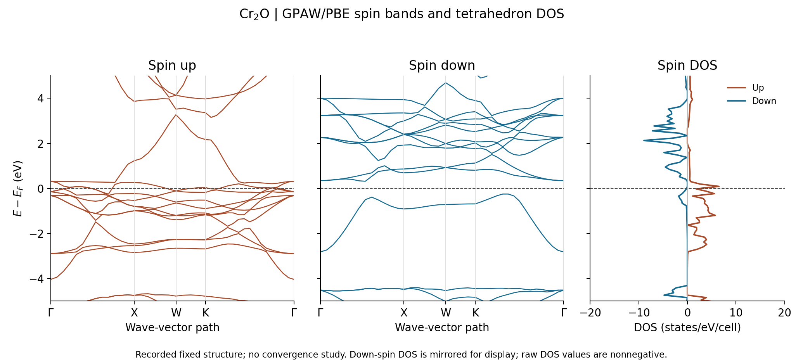

Cr2O: spin-polarized electronic structure (GPAW)
================================================

.. literalinclude:: ../../../nanoworks/examples/Cr2O-spin/Cr2O.py
   :language: python
   :lines: 5-
   :caption: Cr2O.py

:download:`Download Cr2O.py <../../../nanoworks/examples/Cr2O-spin/Cr2O.py>`.

Run
---

Requires GPAW and its PAW datasets.

.. code-block:: bash

   cd ~/.nanoworks/examples/Cr2O-spin
   dftsolve -p 4 -i Cr2O.py -g Cr2O_mp-1206821_primitive.cif

Results
-------

The result directory has the CIF stem ``Cr2O_mp-1206821_primitive``.
Up and Down bands differ because the solution is spin polarized. Compare
Cr-d and O-p projections to identify orbital contributions near Ef.
The recorded DOS remains nonzero near Ef in both channels: these data show
metallic behavior and do not establish a half-metal.

   Recorded example output.

These example settings need convergence tests before quantitative use.

:doc:`Detailed recorded results <../validation/cr2o-gpaw-spin>`.
