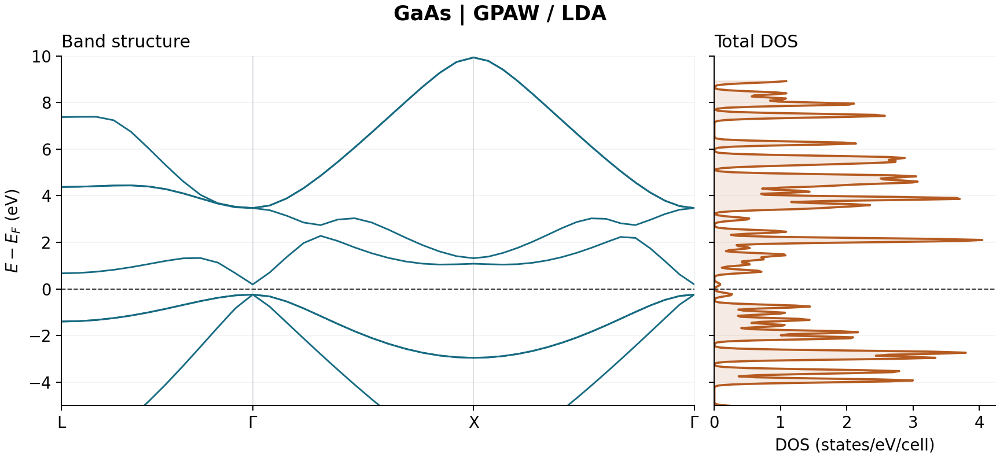
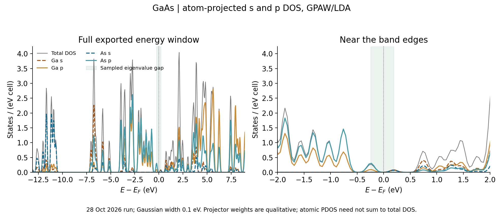

GaAs: geometry, DOS and bands with GPAW
=======================================

.. note::

   These settings are chosen to demonstrate the Nanoworks workflow with a
   short runtime. The numerical results are illustrative; quantitative
   materials predictions require appropriate convergence tests and validation
   of the physical model.

This exercise constructs a two-atom GaAs cell in the input, relaxes it, and
calculates DOS and bands with GPAW. It uses the existing
``Bulk-GaAs-noCIF/bulk_gaas.py`` example. No CIF is needed to start the run.

Prepare and run
---------------

Activate the Nanoworks environment with GPAW and its PAW setups installed.
Open the installed example folder shown below. If needed, install the
examples first with ``nanoworks --install-examples``; see
:ref:`tutorial-examples-setup`.

.. code-block:: bash

   cd ~/.nanoworks/examples/Bulk-GaAs-noCIF
   dftsolve -E GPAW -p 8 -i bulk_gaas.py --check
   dftsolve -E GPAW -p 8 -i bulk_gaas.py

``--check`` checks prerequisites without doing DFT. ``-p 8`` requests eight MPI
processes; adapt this number to the machine. Do not wrap ``dftsolve`` in another
MPI launcher. The output folder is ``bulk-gaas-results/`` beside the input.

Read the input before running
-----------------------------

.. list-table:: Example input settings
   :header-rows: 1
   :widths: 45 55

   * - Setting
     - Value
   * - ``Mode``, ``XC_calc``
     - ``PW``, ``LDA``
   * - ``Wavefunction_cutoff``
     - 300 eV
   * - ``Ground_kpts_density``, ``Gamma``
     - 2.5 points per angstrom, ``True``
   * - ``Geometry_optimizer``, ``Geometry_force_tolerance``
     - ``LBFGS``, 0.05 eV/angstrom
   * - ``Relax_cell``, ``Fix_symmetry``
     - ``[True, True, True, False, False, False]``, ``True``
   * - ``Occupation_scheme``, ``Smearing_width``
     - ``fermi-dirac``, 0.05 eV
   * - ``DOS_integration``, ``DOS_width``, ``DOS_npoints``
     - ``smearing``, 0.1 eV Gaussian width, 501 samples
   * - ``Band_path``, ``Band_npoints``
     - ``LGXG``, 40 total sampled points
   * - Spin and SOC
     - Both disabled

The explicit k-point density takes priority over the input's separate
``Ground_kpts_x/y/z`` values. Gaussian DOS broadening and the ground-state
Fermi-Dirac occupation width are separate settings. This particular input
explicitly chooses a broadened DOS rather than the default tetrahedron method.

Inspect the geometry and electronic results
-------------------------------------------

For GaAs, inspect the valence configurations before interpreting electronic
bands. The example uses ``Ga.LDA`` and ``As.LDA`` PAW datasets with
3 and 5 valence electrons, respectively. In a research calculation, record
the versions of the PAW datasets alongside the input and numerical settings.

The geometry optimizer reached a final maximum generalized force of
0.010252 eV/angstrom, below the requested threshold. The exported primitive
cell has equal edges of 3.9840844 angstrom and angles of 60 degrees, with As at
fractional coordinates (1/4, 1/4, 1/4). Its conventional cubic lattice
parameter is therefore ``sqrt(2)`` times the primitive edge: **5.63435 angstrom**.
The CIF is written with explicit atoms in P1; that file label alone is not a
new symmetry determination.

   Recorded GaAs bands and total DOS, redrawn from the matching DAT tables.
   The dashed line is the Fermi reference. DOS is per two-atom primitive cell.

In the sampled band path, the maximum of occupied band 4 and minimum of band 5
both occur at Gamma. Their separation is **0.43311 eV**. The ground-state log
independently prints a 0.433 eV direct transition at Gamma. The band-edge
energies relative to Ef are approximately -0.24440 and +0.18871 eV: zero need
not lie at the middle of the gap. The first four bands accommodate the eight
valence electrons in this non-spin-polarized calculation.

The finite band separation and low DOS in the same energy region are
consistent with a semiconductor in this setup. A broadened DOS can have tails
inside a band gap; read the gap from eigenvalues rather than from an arbitrary
DOS threshold. This LDA result uses a modest cutoff, one sampling choice and
no SOC. It is not a converged prediction of an experimental gap, nor does a
40-point symmetry path establish extrema everywhere in the Brillouin zone.

Interpret orbital projections
-----------------------------

Projected DOS helps identify the orbital contributions near the band
edges. Compare the projected curves with total DOS on the **same energy
reference**, keeping in mind that atom-centred projectors are not
a complete partition of the electronic states.

   Example atomic projections. The shaded interval marks the band-path
   eigenvalue gap and the dotted line is the Fermi energy. Curves retain
   the input's 0.1 eV Gaussian broadening.

The upper valence region has strong p character on both atoms, with a larger
As p contribution in the plotted -2 to 0 eV window. The conduction region
contains both Ga and As s/p projections. These curves describe qualitative
orbital weights; they are not atom-resolved electron populations or evidence
of a pure atomic orbital at a particular band edge. Gaussian tails also
extend into the shaded eigenvalue gap.

The atom-resolved export contains 501 rows for Ga and 501 for As. Summing
the two atoms reproduces every aggregate-PDOS column exactly; p-component
sums agree to better than 1e-14 states/eV. Atomic projectors do not constitute
a complete orthonormal basis, so their sum need not reproduce the total DOS;
see the `GPAW DOS tutorial
<https://gpaw.readthedocs.io/tutorialsexercises/electronic/dos/dos.html>`_.
In particular, this calculation treats Ga with three valence electrons and
28 frozen-core electrons; its valence DOS is not a spectrum of Ga 3d
semicore states.

The total DOS integrates to 15.8960 states per primitive cell over the
exported energy window. Eight non-spin-polarized bands have a full spectral
weight of 16 states, and the exported limits truncate Gaussian tails.
This unweighted DOS integral is not the number of occupied valence electrons;
occupation-weighted integration would be required for that comparison.

Use, verify and retain the outputs
----------------------------------

Filenames below have the prefix ``bulk-gaas-results`` inside the output folder:

* ``-GROUND-GPAW-Log-SCF.txt`` records the SCF and geometry calculation.
* ``-GROUND-GPAW-Result-Final.cif`` contains the final geometry.
* ``-DOS-GPAW-Result-DOS.dat`` and ``-Result-PDOS.dat`` contain total DOS and
  atom-centred orbital projections; the PDOS sum need not equal total DOS.
* ``-BAND-GPAW-Result-Band-XYYY.dat`` has one column per band;
  ``-Result-KPath.dat`` supplies its matching distances and special labels.

Download the :download:`ground-state and electronic reference data
<../_static/examples/gaas-gpaw-reference.zip>` or the
:download:`extended orbital-projection tables and plotting example
<../_static/examples/gaas-gpaw-repeat-reference.zip>`.
The packages contain inputs, final structures, exported tables and file
checksums. With NumPy and Matplotlib installed, ``python plot_gaas.py``
recreates the plots from the extended package without rerunning GPAW.
The script also supports ``--previous /path/to/gaas-gpaw-reference.zip``
to examine repeatability at fixed inputs.

Repeated calculations with unchanged settings should reproduce compatible
geometries and spectra. This verifies **repeatability**, not cutoff, k-point
or structural convergence. Validate each independently before using
the derived band gaps as material predictions.

The saved ``-GROUND-GPAW-Result-State.gpw`` is required to rerun electronic
stages with ``Ground_calc=False``. Retain it until those calculations are
finished. Once a run is closed, the input, logs, final geometry, DATs and figures
can be archived without the GPW; subsequent DFT postprocessing then requires
regenerating the ground state. Replotting the DAT tables does not require GPW:

.. code-block:: bash

   dftsolve --plot bulk-gaas-results/bulk-gaas-results-BAND-GPAW-Result-Band-XYYY.dat

Keep KPath beside the band table. See :doc:`../result_tables` for saved-table
plotting and :doc:`../dftconverge` for cutoff and k-point studies.
