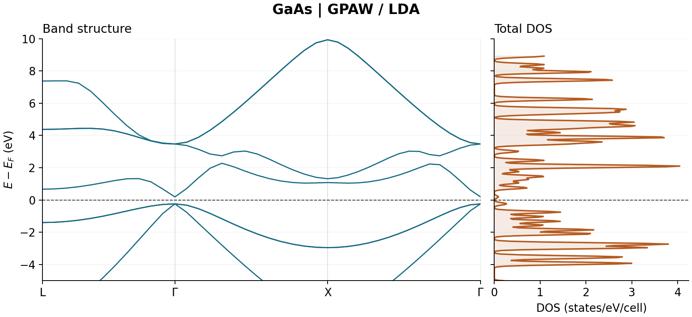

GaAs: structure relaxation, bands and DOS (GPAW)
================================================

.. literalinclude:: ../../../nanoworks/examples/Bulk-GaAs-noCIF/bulk_gaas.py
   :language: python
   :lines: 5-
   :caption: bulk_gaas.py

:download:`Download bulk_gaas.py <../../../nanoworks/examples/Bulk-GaAs-noCIF/bulk_gaas.py>`.

Run
---

Requires GPAW and its PAW datasets.

.. code-block:: bash

   cd ~/.nanoworks/examples/Bulk-GaAs-noCIF
   dftsolve -p 4 -i bulk_gaas.py

Results
-------

Results are in ``bulk-gaas-results/``. The recorded relaxed conventional
lattice parameter is 5.63435 angstrom. The sampled bands have a direct
Gamma-point gap of 0.43311 eV in this LDA calculation. The small DOS around
the gap is consistent with semiconductor behavior; broadening produces tails.
These values illustrate the calculation and are not a converged experimental comparison.

   Recorded example output.

These example settings need convergence tests before quantitative use.

:doc:`Detailed recorded results <../validation/gaas-gpaw>`.
