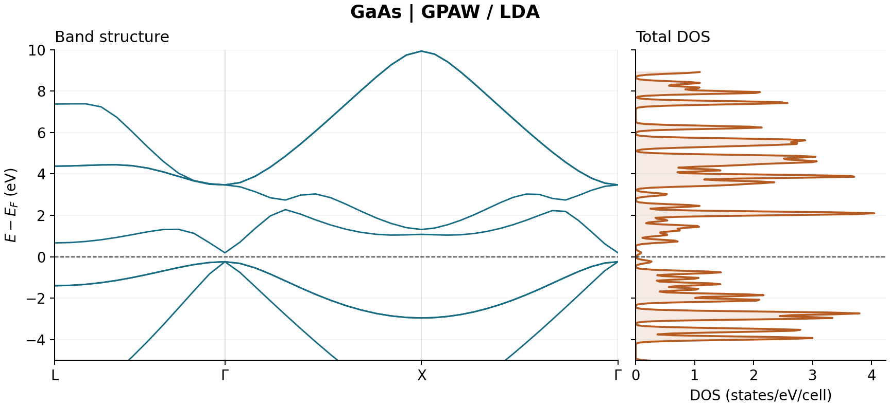
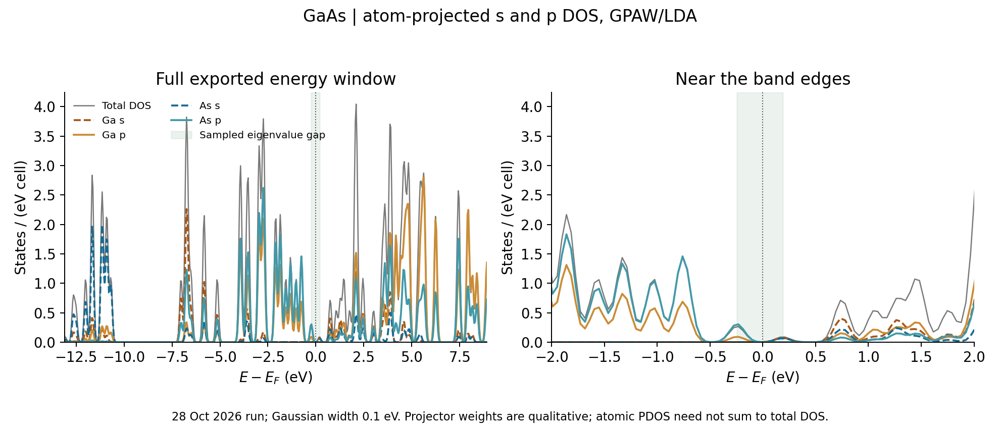

GaAs: geometry, DOS and bands with GPAW
=======================================

.. note::

   These settings are chosen to demonstrate the Nanoworks workflow with a
   short runtime. The numerical results are illustrative; quantitative
   materials predictions require appropriate convergence tests and validation
   of the physical model.

This exercise constructs a two-atom GaAs cell in the input, relaxes it, and
calculates DOS and bands with GPAW. It uses the existing
``Bulk-GaAs-noCIF/bulk_gaas.py`` example. No CIF is needed to start the run.

Prepare and run
---------------

Activate the Nanoworks environment with GPAW and its PAW setups installed.
Open the installed example folder shown below. If needed, install the
examples first with ``nanoworks --install-examples``; see
:ref:`tutorial-examples-setup`.

.. code-block:: bash

   cd ~/.nanoworks/examples/Bulk-GaAs-noCIF
   dftsolve -E GPAW -p 8 -i bulk_gaas.py --check
   dftsolve -E GPAW -p 8 -i bulk_gaas.py

``--check`` checks prerequisites without doing DFT. ``-p 8`` requests eight MPI
processes; adapt this number to the machine. Do not wrap ``dftsolve`` in another
MPI launcher. The output folder is ``bulk-gaas-results/`` beside the input.

Read the input before running
-----------------------------

.. list-table:: Settings used in the recorded run
   :header-rows: 1
   :widths: 45 55

   * - Setting
     - Value
   * - ``Mode``, ``XC_calc``
     - ``PW``, ``LDA``
   * - ``Wavefunction_cutoff``
     - 300 eV
   * - ``Ground_kpts_density``, ``Gamma``
     - 2.5 points per angstrom, ``True``
   * - ``Geometry_optimizer``, ``Geometry_force_tolerance``
     - ``LBFGS``, 0.05 eV/angstrom
   * - ``Relax_cell``, ``Fix_symmetry``
     - ``[True, True, True, False, False, False]``, ``True``
   * - ``Occupation_scheme``, ``Smearing_width``
     - ``fermi-dirac``, 0.05 eV
   * - ``DOS_integration``, ``DOS_width``, ``DOS_npoints``
     - ``smearing``, 0.1 eV Gaussian width, 501 samples
   * - ``Band_path``, ``Band_npoints``
     - ``LGXG``, 40 total sampled points
   * - Spin and SOC
     - Both disabled

The explicit k-point density takes priority over the input's separate
``Ground_kpts_x/y/z`` values. Gaussian DOS broadening and the ground-state
Fermi-Dirac occupation width are separate settings. This particular input
explicitly chooses a broadened DOS rather than the default tetrahedron method.

Inspect the geometry and electronic results
-------------------------------------------

The reference calculation was completed on 19 October 2026 with Nanoworks
27.2.0rc0, ASE 3.29.0, GPAW 26.7.0 and eight MPI processes. The log records
``Ga.LDA`` and ``As.LDA`` PAW setups with 3 and 5 valence electrons respectively.
The run did not record a source commit or PAW data package version, so these
values describe this run rather than an exact cross-version benchmark.

The geometry optimizer reached a final maximum generalized force of
0.010252 eV/angstrom, below the requested threshold. The exported primitive
cell has equal edges of 3.9840844 angstrom and angles of 60 degrees, with As at
fractional coordinates (1/4, 1/4, 1/4). Its conventional cubic lattice
parameter is therefore ``sqrt(2)`` times the primitive edge: **5.63435 angstrom**.
The CIF is written with explicit atoms in P1; that file label alone is not a
new symmetry determination.

   Recorded GaAs bands and total DOS, redrawn from the matching DAT tables.
   The dashed line is the Fermi reference. DOS is per two-atom primitive cell.

In the sampled band path, the maximum of occupied band 4 and minimum of band 5
both occur at Gamma. Their separation is **0.43311 eV**. The ground-state log
independently prints a 0.433 eV direct transition at Gamma. The band-edge
energies relative to Ef are approximately -0.24440 and +0.18871 eV: zero need
not lie at the middle of the gap. The first four bands accommodate the eight
valence electrons in this non-spin-polarized calculation.

The finite band separation and low DOS in the same energy region are
consistent with a semiconductor in this setup. A broadened DOS can have tails
inside a band gap; read the gap from eigenvalues rather than from an arbitrary
DOS threshold. This LDA result uses a modest cutoff, one sampling choice and
no SOC. It is not a converged prediction of an experimental gap, nor does a
40-point symmetry path establish extrema everywhere in the Brillouin zone.

Check the repeated run and atomic projections
---------------------------------------------

The same example was completed again on 28 October 2026 in
``example-runs-Va5NDWGi/GPAW/bulk-gaas``, with Nanoworks 27.2.0rc0,
ASE 3.29.0, GPAW 26.7.0 and eight processes. Its input is byte-for-byte
identical to the earlier reference input. The density setting produces a
Gamma-centred 5 x 5 x 5 electronic grid in the recorded ground-state log.
The new run reports successful ground, DOS and band stages; its final
maximum generalized force is again 0.010252 eV/angstrom.

.. list-table:: Agreement with the 19 October reference
   :header-rows: 1
   :widths: 55 45

   * - Quantity
     - 28 October result / maximum difference
   * - Direct gap at Gamma on the sampled path
     - 0.4331102951 eV
   * - Conventional cubic lattice parameter
     - 5.6343461872 angstrom
   * - Largest absolute change in exported band energies
     - 8.2e-13 eV
   * - Largest absolute change in total-DOS values
     - 7.1e-12 states/eV
   * - Largest absolute change in aggregate-PDOS values
     - 1.5e-11 states/eV

The new final lattice, energies and broadened spectra reproduce the earlier
example to numerical precision. This is a repeatability check at the same
settings, not a cutoff or k-point convergence test. Neither run records an
exact Nanoworks source commit or PAW package release. The new log does retain
the PAW setup identifiers: ``e1f5b04e536df2d35180d97a9e5d9aca`` for Ga and
``354e1067b5e66bdeaed68c554076e911`` for As.

   Atomic projections from the 28 October run. The shaded interval marks the
   eigenvalue gap obtained from the symmetry path, while the vertical dotted
   line is Ef. Curves retain the original 0.1 eV Gaussian broadening.

The upper valence region has strong p character on both atoms, with a larger
As p contribution in the plotted -2 to 0 eV window. The conduction region
contains both Ga and As s/p projections. These curves describe qualitative
orbital weights; they are not atom-resolved electron populations or evidence
of a pure atomic orbital at a particular band edge. Gaussian tails also
extend into the shaded eigenvalue gap.

The atom-resolved export contains 501 rows for Ga and 501 for As. Summing
the two atoms reproduces every aggregate-PDOS column exactly; p-component
sums agree to better than 1e-14 states/eV. Atomic projectors do not constitute
a complete orthonormal basis, so their sum need not reproduce the total DOS;
see the `GPAW DOS tutorial
<https://gpaw.readthedocs.io/tutorialsexercises/electronic/dos/dos.html>`_.
In particular, this calculation treats Ga with three valence electrons and
28 frozen-core electrons; its valence DOS is not a spectrum of Ga 3d
semicore states.

The total DOS integrates to 15.8960 states per primitive cell over the
exported energy window. Eight non-spin-polarized bands have a full spectral
weight of 16 states, and the exported limits truncate Gaussian tails.
This unweighted DOS integral is not the number of occupied valence electrons;
occupation-weighted integration would be required for that comparison.

Download the :download:`28 October input, raw atomic PDOS, band/DOS tables and plotting script
<../_static/examples/gaas-gpaw-repeat-reference.zip>` for this additional
check. The earlier reference archive below remains available separately.
Extract the new archive and install ``numpy>=2`` and ``matplotlib`` in an
analysis environment, then run:

.. code-block:: console

   $ python plot_gaas.py

This regenerates the atomic-PDOS figure and a matching band/DOS figure, and
writes the numerical checks to ``checks.json`` without running DFT. If you
also download the older archive, compare the four paired electronic tables
and verify the identical input with:

.. code-block:: console

   $ python plot_gaas.py --previous /path/to/gaas-gpaw-reference.zip

The band State JSON and the long/XYYY tables agree exactly in the new run.
All distributed source files have hashes in ``SHA256SUMS``. The raw atomic
and aggregate PDOS, band-state record and final CIF are retained with the
new data, so the extra figure can be reproduced without a GPW file.

Use and retain the outputs
--------------------------

Filenames below have the prefix ``bulk-gaas-results`` inside the output folder:

* ``-GROUND-GPAW-Log-SCF.txt`` records the SCF and geometry calculation.
* ``-GROUND-GPAW-Result-Final.cif`` contains the final geometry.
* ``-DOS-GPAW-Result-DOS.dat`` and ``-Result-PDOS.dat`` contain total DOS and
  atom-centred orbital projections; the PDOS sum need not equal total DOS.
* ``-BAND-GPAW-Result-Band-XYYY.dat`` has one column per band;
  ``-Result-KPath.dat`` supplies its matching distances and special labels.

Download the :download:`reference input, final CIF and DAT tables
<../_static/examples/gaas-gpaw-reference.zip>` used for this page. The archive
also includes a provenance record and file hashes. Its input matches the
repository example at the time this tutorial was prepared. The long and XYYY
band exports agree, and the DOS/PDOS tables passed finite-value and orbital-sum
checks. These checks establish export consistency, not parameter convergence.

The saved ``-GROUND-GPAW-Result-State.gpw`` is required to rerun electronic
stages with ``Ground_calc=False``. Retain it until those calculations are
finished. Once a run is closed, the input, logs, final geometry, DATs and figures
can be archived without the GPW; subsequent DFT postprocessing then requires
regenerating the ground state. Replotting the DAT tables does not require GPW:

.. code-block:: bash

   dftsolve --plot bulk-gaas-results/bulk-gaas-results-BAND-GPAW-Result-Band-XYYY.dat

Keep KPath beside the band table. See :doc:`../result_tables` for saved-table
plotting and :doc:`../dftconverge` for cutoff and k-point studies.
