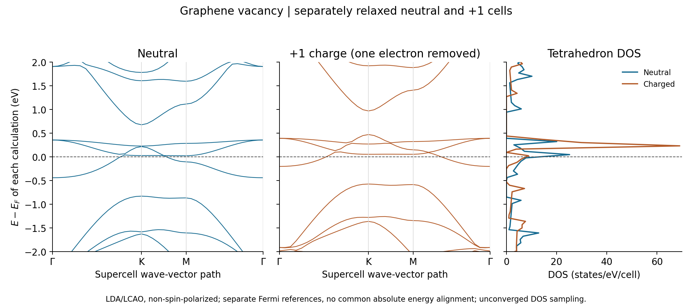
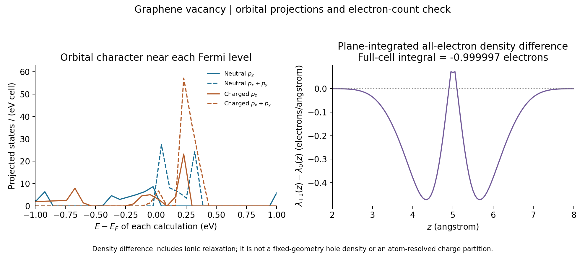

Graphene vacancy: neutral and charged cells with GPAW
=====================================================

This exercise follows the completed ``GPAW/graphene-neutral`` and
``GPAW/graphene-charged`` cases in ``example-runs-Va5NDWGi``. It demonstrates
how to check the sign of an imposed charge, compare electronic spectra with
separate Fermi references, and verify the electron-count difference directly
from density exports.

Both calculations completed. They use a **31-carbon vacancy structure**, made
by removing one atom from a 32-atom 4 x 4 graphene supercell. The neutral case
is therefore a neutral vacancy reference. The recorded settings illustrate
the workflow; they are not converged predictions of vacancy magnetism,
charge-transition levels or experimental doping effects.

Prepare and run
---------------

Use an environment with Nanoworks, GPAW and its PAW/basis datasets installed;
see :doc:`../installation`. Copy ``graphene-neutral.py``,
``graphene-charged.py`` and ``graphene4x4withdefect.cif`` from
``nanoworks/examples/Graphene-charged`` in your source checkout into a fresh
working directory. Run the two cases separately:

.. code-block:: console

   $ dftsolve -E GPAW -p 8 -i graphene-neutral.py -g graphene4x4withdefect.cif --check
   $ dftsolve -E GPAW -p 8 -i graphene-neutral.py -g graphene4x4withdefect.cif
   $ dftsolve -E GPAW -p 8 -i graphene-charged.py -g graphene4x4withdefect.cif --check
   $ dftsolve -E GPAW -p 8 -i graphene-charged.py -g graphene4x4withdefect.cif

The input names the output directories ``Neutral/`` and ``Charged/``.
Both use the filename prefix ``graphene4x4withdefect`` within their respective
directories. Keep the results separate when copying or plotting tables.
Adapt the MPI process count to your machine.

The two recorded runs were performed on 28 October 2026 with Nanoworks
27.2.0rc0, GPAW 26.7.0, ASE 3.29.0 and eight processes. Their active inputs
and starting CIF match the repository files inspected for this tutorial.
An exact run source commit and PAW/basis package release were not recorded.

Read the two inputs together
----------------------------

The only literal setting differences are ``Outdirname`` and ``Total_charge``:
the latter is 0.0 for neutral and +1.0 for charged. The remaining settings
are shared.

.. list-table:: Recorded settings
   :header-rows: 1
   :widths: 43 57

   * - Setting
     - Value
   * - Electronic representation
     - LCAO with a dzp basis, LDA; no spin polarization or SOC
   * - Real-space grid setting
     - ``Ground_gpts_density = 0.2`` angstrom; actual grid 44 x 44 x 100
   * - Electronic k-point grid
     - Gamma-centred 4 x 4 x 1
   * - Ground occupations
     - Fermi–Dirac, width 0.05 eV
   * - Geometry
     - Independent LBFGS relaxation for each charge; fixed cell, symmetry preserved
   * - Geometry tolerance
     - 0.05 eV/angstrom
   * - Cell
     - a=b=9.84 angstrom, c=20 angstrom, gamma=120 degrees; periodic in all directions
   * - DOS
     - Tetrahedron integration, 501 energy samples
   * - Bands
     - Supercell Gamma–K–M–Gamma path, 40 points
   * - All-electron density refinement
     - ``Refine_grid = 4``; exported grid 176 x 176 x 400

In LCAO mode the basis and real-space grid control the representation.
The input's ``Wavefunction_cutoff = 340`` is not a plane-wave basis cutoff
for these LCAO runs. The explicit spacing also takes priority over the
input's separate ``Ground_gpts_x/y/z`` values.

The neutral optimization ends at a maximum force of 0.043988 eV/angstrom;
the charged optimization ends at 0.033003 eV/angstrom. Both meet the requested
tolerance. Their final cells are identical, but atomic positions differ by up
to approximately 0.01992 angstrom with periodic wrapping taken into account.
Both remain planar and retain the reported P-6m2 structural symmetry.

``Spin_calc=False`` constrains the electronic solution. Preserving the initial
symmetry can also restrict structural relaxation. No alternative spin states,
lower-symmetry vacancy reconstructions or larger supercells were compared;
these outputs do not determine the physical magnetic or structural ground
state of an isolated graphene vacancy.

Check what +1 charge means
--------------------------

Positive ``Total_charge`` removes electrons. Each carbon contributes four
valence electrons: 31 atoms give 124 in the neutral cell, so the +1 input
targets **123 valence electrons**. The log's line describing 124 valence
electrons identifies the neutral setup electron count; its separate charge
line and the density integral establish the charged electron count.

.. list-table:: Integrals of the original density CUBEs
   :header-rows: 1

   * - Quantity
     - Neutral
     - +1 charged
   * - Pseudo electron integral
     - 123.999692
     - 122.999694
   * - All-electron integral
     - 185.999486
     - 184.999489
   * - Expected all-electron count
     - 186
     - 185

The all-electron count includes the 62 frozen-core electrons of the 31 carbon
atoms. Subtracting the two integrals gives **-0.9999974 electrons**. This
independently verifies that the imposed +1 charge removes one electron.
The tabulated CUBE values are in electrons per bohr cubed; integration uses
the absolute determinant of the voxel vectors in bohr.

The in-plane area is 83.85343 square angstrom. One removed electron per
periodically repeated cell corresponds nominally to 1.19256e14 holes per
square centimetre. This is a cell-count conversion, not a measurement of a
localized vacancy charge or a simulation of a specific gate geometry.

Compare spectra with the correct energy reference
-------------------------------------------------

   Tables plotted without added smoothing. Each calculation uses its own Ef
   as zero. These are folded supercell bands, not unfolded primitive graphene
   bands. Only the -2 to +2 eV window is shown.

Band 62 in the one-based DAT numbering straddles Ef in both calculations.
Its sampled range is -0.443053 to +0.038746 eV for neutral and
-0.204376 to +0.102557 eV for charged. Both constrained solutions therefore
show metallic behavior on the sampled path. A pristine-graphene Dirac-point
interpretation should not be imposed on this vacancy supercell spectrum.

.. important::

   These spectra are not aligned to a common absolute energy reference.
   The ground logs print Ef values near -3.004 eV and -5.858 eV in their
   respective potential conventions. Subtracting them does not establish
   a work-function change or a physical doping shift.

   Both structures were relaxed independently, and the potential changes
   with charge. This comparison is not a fixed-geometry rigid-band test.

The CUBE and SCF records show full three-dimensional periodic boundary
conditions, including the 20 angstrom cell direction normal to the sheet.
A charged periodic calculation requires a compensating electrostatic
background. Its energies and potential references need finite-size and vacuum
analysis before a quantitative isolated-slab interpretation. The example
does not specify a physical gate or an isolated charged-sheet boundary
condition. See the GPAW discussion of `charged periodic defects
<https://gpaw.readthedocs.io/tutorialsexercises/energetics/defects/defects.html>`_.

In particular, the difference of the two raw total energies alone is not a
defect formation energy, ionization energy or charge-transition level;
the relevant reservoirs, reference alignment and electrostatic treatment
would have to be defined.

Inspect orbital character and density differences
-------------------------------------------------

   Left: summed carbon projections on each calculation's energy axis.
   Right: the original all-electron density integrated over each xy plane,
   followed by charged-minus-neutral subtraction at the matching z grid.
   The full-cell integral is approximately -1 electron.

The pz and in-plane p contributions distinguish out-of-plane and in-plane
orbital weight in this planar structure. Atomic projectors are qualitative
weights, not a complete partition of total DOS or unique atomic charges.
For both cases, summing the 31 atom-resolved PDOS tables reproduces the
aggregate table; orbital component sums agree to numerical precision.

The density difference includes charge response **and ionic relaxation**.
It has both positive and negative regions even though its cell integral is
negative. It is not a fixed-geometry hole-density map or evidence that a
whole electron is localized on one atom.

The reconstructed all-electron CUBEs also contain small negative samples:
their minima are approximately -8.18e-5 and -8.13e-5 electrons/bohr cubed,
and the negative contributions integrate to about -0.01289 and -0.01282
electrons respectively. Such pointwise values cannot represent a physical
negative electron density. They require a reconstruction/grid convergence
check before local interpretation. Their precise cause was not established
by this audit. The pseudo densities are nonnegative in these exports.
No values were clipped, so the displayed profile and quoted electron counts
retain the original data.

Treat the DOS as an unconverged table
-------------------------------------

The DOS energy spacing is approximately 0.069 eV. Integrating the full
exported tables gives 226.94 states for neutral and 275.46 for charged.
Their computed non-spin-polarized band counts are 124 and 123, with expected
full spectral weights of 248 and 246 states. These discrepancies are too large
for quantitative state counting from the saved DOS samples. In particular,
the charged integral exceeds its full band weight, so finite-window truncation
alone cannot explain it. Narrow tetrahedron features and the energy/k-grid
sampling must be resolved before reporting DOS amplitudes quantitatively.

Linear interpolation of these coarse tables at Ef gives approximately 13.69
and 7.91 states/(eV cell). They describe this saved sampling only; their
difference is not a converged prediction of a DOS change. No Gaussian
broadening was applied, but tetrahedron integration still needs convergence
checks. The number of computed empty bands also changes between these inputs;
the two tables do not describe identical full spectral windows.

The long, XYYY and State band records agree exactly in each case, the KPath
metadata match, and all electronic tables are finite and nonnegative in their
DOS/projection columns. Those export checks and the electron-count difference
pass; they do not remove the physical limitations above.

Download and redraw
-------------------

:download:`Download both input/result sets and the plotting script <../_static/examples/graphene-gpaw-charge-reference.zip>`.
The package preserves the active inputs, shared starting CIF, final CIFs,
band/DOS/PDOS/atom-resolved tables and State records. It includes the derived
``planar-density.dat`` and ``density-checks.dat``, plus source hashes for the
four original density CUBEs. The large CUBEs remain in the original run and
are not duplicated in this plotting archive.

Install ``numpy>=2`` and ``matplotlib`` in an analysis environment, extract
the archive and run:

.. code-block:: console

   $ python plot_graphene.py

This redraws both figures and writes ``checks.dat`` without running GPAW.
It verifies the electronic export relationships and the integral of the
included plane-integrated profile. Recreating that profile from scratch
requires the original CUBEs. The second included script verifies their source
hashes and regenerates the density profile and extended checks:

.. code-block:: console

   $ python extract_density.py /path/to/Neutral /path/to/Charged

Its separately named ``*-regenerated.dat`` outputs leave the bundled tables
intact. ``SHA256SUMS`` records the distributed file hashes. No electronic GPW
file is needed for these analyses.
