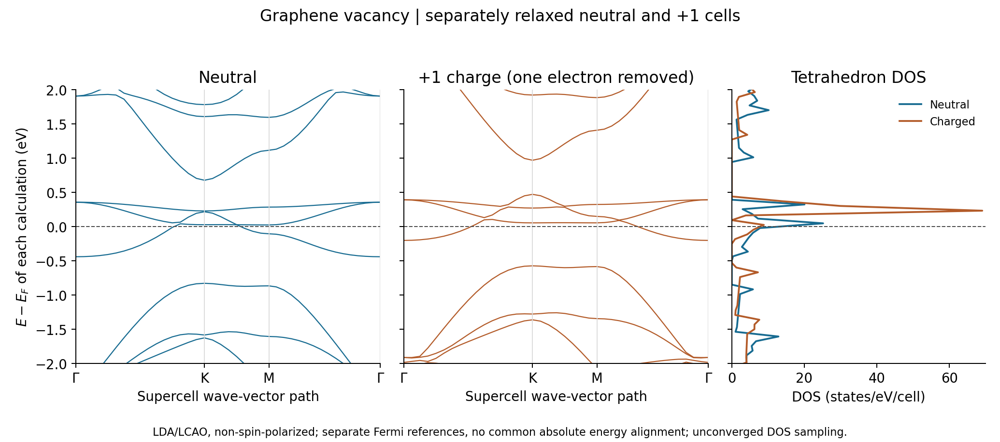

Graphene: charging a vacancy (GPAW)
===================================

.. literalinclude:: ../../../nanoworks/examples/Graphene-charged/graphene-charged.py
   :language: python
   :lines: 5-
   :caption: graphene-charged.py

:download:`Download graphene-charged.py <../../../nanoworks/examples/Graphene-charged/graphene-charged.py>`.

**Companion input: graphene-neutral.py**

.. literalinclude:: ../../../nanoworks/examples/Graphene-charged/graphene-neutral.py
   :language: python
   :lines: 5-
   :caption: graphene-neutral.py

:download:`Download graphene-neutral.py <../../../nanoworks/examples/Graphene-charged/graphene-neutral.py>`.

Run
---

Requires GPAW and its PAW datasets.

.. code-block:: bash

   cd ~/.nanoworks/examples/Graphene-charged
   dftsolve -p 4 -i graphene-neutral.py -g graphene4x4withdefect.cif
   dftsolve -p 4 -i graphene-charged.py -g graphene4x4withdefect.cif

Results
-------

.. note::

   This example is a qualitative demonstration. For reliable quantitative
   results, optimize the structure where appropriate and converge the
   numerical settings.

Compare the neutral and charged result directories specified by the inputs.
``Total_charge=1`` removes one electron. The near-Fermi bands and DOS change
with charge and relaxation. Each plot uses its own Ef as zero, so the
horizontal shift between curves is not an absolute work-function change.
A quantitative charged-sheet study also needs electrostatic size and vacuum convergence.

   Recorded example output.

:doc:`Detailed recorded results <../validation/graphene-gpaw-charge>`.
