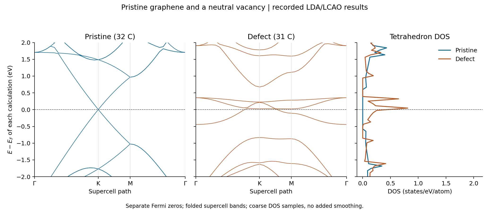

Graphene: a vacancy with LCAO (GPAW)
====================================

.. literalinclude:: ../../../nanoworks/examples/Graphene-LCAO/graphene.py
   :language: python
   :lines: 5-
   :caption: graphene.py

:download:`Download graphene.py <../../../nanoworks/examples/Graphene-LCAO/graphene.py>`.

Run
---

Requires GPAW and its PAW datasets.

.. code-block:: bash

   cd ~/.nanoworks/examples/Graphene-LCAO
   dftsolve -p 4 -i graphene.py -g graphene4x4.cif
   dftsolve -p 4 -i graphene.py -g graphene4x4withdefect.cif

Results
-------

.. note::

   This example is a qualitative demonstration. For reliable quantitative
   results, optimize the structure where appropriate and converge the
   numerical settings.

The two CIF stems give separate result directories. Compare the pristine
and vacancy bands and DOS near Ef. The vacancy changes the near-Fermi states.
These are folded supercell bands. The apparent 1.239 eV gap printed on the
pristine coarse SCF mesh is not a graphene band gap: that mesh misses K.
The sampled path reaches K and shows nearly touching bands.

   Recorded example output.

:doc:`Detailed recorded results <../validation/graphene-gpaw-vacancy>`.
