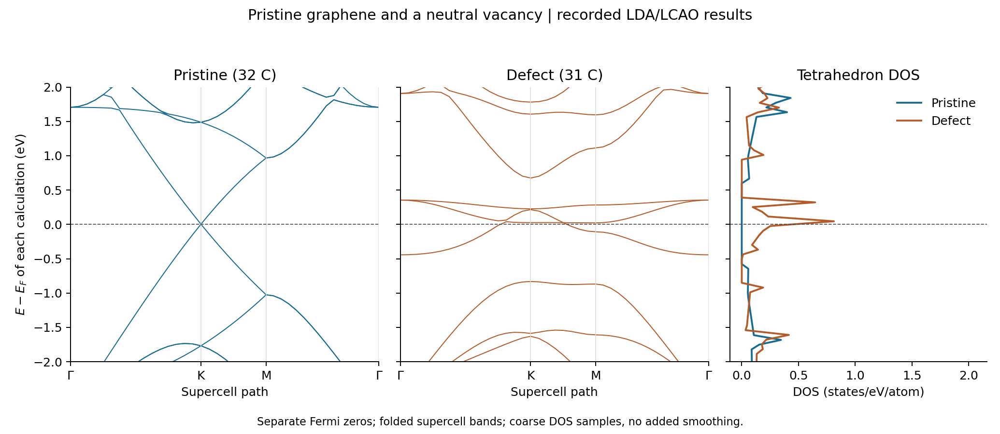
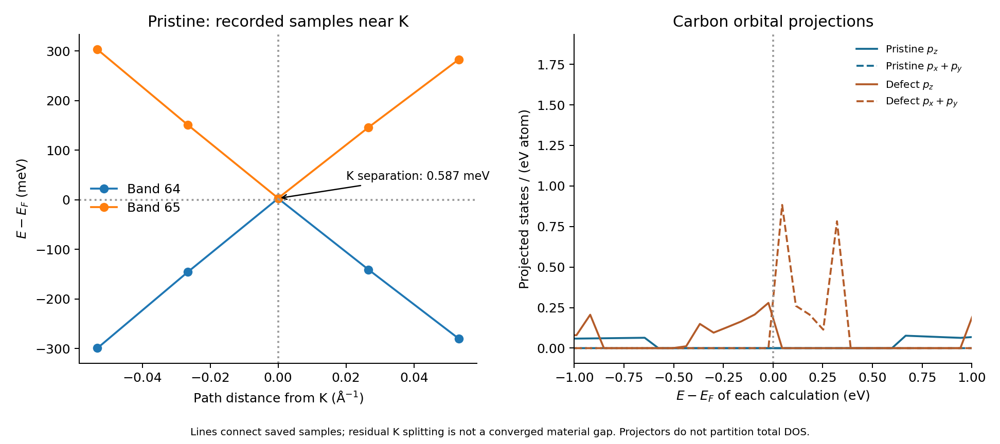

Graphene with and without a vacancy: sampling matters
=====================================================

This tutorial compares the completed ``GPAW/graphene-pristine`` and
``GPAW/graphene-defect`` runs in ``example-runs-Va5NDWGi``. Both use the same
Nanoworks input with different CIFs: 32 carbon atoms for pristine graphene,
31 for a neutral vacancy in the same 4 x 4 cell. It demonstrates how to read
folded supercell bands, compare DOS per atom, and distinguish a coarse-grid
gap report from a band path that actually samples K.

These are teaching calculations. They do not establish a converged graphene
gap, isolated-vacancy ground state or defect formation energy. No new DFT
calculation was run for this review.

Prepare the two structures
--------------------------

Install Nanoworks, GPAW and its PAW/basis datasets following
:doc:`../installation`. Copy ``graphene.py``, ``graphene4x4.cif`` and
``graphene4x4withdefect.cif`` from ``nanoworks/examples/Graphene-LCAO``
into a fresh working directory. Use the same Python input for each CIF:

.. code-block:: console

   $ dftsolve -E GPAW -p 8 -i graphene.py -g graphene4x4.cif --check
   $ dftsolve -E GPAW -p 8 -i graphene.py -g graphene4x4.cif
   $ dftsolve -E GPAW -p 8 -i graphene.py -g graphene4x4withdefect.cif --check
   $ dftsolve -E GPAW -p 8 -i graphene.py -g graphene4x4withdefect.cif

Adapt the process count to your computer. The structures produce separate
``graphene4x4/`` and ``graphene4x4withdefect/`` output directories and
corresponding filename prefixes.

Both recorded inputs and starting CIFs match the inspected repository files
byte for byte. The runs used Nanoworks 27.2.0rc0, GPAW 26.7.0 and ASE 3.29.0
on 28 October 2026, with eight processes. The exact calculation source commit
and dataset package release were not recorded.

Read the shared settings
------------------------

.. list-table:: Recorded calculation settings
   :header-rows: 1
   :widths: 40 60

   * - Quantity
     - Value
   * - Representation
     - LCAO, dzp basis; LDA; no spin polarization or SOC
   * - Cell
     - a=b=9.84 angstrom, c=20 angstrom, gamma=120 degrees
   * - Real-space grid
     - ``Ground_gpts_density=0.2`` angstrom; actual 44 x 44 x 100
   * - Electronic grid
     - Gamma-centred 4 x 4 x 1
   * - Ground occupations
     - Fermi–Dirac, width 0.05 eV
   * - Relaxation
     - LBFGS; fixed cell; ``Fix_symmetry=True``; tolerance 0.05 eV/angstrom
   * - Charge
     - ``Total_charge=0.0`` for both structures
   * - DOS
     - Tetrahedron integration, 501 energy samples
   * - Band path
     - Supercell Gamma–K–M–Gamma, 40 total points

In LCAO mode, the explicit grid spacing and basis control the representation;
``Wavefunction_cutoff=340`` is not a plane-wave basis cutoff for these runs.
The path has 40 points in total, rather than 40 per segment. Inspect the
``Result-KPath.dat`` file for its actual indices and distances.

Both calculation exit codes are zero and the ground SCF records converge.
The optimizer reports maximum forces of 0.000000 and 0.043988 eV/angstrom
for pristine and vacancy respectively, within the requested tolerance.
These are optimizer forces with the symmetry constraint applied; individual
raw force vectors in the SCF log need not have the same maximum norm.
The reported final structural symmetries are P6/mmm and P-6m2 respectively.
Both final structures remain planar. A P1 label in the exported CIF is a
serialization choice and does not establish loss of structural symmetry.

Preserving symmetry and disabling spin constrain the vacancy relaxation.
No alternative magnetic states or lower-symmetry reconstructions were tested.

Compare the spectra
-------------------

   Each spectrum uses its own Fermi energy as zero. DOS is divided by 32 or
   31 carbon atoms; the original exported tables are per cell. No additional
   smoothing is applied.

These are folded supercell bands. They are not an unfolding onto the primitive
graphene Brillouin zone. Separate Fermi zeros allow a comparison of spectral
features near each Fermi level, but provide no common absolute energy alignment
or work-function difference.

The pristine ground log prints a gap of **1.239 eV** on its 4 x 4 x 1 mesh.
The reported transition is at supercell coordinates (0.50, 0.25, 0.00).
That mesh does not contain K=(1/3,1/3,0), whereas the subsequent path explicitly
contains K at index 16. At K, bands 64 and 65 (one-based numbering) lie at
+0.00278905 and +0.00337609 eV relative to the exported Fermi zero: their
separation is only **0.000587047 eV**, or 0.587 meV.

.. important::

   The 1.239 eV number is a gap on the sampled SCF mesh. It must not be
   reported as the physical band gap of pristine graphene. The near-touching
   bands at K show why the sampling domain matters. The residual 0.587 meV
   separation is also not established as a converged material gap.

   The exported pristine Fermi zero lies about 3 meV below the near-touching
   pair. Band 64 therefore straddles zero on this path. A crossing relative
   to this saved reference is not a quantitative carrier-density measurement.

For the vacancy, band 62 straddles zero on the selected path. The difference
between the minimum of band 63 and maximum of band 62 is -0.0166682 eV,
an overlap on this path. The ground mesh instead prints a 0.036 eV gap.
This is another reason to identify which eigenvalue sample a gap report uses.
Neither the coarse mesh nor one path maps every extremum in the full zone.

   Left: saved samples around K; connecting lines are guides. Right: carbon
   pz and in-plane p projections per atom. The coarse projected-DOS samples
   do not resolve narrow features quantitatively.

Check the DOS before assigning numbers
--------------------------------------

The recorded DOS spacings are approximately 0.069 eV. Integrals over the
saved energy windows give 232.7302 states/cell for pristine and 226.9377 for
the vacancy. Their computed band counts are 128 and 124, with full
spin-degenerate spectral weights of 256 and 248 states/cell. Finite windows
and unresolved tetrahedron features mean these tables are inadequate for
quantitative state counting. These unweighted spectral integrals should not
be compared directly with the occupied valence-electron counts of 128 and 124.

Linear interpolation at Ef gives zero DOS for pristine and approximately
13.69 states/(eV cell) for the vacancy in these saved tables. The pristine
zero comes from the coarse DOS sampling; it does not independently establish
a physical gap. Tetrahedron integration removes an added Gaussian broadening
parameter, but still needs k-point and energy-sampling convergence.

Summing the 32 or 31 atom-resolved PDOS records reproduces the aggregate
table, and p/d/orbital component sums agree numerically. These projectors
describe orbital character; they do not form a complete partition of total
DOS or unique atomic charges. In particular, a narrow in-plane p feature
in this constrained vacancy calculation is not a magnetic-state prediction.

The vacancy spectra also reproduce the independent ``graphene-neutral`` run
in :doc:`graphene-gpaw-charge`: the maximum band difference is below
5.4e-12 eV, total-DOS difference below 2.5e-8 states/(eV cell), and aggregate
PDOS difference below 3.1e-8 states/(eV cell). This is a repeatability check,
not a parameter-convergence study.

What to retain from this exercise
---------------------------------

Use the example to practice selecting a structure with ``-g``, reading
separate output directories, checking the actual KPath metadata, and comparing
spectra with explicit units and references. Before quantitative materials
claims, test the electronic mesh, DOS sampling, basis/grid, cell size/vacuum
and relaxation constraints. A defect formation energy additionally requires
a defined carbon reservoir and consistent total-energy treatment.

The density-export stages were produced by these runs, but their CUBEs were
not numerically audited in this comparison. No density-based defect-charge
or localization conclusion is made here.

Reference data
--------------

:download:`Download the recorded spectral tables and checks <../_static/examples/graphene-gpaw-vacancy-reference.zip>`.
The archive contains both active inputs, starting/final CIFs, original
band/DOS/PDOS tables, band State metadata, two figures and SHA256SUMS.
Its optional ``plot_graphene_comparison.py`` script checks long/XYYY/State
agreement, KPath indexing, finite/nonnegative DOS, atom/orbital sums and
the tabulated numerical summaries before redrawing the figures. It requires
NumPy 2 or newer and Matplotlib, and does not run GPAW. Large GPW/CUBE files
and machine-specific logs are not duplicated in the archive.
