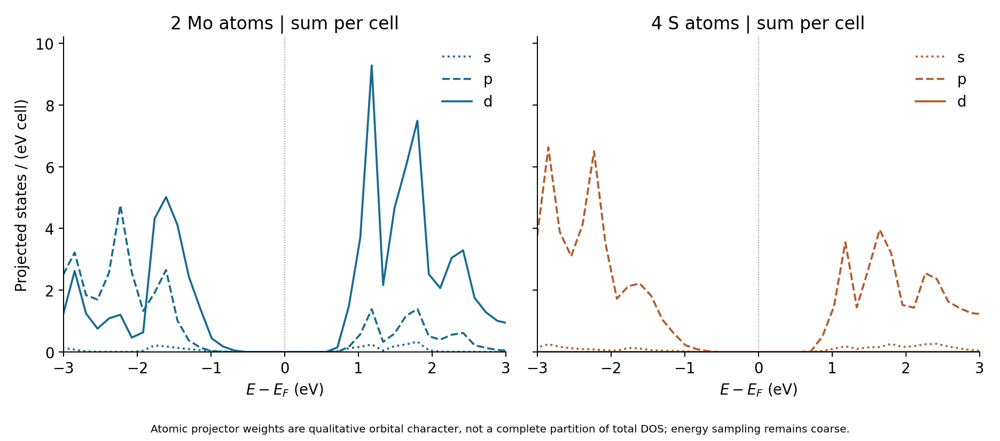

Bulk MoS2: a PBE reference without dispersion correction
========================================================

.. note::

   These settings are chosen to demonstrate the Nanoworks workflow with a
   short runtime. The numerical results are illustrative; quantitative
   materials predictions require appropriate convergence tests and validation
   of the physical model.

This exercise follows the completed ``GPAW/mos2-reference`` run in
``example-runs-Va5NDWGi``. It demonstrates cell relaxation, electronic bands
and atom-resolved orbital projections for a six-atom bulk MoS2 cell. This is
a three-dimensional layered crystal, not an isolated monolayer with vacuum.
The calculation uses PBE with no dispersion correction and no SOC.

Prepare and run
---------------

Install Nanoworks, GPAW and its PAW datasets following :doc:`../installation`.
Copy ``MoS2-wo-vdW.py`` and ``Bulk_MoS2.cif`` from
``nanoworks/examples/Bulk-MoS2-vdW`` into a fresh working directory, then run:

.. code-block:: console

   $ dftsolve -E GPAW -p 8 -i MoS2-wo-vdW.py -g Bulk_MoS2.cif --check
   $ dftsolve -E GPAW -p 8 -i MoS2-wo-vdW.py -g Bulk_MoS2.cif

Adapt the process count to your machine. ``Outdirname='MoS2-wo-vdW'`` selects
the output directory; the starting CIF supplies the ``Bulk_MoS2`` prefix.
The saved input and starting CIF match the inspected repository files byte
for byte. The recorded run used Nanoworks 27.2.0rc0, GPAW 26.7.0, ASE 3.29.0
and eight processes on 28 October 2026. Its exact source commit and PAW
dataset package release were not recorded. No new DFT calculation was run
for this tutorial.

Read the input and relaxed structure
------------------------------------

.. list-table:: Recorded settings and outputs
   :header-rows: 1
   :widths: 42 58

   * - Quantity
     - Value
   * - Cell contents
     - 2 Mo and 4 S atoms; initial P6_3/mmc structure
   * - Electronic representation
     - Plane waves, 400 eV cutoff, PBE
   * - Ground and DOS electronic grid
     - Gamma-centred 6 x 6 x 4
   * - Occupations
     - Fermi–Dirac, width 0.05 eV
   * - Dispersion / SOC / spin
     - ``vdW_calc='None'``; SOC off; non-spin-polarized solution
   * - Relaxation
     - LBFGS; normal cell strains enabled, shear strains fixed; symmetry preserved
   * - Optimizer stopping threshold
     - 0.05 eV/angstrom; final optimizer fmax 0.019182
   * - Band path
     - Gamma–M–K–Gamma, 61 total points, kz=0
   * - Electronic exports
     - 52 bands; 501 DOS energy samples

The input leaves several plotting and DOS controls at their defaults. The
inspected source defaults to 61 band-path points and tetrahedron DOS
integration; the saved outputs confirm the point counts. The exact run source
commit was not recorded, and the text log does not independently name the DOS
integration algorithm. Ground-state occupation smearing is a separate setting
from the DOS integration method.

The geometry optimizer ends after step 11 and the final ground SCF converges
in 11 electronic steps. Its fmax includes the geometry filter's cell degrees
of freedom; it should not be read as a stress tolerance in GPa. The final
printed diagonal stresses are approximately +0.000010, +0.000010 and
-0.000485 eV/angstrom cubed. Tighter force/stress and basis/sampling checks
are needed before treating the lattice constants as equilibrium predictions.

.. list-table:: Starting and final cell lengths
   :header-rows: 1

   * - Quantity
     - Starting (angstrom)
     - Final (angstrom)
     - Change
   * - a=b
     - 3.160000
     - 3.179361
     - +0.613%
   * - c
     - 12.290000
     - 13.329097
     - +8.455%

The cell angles remain 90, 90 and 120 degrees. The c-axis change is relative
to the starting CIF, not an error measured against experiment. Because this
is bulk material, c describes the crystal repeat and must not be interpreted
as a vacuum thickness. The exported final CIF uses P1 serialization; that
label alone does not establish a broken structural symmetry.

Read the band extrema and energy reference
------------------------------------------

.. figure:: ../_static/examples/mos2-gpaw-reference.png
   :alt: Recorded bulk MoS2 bands along Gamma M K Gamma and total DOS, with energies relative to the saved Fermi reference.
   :width: 100%

   The highlighted band edges lie at Gamma and K on the saved kz=0 path.
   The DOS is plotted directly from the original table without extra smoothing.

The long band table, XYYY table and band State record contain identical
energies. KPath metadata place M at index 21, K at 33 and the final Gamma
at 60. With 52 valence electrons, bands 26 and 27 in one-based numbering
bracket the occupied/unoccupied separation. The path gives:

.. list-table:: Band-edge values on the saved path
   :header-rows: 1

   * - Quantity
     - Value (eV)
   * - VBM at Gamma, relative to Ef
     - -0.552863
   * - CBM at K, relative to Ef
     - +0.686472
   * - Indirect path gap, Gamma to K
     - 1.239335
   * - Minimum direct path gap, at K
     - 1.640390

The ground mesh reports 1.239 and 1.640 eV respectively, consistent with
these path results at its printed precision. This agreement is an internal
check. The path does not include kz other than zero or all possible off-path
extrema, and no denser-mesh study was performed. These numbers are not
established as converged full-zone or experimental gaps. They are also not
optical excitation energies; no optical or excitonic calculation is included.

The saved band energies are already relative to Ef. Do not subtract the
ground log's printed Fermi level again. The position of zero within this gap
is the calculation's energy reference, not a work-function measurement.

Inspect DOS and orbital projections
-----------------------------------

   Both panels use states per eV per six-atom cell. Mo and S sums contain
   different numbers of atoms, so these are not per-atom comparisons.

The Mo d and S p curves help identify orbital character in the plotted energy
range. The projections are qualitative weights and do not completely
partition total DOS or define unique atomic charges. The Mo setup includes
14 valence electrons per atom, including semicore states; the S setup has
6. Thus the six-atom cell has 52 valence electrons, not the count obtained
by treating Mo as a six-valence-electron setup. Recorded setup identifiers are
``296a29d4664fe6c6f68623909fe0870f`` (Mo) and
``ca434db9faa07220b7a1d8cb6886b7a9`` (S).

The original atom-resolved PDOS has six groups of 501 rows. Their sum
reproduces the combined table exactly at stored precision; p, d and total
orbital component sums also agree. All electronic tables are finite, and
DOS/projection values are nonnegative.

The DOS energy spacing is approximately 0.155 eV. Its finite-window integral
is 100.1447 states/cell, compared with the full spin-degenerate spectral weight
of 104 for 52 bands. This unweighted integral is not an electron count and
should not be compared with the 52 occupied electrons. Finite-window and
energy-sampling effects are unresolved. Interpolation at Ef gives zero in
this table, consistent with a gap, but numerical DOS amplitudes and precise
onsets require convergence checks.

Where the D3 comparison stands
------------------------------

The separate ``GPAW/mos2-d3`` case failed during ``--check`` with exit code 1.
Its original log reports an Open MPI ORTE daemon / MPI_Init failure and a
segmentation fault, before the DFT calculation starts. This evidence does
not identify a D3-library failure or show that the physical D3 model fails.
There is no completed D3 result in this pair of GPAW runs. Consequently this
tutorial makes no numerical claim about a D3-induced lattice or gap change.

Reference data
--------------

:download:`Download the original inputs, spectral tables and redraw package <../_static/examples/mos2-gpaw-reference.zip>`.
It includes the starting/final CIFs, band/DOS/PDOS data, band State record,
figures, SHA256SUMS and an optional ``plot_mos2.py`` script. The script checks
export consistency and regenerates both figures and ``checks.dat`` using
NumPy 2 or newer and Matplotlib, without running GPAW. Large GPW files and
machine-specific logs are omitted. No density, phonon or optical results
are claimed for this example.
