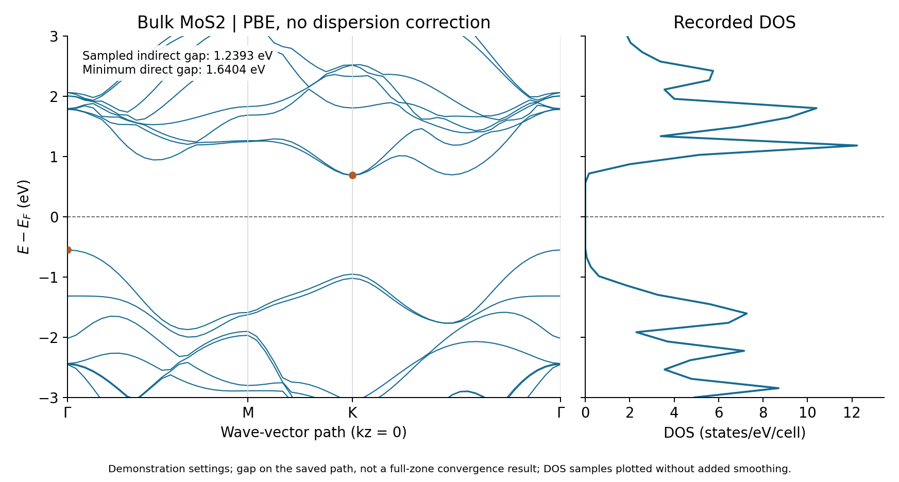

Bulk MoS2: relaxation and electronic structure (GPAW)
=====================================================

.. literalinclude:: ../../../nanoworks/examples/Bulk-MoS2-vdW/MoS2-wo-vdW.py
   :language: python
   :lines: 5-
   :caption: MoS2-wo-vdW.py

:download:`Download MoS2-wo-vdW.py <../../../nanoworks/examples/Bulk-MoS2-vdW/MoS2-wo-vdW.py>`.

Run
---

Requires GPAW and its PAW datasets.

.. code-block:: bash

   cd ~/.nanoworks/examples/Bulk-MoS2-vdW
   dftsolve -p 4 -i MoS2-wo-vdW.py -g Bulk_MoS2.cif

Results
-------

Results are in ``MoS2-wo-vdW/``. The recorded calculation gives a 1.239335 eV
indirect gap along the sampled Gamma-M-K-Gamma path. The relaxed c parameter
increases from 12.29 to 13.329097 angstrom. This input has no dispersion
correction, so inspect the interlayer spacing before using its electronic
properties as a model of bulk MoS2.

   Recorded example output.

These example settings need convergence tests before quantitative use.

:doc:`Detailed recorded results <../validation/mos2-gpaw-reference>`.
