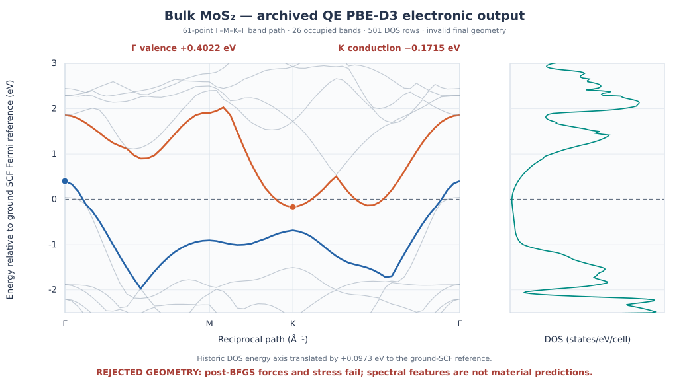

MoS2 with QE-D3: a rejected relaxation and spectral audit
==========================================================

.. warning::

   The 28 October 2026 QE 7.4.1 calculation completed but the recorded
   structure **failed post-BFGS forces and stress checks**. This is a
   reproducible *troubleshooting case*, not a physically validated MoS2
   lattice or a quantitative comparison between PBE and PBE-D3.

This page follows the completed file archive in
``example-runs-Va5NDWGi/QE/mos2-d3``. It contains a QE+D3 run,
but **no matching QE calculation without D3**. A completed GPAW/PBE
reference exists separately, although comparing those two different
engines and pseudopotentials would not isolate the D3 contribution.

Inputs and QE native dispersion
-------------------------------

Install the examples using ``nanoworks --install-examples`` if
necessary. With a supported QE version and PBE pseudopotentials
already installed, inspect both examples:

.. code-block:: console

   $ cd ``/.nanoworks/examples/Bulk-MoS2-vdW
   $ dftsolve -E QE -p 4 -i MoS2-wo-vdW.py -g Bulk_MoS2.cif --check
   $ dftsolve -E QE -p 4 -i MoS2-with-vdW.py -g Bulk_MoS2.cif --check

The two inputs differ in their output-directory names and the
``vdW_calc`` setting: ``'None'`` versus ``'D3'``. For QE, Nanoworks
uses QE's **native** ``vdw_corr = 'grimme-d3'`` parameter.
There is no need to install a separate ``dftd3`` executable
for QE. The original input deck and QE log confirm this.
The final recorded D3 contribution, **-0.14415002 Ry**, is
the correction to the total cell energy; it is *not* an
interlayer binding energy.

The archived six-atom bulk 2H-MoS2 input used PBE, a 400 eV
wavefunction cutoff, a four-times density cutoff, a Gamma-centered
6 x 6 x 4 electronic mesh and Fermi-Dirac smearing of 0.05 eV.
It requested variable-cell BFGS optimization with a force-component
threshold of 0.05 eV/angstrom, then DOS, PDOS and electronic
bands. These settings were smoke-test inputs, not converged
research parameters.

The central failure: final SCF after BFGS
----------------------------------------

QE printed ``bfgs converged`` after six BFGS steps. At the next
stage it recalculated the G-vectors and performed a fresh
SCF at the proposed relaxed geometry. Its results were:

.. list-table:: Original QE values before and after final recalculation
   :header-rows: 1
   :widths: 48 26 26

   * - Quantity
     - BFGS ending
     - Final SCF
   * - Total energy (Ry)
     - -368.91252996
     - -368.31758860
   * - Hydrostatic pressure (kbar)
     - -0.31
     - -234.92
   * - Principal diagonal stresses (kbar)
     - -0.23, -0.23, -0.49
     - -210.83, -210.83, -283.10
   * - Largest Cartesian force component (eV/angstrom)
     - Approximately 0.0079
     - **0.05583**

The energy discontinuity was **+0.59494136 Ry (+8.095 eV)**.
The largest final stress deviation from the zero-pressure
target was **283.10 kbar**, versus QE's default
``press_conv_thr = 0.5`` kbar for cell relaxation. The maximum
final force exceeded the requested 0.05 eV/angstrom.
The later SCF therefore invalidated the earlier BFGS
convergence claim.

QE explicitly indicates that its plane-wave vectors are
recomputed for the final unit cell. That could contribute
to the discontinuity, but the archive does not prove the
root cause; increasing the wavefunction and density cutoff
and independently checking the electronic mesh would be
necessary to establish it.

The nominal final CIF has a = **2.903446769 angstrom**
and c = **10.694214657 angstrom**, compared with
the starting a = 3.1600 angstrom and c = 12.2900 angstrom.
The changes are -8.12% and -12.98%; the cell volume
shrunk by **26.54%**. These are numbers from a
failed geometry optimization and must not be reported as
equilibrium parameters or a predicted effect of D3.

Current Nanoworks has a final-SCF force validator that
rejects this run. A new validator also checks the final
stress after fully unconstrained QE variable-cell BFGS
(``cell_dofree='all'``) and rejects structures when any
stress component deviates from the target by more than
QE's default 0.5 kbar tolerance (with a small
printed-output rounding allowance). Partially constrained
cell modes require separate consideration of the allowed
strain components and are not handled by this particular
full-tensor guard.

Recorded bands and DOS are diagnostics, not material predictions
----------------------------------------------------------------

   Raw recorded band and DOS values. The historical DOS energy
   axis is translated by +0.0973 eV to match the ground-state
   energy reference used for the band plot; the source tables
   were not modified.

The ground SCF reports **52 electrons** in the six-atom
non-spin-polarized cell, yielding 26 nominal occupied
bands. Along the saved 61-point Gamma-M-K-Gamma path
(at k_z = 0), the top of band 26 occurs at Gamma
at **+0.4022 eV**, while the bottom of band 27
occurs at K at **-0.1715 eV**. This creates a
sampled indirect separation of **-0.5737 eV**.
The same two bands have a +0.5123 eV direct
separation at K.

A nonzero DOS close to the historical Fermi zero and
this apparent band overlap do not constitute an
acceptable prediction that bulk MoS2 is metallic:
the starting geometry failed severe post-relaxation
checks, SOC was omitted, and the k-path does not
sample the complete three-dimensional Brillouin zone.

The archived ground-SCF Fermi energy is 17.3734 eV,
while the DOS NSCF Fermi energy is 17.4707 eV.
Consequently the old DOS and band files have
**different energy origins**. To align the *archived*
DOS axis with the ground-state band reference, add
17.4707 - 17.3734 = **+0.0973 eV** to each archived
DOS energy. This is an axis shift, not a physical
band offset. Current Nanoworks aligns ordinary
QE band and DOS exports to the ground-state reference
when possible, without rewriting historical files.

The total DOS has **501** energy samples; the
assembled PDOS has **424**. The first 424 energy
coordinates agree, but the PDOS stops at +3.4603 eV,
while total DOS extends to +5.0003 eV.
Atomic projected ``TOTAL`` and global DOS also
need not have equal amplitudes.

Download the original data and repeat the checks
------------------------------------------------

The archived files below were copied unchanged:

:download:`BAND XYYY <../_static/examples/mos2-qe-d3-bands.dat>` |
:download:`K-point path <../_static/examples/mos2-qe-d3-kpath.dat>` |
:download:`Total DOS <../_static/examples/mos2-qe-d3-dos.dat>` |
:download:`PDOS <../_static/examples/mos2-qe-d3-pdos.dat>` |
:download:`Rejected final CIF <../_static/examples/mos2-qe-d3-unverified-final.cif>`.

Selected SHA-256 values:

.. code-block:: text

   band: f7016a0bbbe8cf9afd529c7b603119c9f7070ddfe0cf2903f2db763aa9712d43
   DOS:  841b29265c5d77e263b065adbd6653dc35a5c13f929b59482769ed85320a84ae
   CIF:  5326259ad6b575f54bd54c06e822c0f6eab43461a921e608efd6db00a1fe5041

You can inspect the failed calculation's band occupancy
and sampling without running QE:

.. code-block:: python

   import numpy as np

   bands = np.loadtxt("mos2-qe-d3-bands.dat", skiprows=1)
   dos = np.loadtxt("mos2-qe-d3-dos.dat", skiprows=1)
   pdos = np.loadtxt("mos2-qe-d3-pdos.dat", skiprows=1)

   assert bands.shape == (61, 32)
   assert dos.shape == (501, 2)
   assert pdos.shape == (424, 14)
   assert np.allclose(dos[:424, 0], pdos[:, 0])

   # First column is k-point index; columns 1..31 are bands.
   valence, conduction = bands[:, 26], bands[:, 27]
   print("Sampled indirect separation:", conduction.min() - valence.max())
   print("K direct separation:", conduction[33] - valence[33])

A research-quality D3 comparison requires new independent
QE runs with and without D3, starting from the same CIF
and using matched pseudopotentials, sampling and tolerances.
Converge the final ground-state force and stress checks first.
Do not compare outputs from different engines as if
they differed only in the D3 flag. For a separate successful
GPAW/PBE calculation, see the neighboring MoS2 GPAW
reference tutorial.
