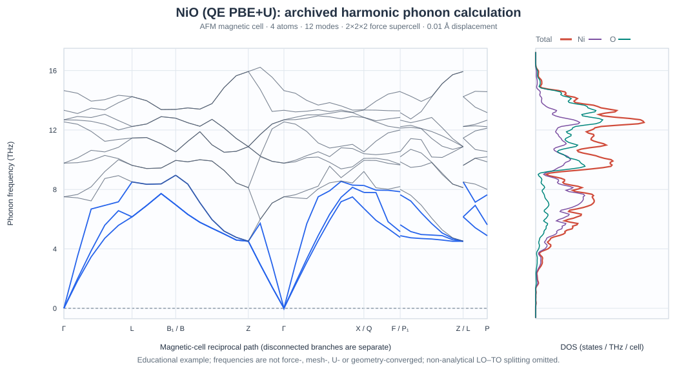

NiO: audit magnetic QE+U finite-displacement phonons
========================================================

.. note::

   This tutorial documents an **existing**, completed NiO calculation from
   ``example-runs-Va5NDWGi/QE/nio-hubbard-phonon``, recorded on
   28 October 2026 using QE 7.4.1, Phonopy 4.8.6 and Nanoworks
   27.2.0rc0. It is a workflow demonstration, **not** an experimentally
   validated NiO dispersion or a proof of lattice stability.

The example tests a significant workflow combination: an antiferromagnetic
(AFM) rocksalt magnetic cell, explicit QE spin species, Hubbard-U projectors,
Phonopy force displacements and a resume-safe force cache.

Run the installed example
-------------------------

With QE 7.4.1, Nanoworks, Phonopy and the required managed PBE
pseudopotentials installed, first install the bundled examples if necessary
(:ref:`tutorial-examples-setup`):

.. code-block:: console

   $ nanoworks --install-examples
   $ cd ~/.nanoworks/examples/NiO-QE-Hubbard-phonon
   $ dftsolve -E QE -p 4 -i NiO-QE-phonon.py --check
   $ dftsolve -E QE -p 4 -i NiO-QE-phonon.py --dry-run
   $ dftsolve -E QE -p 4 -i NiO-QE-phonon.py

The first command checks inputs, the second prepares an execution plan
without force SCFs, and the third executes the example. Adjust ``-p`` to
the machine. This calculation is considerably heavier than the
two-atom silicon exercise. The historical outputs described below are
**not** produced by the check and dry-run commands.

Input and magnetic model
------------------------

``NiO-QE-phonon.py`` starts with a four-atom AFM cell constructed by
doubling a rocksalt primitive cell with an off-diagonal supercell matrix.
The starting cubic lattice parameter is **4.17 angstrom**; the cell is
held fixed (``Geo_optim=False``). The two Ni sites are initialized
with +2 and -2 Bohr magnetons; two O sites have zero seed moments.
These seeds do not constrain the final self-consistent spin state.

.. list-table:: Archived parameters
   :header-rows: 1
   :widths: 42 58

   * - Setting
     - Recorded value
   * - XC and on-site correction
     - PBE; Dudarev U(Ni-3d) = 6.0 eV, ortho-atomic projectors
   * - Pseudopotential family
     - Scalar-relativistic PseudoDojo PBE standard, Ni and O
   * - Kinetic cutoff
     - 600 eV, or approximately 44.10 Ry
   * - Ground-state electronic mesh
     - Gamma-centered 4 x 4 x 4
   * - Force electronic mesh
     - 2 x 2 x 2, derived from reciprocal sampling
   * - Spin and smearing
     - Collinear AFM; Fermi-Dirac 0.02 eV
   * - Force supercell
     - 2 x 2 x 2 of the four-atom magnetic cell (32 atoms)
   * - Finite displacement
     - 0.01 angstrom, with plus/minus generation
   * - Phonon q-mesh
     - 12 x 12 x 12; 1,728 points
   * - Postprocessing
     - Acoustic sum rule on; thermal values 0–1000 K in 10 K steps
   * - Long-range dipole response
     - No non-analytical LO-TO correction

The run generated **five** QE force jobs: one undisplaced 32-atom
reference and four Phonopy displacement jobs. This is the number of
symmetry-inequivalent displaced configurations generated by this
record's settings; it does **not** mean only five atoms were included.
The cached plan and all five records were marked complete. The output
directory includes force input decks, complete QE logs, verified force
JSON records, force constants and Phonopy YAML.

Check that the AFM state survived
---------------------------------

The ground SCF has **48 valence electrons** in the four-atom cell and a
final energy of -730.44449661 Ry. The projected atomic-sphere moments
reported by QE are approximately **+1.5569 and -1.5569 Bohr magnetons**
on Ni, with negligible O moments. Its total magnetization is approximately
zero and its absolute magnetization is 3.46 Bohr magnetons per cell.
These atomic-sphere moments are method-dependent partitions, not unique
atomic observables.

Each 32-atom force SCF converged with approximately zero **total**
magnetization and about 27.64 Bohr magnetons **absolute** magnetization,
consistent with the intended compensated AFM pattern. The force jobs
retain PBE, Hubbard projectors and separate Ni1/Ni2 spin labels.
Successful SCF and the correct moment signs are necessary checks,
not demonstrations that the magnetic configuration is the lowest-energy
state relative to alternative orderings.

The undisplaced residual force maximum is **0.016013 eV/angstrom**
(atom-wise vector norm). Nanoworks subtracts these baseline forces
before constructing finite-difference force constants and removes
the per-displacement mean drift. This is a numerical workflow correction;
it does not replace full relaxation of the initial magnetic cell.
A quantitative NiO result should first verify equilibrium forces,
magnetic state and residual stress.

Read the phonon branches and DOS
--------------------------------

   Reconstructed directly from the archived THz band and DOS tables.
   Repeated path distances mark separate reciprocal-space segments; the
   drawn curves are disconnected at those boundaries. The figure does
   not add or recalculate force constants.

Each magnetic four-atom cell has **12** vibrational branches.
The three Gamma-point acoustic frequencies from the archived path are,
in THz, approximately

.. code-block:: text

   -0.0000001425     +0.0000000615     +0.0000000642

The tiny signed negative value is numerical zero at the printed precision,
not an established imaginary branch. The lowest *mesh-sampled*
frequency is **+0.355510 THz**, at fractional q =
(1/24, 1/24, 1/24). There are no negative frequencies among the
1,728 recorded q-points. However, this shifted sampling grid does
**not** include the exact Gamma point, and no unsampled q-vector can
be certified stable from a finite mesh.

The largest recorded path-mode frequency is approximately **16.225 THz**.
The DOS table contains 201 sampled frequencies. Numerical integration
of the total DOS gives **12.0000 modes** per magnetic cell; all four
atom-projected DOS integrals give **3.0000 modes** each, with a
sum matching the total DOS within exported rounding precision.
The two Ni contributions integrate to six modes and the two O
contributions to six. This mode-count check verifies spectral
normalization; it does not establish agreement with experiment.

Thermal table and interpretation
--------------------------------

The harmonic thermal export has 101 rows from 0 to 1000 K.
Selected archived values are:

.. list-table:: Harmonic quantities from the archived DOS
   :header-rows: 1
   :widths: 18 27 27 28

   * - Temperature (K)
     - Free energy (kJ/mol)
     - Entropy (J/K/mol)
     - Cv (J/K/mol)
   * - 0
     - 23.9574
     - 0
     - 0
   * - 300
     - 15.8199
     - 68.9711
     - 80.1327
   * - 1000
     - -77.6199
     - 179.4688
     - 97.7199

These are phonon harmonic properties for the input four-atom magnetic
cell, not electronic or magnetic thermal contributions. The absence
of non-analytical corrections, potential non-equilibrium geometry,
and unconverged force settings limit the predictive use of
the high-frequency optical branches and thermodynamic quantities.

Reproduce numerical checks without QE
-------------------------------------

The following are original Nanoworks data exports from the archived
run, retained without numeric changes:

:download:`NiO band table (THz) <../_static/examples/nio-qe-hubbard-band-thz.dat>` |
:download:`NiO total and projected DOS (THz) <../_static/examples/nio-qe-hubbard-dos-thz.dat>` |
:download:`NiO thermal properties <../_static/examples/nio-qe-hubbard-thermal.dat>`.

Their SHA-256 digests are:

.. code-block:: text

   band:    979abe1ddbfb06a35bbc8de75ba0673b5a7664a1dbf0664b571ea4522c321531
   DOS:     5dbc67e77c80736bd28f8368d62c9cb5e19c8828fc20b661b06a1c199d0c0517
   thermal: 11797716ac445ff504eb121775d2462b9ed33dedd081ae2435cec474def38d04

For example, NumPy can check the mode count and three Gamma modes:

.. code-block:: python

   import numpy as np

   band = np.loadtxt("nio-qe-hubbard-band-thz.dat", skiprows=1)
   dos = np.loadtxt("nio-qe-hubbard-dos-thz.dat", skiprows=1)
   assert band.shape == (40, 16)  # distance, qx/qy/qz, 12 branches
   assert dos.shape == (201, 6)   # frequency, total, four atom PDOS
   assert np.max(np.abs(band[0, 4:7])) < 1e-5
   assert np.isclose(np.trapezoid(dos[:, 1], dos[:, 0]), 12, atol=1e-3)
   assert np.allclose(dos[:, 2:].sum(axis=1), dos[:, 1], atol=1e-8)

NumPy 2 or newer provides ``np.trapezoid``; earlier versions can use
``np.trapz``. The recorded data themselves were exported by Nanoworks
and Phonopy; this script independently checks their published tables
without rerunning QE.

Why the archived run is not a convergence result
------------------------------------------------

To use NiO phonons in a research publication, first relax the chosen
AFM magnetic geometry with consistent DFT+U forces and stress, and verify
the magnetic ordering and local moments. Converge the cutoff, force
k-point mesh, supercell size and displacement; compare at least
several displacement magnitudes. Evaluate the treatment of LO-TO
splitting for polar NiO, requiring a consistent dielectric response
and Born effective charges if non-analytical terms are to be included.
Compare physical dispersions against experiment only after those checks.

When repeating with new input settings, regenerate the force plan.
Cached forces are reusable only when their required provenance,
input and content signatures match. For archived verified runs,
``python -m nanoworks.qe_phonon <manifest.json>`` can redo analysis
without ``pw.x``, provided the complete source folder and matching
Phonopy environment are available. Do not transfer a standalone JSON
summary and assume it contains all required force records.
