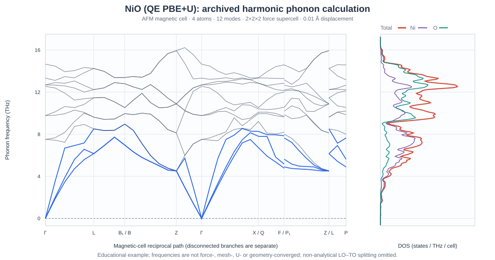

NiO: antiferromagnetic DFT+U phonons (QE)
=========================================

.. literalinclude:: ../../../nanoworks/examples/NiO-QE-Hubbard-phonon/NiO-QE-phonon.py
   :language: python
   :lines: 5-
   :caption: NiO-QE-phonon.py

:download:`Download NiO-QE-phonon.py <../../../nanoworks/examples/NiO-QE-Hubbard-phonon/NiO-QE-phonon.py>`.

Run
---

Requires QE and the managed pseudopotentials.

.. code-block:: bash

   cd ~/.nanoworks/examples/NiO-QE-Hubbard-phonon
   dftsolve -p 4 -i NiO-QE-phonon.py

Results
-------

Results are in ``NiO-QE-phonon-results/``. First verify that opposite Ni
layers keep opposite magnetic moments after SCF. Read phonon bands and DOS
only for that magnetic state. The finite-displacement supercell has
12 branches per four-atom reference cell. Negative frequencies require
force, displacement and supercell convergence checks.

   Recorded example output.

These example settings need convergence tests before quantitative use.

:doc:`Detailed recorded results <../validation/nio-qe-hubbard-phonons>`.
