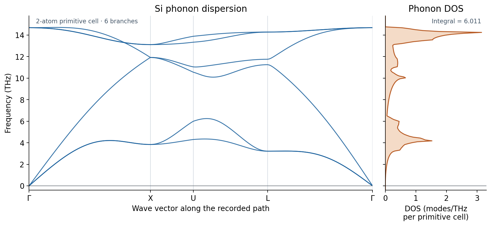

.. _si-gpaw-phonons:

Silicon: phonons (GPAW)
=======================

.. literalinclude:: ../../../nanoworks/examples/Si-phonon/Si-phonon.py
   :language: python
   :lines: 5-
   :caption: Si-phonon.py

:download:`Download Si-phonon.py <../../../nanoworks/examples/Si-phonon/Si-phonon.py>`.

Run
---

Requires GPAW and its PAW datasets.

GPAW uses Phonopy displacements; QE uses native DFPT for this shared input.

.. code-block:: bash

   cd ~/.nanoworks/examples/Si-phonon
   dftsolve -E GPAW -p 4 -i Si-phonon.py -g Si_mp-149_primitive.cif

Results
-------

The result directory uses the CIF stem. Read frequency against path
distance in the band table and frequency against mode count in the phonon DOS.
A two-atom primitive cell has three acoustic and three optical branches. Negative
frequencies indicate imaginary modes. Small acoustic residuals near Gamma
need numerical convergence checks before diagnosing an instability.

   Recorded example output.

These example settings need convergence tests before quantitative use.

:doc:`Detailed recorded results <../validation/si-gpaw-phonons>`.
