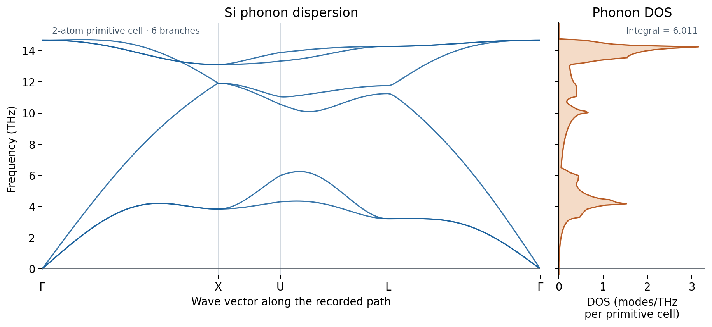

.. _si-gpaw-phonons:

Silicon phonons: acoustic and optical branches with GPAW
=========================================================

.. note::

   These settings demonstrate the Nanoworks workflow. The numerical results
   are illustrative; quantitative materials predictions require convergence
   tests and validation of the physical model.

This tutorial follows the completed ``GPAW/si-phonon`` calculation from
``example-runs-Va5NDWGi``. Starting from relaxed diamond silicon, it connects
finite-displacement forces to six phonon branches and a phonon density of
states (DOS). It complements :doc:`al-gpaw-phonons`: a two-atom primitive cell
has six branches, with three acoustic translations at Gamma and three
finite-frequency optical modes.

Prepare and run
---------------

Activate an environment with Nanoworks, GPAW, its PAW datasets and Phonopy;
see :doc:`../installation`. Use the installed example directory. If needed,
run ``nanoworks --install-examples`` first as described in
:ref:`tutorial-examples-setup`.

.. code-block:: console

   $ cd ~/.nanoworks/examples/Si-phonon
   $ dftsolve -E GPAW -p 8 -i Si-phonon.py -g Si_mp-149_primitive.cif --check
   $ dftsolve -E GPAW -p 8 -i Si-phonon.py -g Si_mp-149_primitive.cif

The first command checks prerequisites without running DFT. The second
relaxes the structure and computes displaced-supercell forces and phonon
outputs. Adjust the MPI process count to your machine. When changing force
settings or geometry, check cache compatibility before reusing results;
see the installed example README for the resume procedure.

The recorded input and starting CIF match the bundled example byte for byte.
The run completed on 28 October 2026 with Nanoworks 27.2.0rc0, GPAW 26.7.0,
ASE 3.29.0 and Phonopy 4.8.6, using eight processes. Its exact Nanoworks source
commit and PAW dataset package release were not recorded. The Si PBE setup
identifier in the log is ``ee77bee481871cc2cb65ac61239ccafa`` (four valence and
ten frozen-core electrons per atom).

.. list-table:: Recorded settings
   :header-rows: 1
   :widths: 40 60

   * - Quantity
     - Setting
   * - Electronic approximation
     - PBE, plane waves, 500 eV; spin and SOC off
   * - Ground-state electronic grid
     - Gamma-centred 11 x 11 x 11
   * - Force electronic grid
     - 4 x 4 x 4 Monkhorst-Pack on the 54-atom supercell
   * - Occupations / SCF preset
     - Fermi–Dirac, 0.01 eV; ``SCF_accuracy = 'very-tight'``
   * - Relaxation
     - QuasiNewton (BFGSLineSearch); 0.0001 eV/angstrom tolerance;
       normal strains relaxed, shear fixed, symmetry retained
   * - Finite displacements
     - 3 x 3 x 3 primitive cells; displacement 0.01 angstrom
   * - Translational constraint
     - ``Phonon_acoustic_sum_rule = True``
   * - Phonon path
     - Gamma–X–U–L–Gamma; 61 points per segment
   * - Phonon DOS mesh
     - 20 x 20 x 20, shifted; 4000 representatives, weight sum 8000
   * - Thermal analysis
     - Disabled in this recorded input; no thermal-property tables

Electronic k-point grids determine the DFT forces. The phonon q-point mesh
samples the resulting dynamical matrices for DOS integration. Increasing the
DOS mesh does not replace a larger force supercell or better electronic
convergence.

Check the relaxed structure and forces
--------------------------------------

The final primitive cell has two Si atoms, equal edges of 3.871641717
angstrom and angles of 60 degrees. Its conventional cubic lattice parameter
is 5.475328224 angstrom and its volume is 41.036516207 cubic angstrom per
primitive cell. These are recorded PBE results, not an experimental comparison.
The final stress components print as zero at six decimal places in
eV/angstrom cubed; this does not establish an exactly stress-free state.

The optimizer reached step 2; its final displayed force measure is 0.0000
eV/angstrom at four decimal places. This cell-filter quantity includes the
relaxed strain degrees of freedom and should not be read as a separately
specified stress tolerance. Although the final CIF uses a P1 representation,
its geometry is diamond Si: a symmetry check and the saved Phonopy YAML both
identify Fd-3m (227).

The final ground-state SCF and the displaced-supercell SCF converged. Symmetry
reduces the calculation to one displaced configuration; the latter SCF took
25 iterations. Its saved force array contains 54 vectors in eV/angstrom and
agrees with the forces embedded in the YAML to better than ``6e-17``
eV/angstrom. The net-force components are below ``3e-17`` eV/angstrom.

The compact force-constant array has shape ``(2, 54, 3, 3)`` in
eV/angstrom squared. Its SHA256 matches the archived result summary and its
values agree with the YAML within ``5e-16`` eV/angstrom squared. Summing over
the supercell atom index leaves a maximum component of ``7.2e-15``
eV/angstrom squared after symmetrization and the acoustic sum rule. These
are consistency checks; the enforced sum rule does not independently prove
that the DFT forces are converged.

Read the six branches and DOS
-----------------------------

   Redrawn from the saved band YAML and DOS DAT without smoothing or
   rescaling. Degenerate modes overlap. All six sorted frequencies use the
   same colour; following branch character through a crossing would require
   eigenvectors, rather than frequency ordering alone.

At Gamma, the three acoustic frequencies have magnitudes below ``3e-7`` THz.
Their small signs differ slightly between the separately evaluated summary
and band YAML, consistently with numerical noise around zero. They are not
resolved imaginary branches. The three optical frequencies coincide at
14.683895 THz within the stored precision.

.. list-table:: Frequencies at sampled endpoints (THz, ascending order)
   :header-rows: 1
   :widths: 15 85

   * - Point
     - Six frequencies
   * - Gamma
     - approximately 0, 0, 0, 14.683895, 14.683895, 14.683895
   * - X
     - 3.838981, 3.838981, 11.921170, 11.921170, 13.113436, 13.113436
   * - U
     - 4.303267, 5.994495, 10.554270, 11.047207, 13.336580, 13.885425
   * - L
     - 3.218937, 3.218937, 11.249228, 11.754189, 14.277794, 14.277794

The band DAT contains 244 rows: shared endpoints occur at both adjacent
segments. DAT and YAML values agree within ``5.1e-7`` in their respective
frequency/distance units, consistent with DAT rounding. The highest sampled
band frequency is 14.709414 THz; the Gamma optical value is therefore not the
maximum over the path.

The DOS is nonnegative, and its trapezoidal integral is 6.011344 modes per
two-atom primitive cell, close to the expected six. The small excess is a
numerical integration error of the exported DOS table. The negative-frequency
axis padding has exactly zero DOS; it is not an unstable spectral contribution.

Understand the shifted mesh warning
-----------------------------------

.. important::

   The archived 20 x 20 x 20 DOS mesh does not contain Gamma, even though
   Gamma is explicitly present in the band path and evaluated separately.
   Its smallest frequency, 0.362277 THz at reduced q = (0.025, 0.025, 0.025),
   must not be interpreted as an acoustic gap.

All 4000 saved mesh representatives have weight two; their weights sum to
8000. The mesh has no negative frequency. In conjunction with the path,
this supports the absence of a resolved instability in the sampled model;
it does not establish stability throughout a converged Brillouin zone.

Phonopy emitted ``MeshSymmetryFallbackWarning``: the half-grid shift is not
preserved by the primitive-cell point group, so point-group reduction was
disabled and only time-reversal reduction was used. The warning explains the
4000 representatives instead of a much smaller symmetry-reduced set. It does
not report an SCF failure or a negative mode. The raw shifted-mesh results are
preserved here; no alternative mesh calculation is claimed.

Phonopy 4 also chose a cyclic permutation of the primitive basis automatically.
The saved YAML records the matrix. Keep it with the numerical tables because
reduced q coordinates refer to that reciprocal basis. For details, see the
`Phonopy mesh settings <https://phonopy.github.io/phonopy/setting-tags.html#mesh-mp-or-mesh-numbers>`_
and `force-constant formulation <https://phonopy.github.io/phonopy/formulation.html#second-order-force-constants>`_.

Download and redraw
-------------------

:download:`Download the input, structure, forces, force constants, DAT/YAML data and plotting script <../_static/examples/si-gpaw-phonons-reference.zip>`.
Extract the archive, install NumPy 2 or newer, Matplotlib and PyYAML, then run:

.. code-block:: console

   $ python plot_phonons.py

The script verifies ``SHA256SUMS``, checks the independent stored
representations, writes ``checks.dat`` with units, and redraws the figure.
It does not import GPAW or run DFT. Original calculation inputs and numerical
files are preserved byte for byte; large electronic state files and
machine-specific postprocessing plans are not needed for the plot.

For quantitative work, vary the cutoff, electronic grids and smearing,
displacement size and supercell, then converge the phonon DOS mesh separately.
Thermal analysis was disabled in this run, so this tutorial does not report
heat capacities or vibrational free energies. See :doc:`al-gpaw-phonons` for a
recorded thermal-analysis example.
