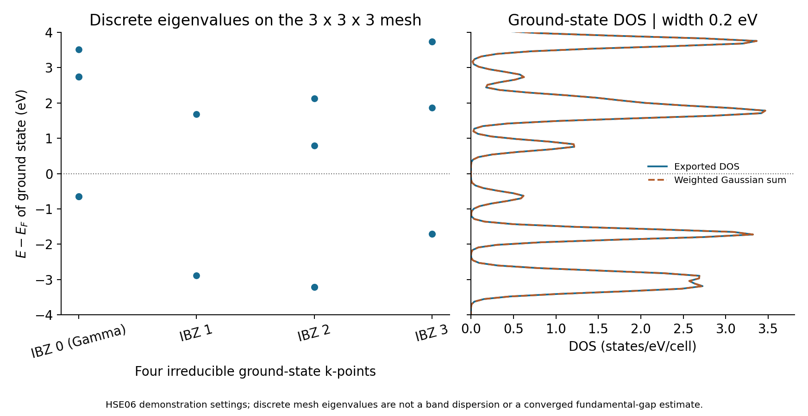
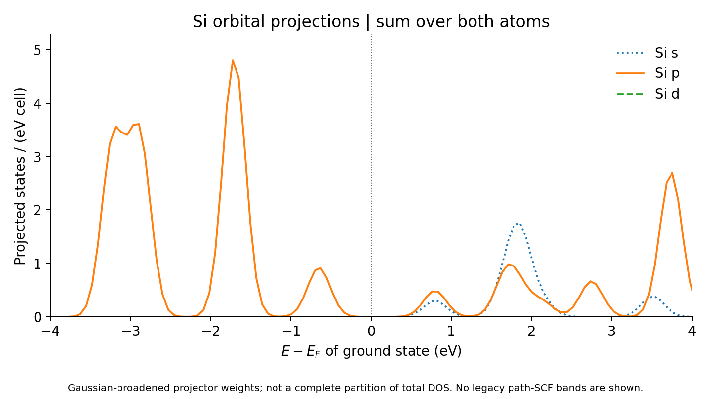

Silicon with HSE06: ground-state DOS and a hybrid-band caveat
=============================================================

.. note::

   These settings are chosen to demonstrate the Nanoworks workflow with a
   short runtime. The numerical results are illustrative; quantitative
   materials predictions require appropriate convergence tests and validation
   of the physical model.

This tutorial explains a hybrid-functional ground-state calculation and
density of states using silicon. It shows how to reuse saved electronic
eigenvalues and distinguish occupation smearing from DOS broadening.
Hybrid-functional band paths need additional methodological care, so this
exercise focuses on ground state and DOS.

Run the ground-state and DOS stages
-----------------------------------

Use Nanoworks with GPAW and its PAW datasets installed. If necessary, install
the examples following :ref:`tutorial-examples-setup`, then run:

.. code-block:: console

   $ cd ~/.nanoworks/examples/Si-with-HSE
   $ dftsolve -E GPAW -p 8 -i Si-with-HSE.py -g Si_mp-149_primitive.cif -s Band_calc=False --check
   $ dftsolve -E GPAW -p 8 -i Si-with-HSE.py -g Si_mp-149_primitive.cif -s Band_calc=False

Adapt the process count to your computer. The shared input enables bands by
default; the explicit override excludes that stage for this GPAW tutorial
without editing the original input. This caveat concerns the inspected GPAW
hybrid path and does not establish a failure of the separate QE hybrid path.
Outputs use ``Si_mp-149_primitive/`` and the same filename prefix.

Record the GPAW and PAW dataset versions when repeating the example.
Hybrid calculations are especially sensitive to the chosen electronic
representation and convergence thresholds.

Read the settings
-----------------

.. list-table:: Ground-state and DOS settings
   :header-rows: 1
   :widths: 45 55

   * - Quantity
     - Value
   * - Structure
     - Two-atom diamond Si primitive cell; fixed input geometry
   * - Functional and representation
     - HSE06, legacy GPAW plane-wave hybrid backend, 400 eV
   * - Ground-state mesh
     - Gamma-centred 3 x 3 x 3; four irreducible points
   * - SCF profile
     - ``SCF_accuracy='loose'``; occupied bands are the convergence target
   * - Ground occupations
     - Fermi–Dirac, width 0.2 eV
   * - DOS
     - Gaussian broadening, ``DOS_width=0.2`` eV; 301 points
   * - Band count / electron count
     - Eight bands / eight valence electrons
   * - Other stages
     - No relaxation, spin polarization, SOC, density export or optics

The saved ground-state result completed the SCF cycle, but a loose profile
and occupied-band convergence target do not establish accurate empty-state
eigenvalues. Geometry is fixed (``Geo_optim=False``); the input and final
structures therefore agree within numerical precision. The Si PAW setup has
four valence and ten core electrons. A ``PBE``-labelled PAW dataset does
not imply that the HSE06 functional was replaced: inspect the calculator
parameters to verify the actual XC choice.

Verify the DOS from the saved eigenvalues
-----------------------------------------

For hybrids, this Nanoworks DOS path reads the saved ground-state eigenvalues;
it does not run a new fixed-density DOS mesh. Changing a DOS mesh setting alone therefore does not demonstrate denser
hybrid sampling: the ground-state calculation must supply the desired
sampling and enough appropriately converged empty bands.

   Left: discrete eigenvalues, with no lines implying a band path. Right:
   the original total DOS and a Gaussian sum using the original GPW energies
   and k-point weights. Both use the ground-state Fermi reference.

The four irreducible weights are 1/27, 12/27, 6/27 and 8/27; they sum to one.
Including the spin degeneracy, the total DOS is reproduced by

.. math::

   D(E)=2\sum_{kn}w_k\frac{\exp[-((E-(\epsilon_{kn}-E_F))/\sigma)^2]}
                              {\sigma\sqrt{\pi}},\qquad\sigma=0.2\ \mathrm{eV}.

The maximum difference from the exported DOS is below
2e-14 states/(eV cell). The occupation-weighted GPW count is eight electrons.
The Gaussian width here controls the plotted spectral broadening; the
separate Fermi–Dirac width controls ground-state occupations. Both happen
to have the same numerical value in this input.

The ground mesh has a sampled occupied/unoccupied separation of
1.445862 eV. It is not established as a converged fundamental gap. The
finite-window DOS integral is 15.66330 states/cell, compared with the
full Gaussian spectral weight of 16 for eight spin-degenerate bands.
This unweighted integral is not the eight-electron occupation count.
Gaussian tails extend beyond the exported energy window and into the gap;
a small nonzero broadened DOS near Ef is not evidence of metallicity.

Inspect the orbital character
-----------------------------

   Projections are summed over both atoms and expressed per primitive cell.
   They describe orbital weights, not a complete partition of total DOS.

The original atom-resolved table contains two groups of 301 rows. Their
sum agrees with the combined PDOS, and the p/d/total component identities
hold within numerical precision. All exported DOS and projection values
are finite and nonnegative.

Why hybrid band paths need a separate method
--------------------------------------------

A standard ground-state k-point mesh and a band path serve different purposes.
For a hybrid functional, substituting a line of special k-points into a
converged ground-state calculator and then running a new SCF is **not**
equivalent to evaluating the bands of the original electronic state.

For example, a legacy GPAW path calculation using the ``GXWKGLUWLK``
path assigned equal weights to its 61 points and performed additional
self-consistent iterations. Its electronic potential and Fermi energy
therefore differed from those of the uniform-mesh ground state. Referencing
these path eigenvalues to the previous Fermi level would not correct the
underlying change in electronic state.

A valid hybrid band workflow should retain the converged reference state
and use a supported hybrid eigenvalue evaluation along the chosen path.
The `GPAW hybrid-band documentation
<https://gpaw.readthedocs.io/tutorialsexercises/electronic/bandstructures/bandstructures.html#non-self-consistent-and-self-consistent-hse06>`_
discusses suitable approaches. Nanoworks currently rejects unsupported
GPAW hybrid band-stage requests with a ``Band_calc=False`` hint.
The command above therefore disables the band stage explicitly and
teaches only the ground-state and DOS workflow. Do not substitute a
self-consistent path run for a converged HSE band structure.

Reference data
--------------

:download:`Download the ground-state DOS reference package <../_static/examples/si-hse-gpaw-dos-reference.zip>`.
It preserves the active input, starting/final CIFs and original DOS/PDOS
tables, together with a derived table of ground-state eigenvalues, weights
and occupations, two figures, checks and SHA256SUMS. The original input
still has ``Band_calc=True``; use the override in the commands above.

The optional ``plot_si_hse.py`` script reproduces the figures and checks
using NumPy 2 or newer and Matplotlib. ``extract_ground.py`` can verify the
source GPW hash and regenerate the eigenvalue table using ASE, without running
GPAW. The GPW itself remains in the original run; neither it nor the invalid
path-SCF band outputs are bundled as reference band data.
