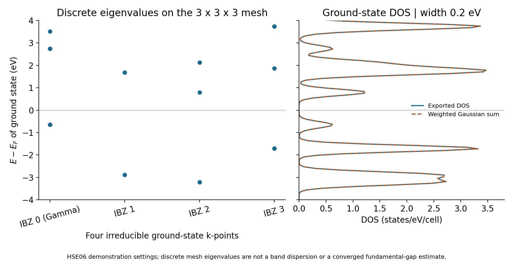

Silicon: HSE06 ground state and DOS (GPAW)
==========================================

.. literalinclude:: ../../../nanoworks/examples/Si-with-HSE/Si-with-HSE.py
   :language: python
   :lines: 5-
   :caption: Si-with-HSE.py

:download:`Download Si-with-HSE.py <../../../nanoworks/examples/Si-with-HSE/Si-with-HSE.py>`.

Run
---

Requires GPAW and its PAW datasets.

.. code-block:: bash

   cd ~/.nanoworks/examples/Si-with-HSE
   dftsolve -p 4 -i Si-with-HSE.py -g Si_mp-149_primitive.cif

Results
-------

Results are in ``Si_mp-149_primitive/``. The DOS is reconstructed from the
uniform-mesh HSE06 ground state. Its 0.2 eV Gaussian width smooths narrow
features; it does not set the electronic occupations. This coarse example
is not a converged silicon gap prediction. The unsupported legacy GPAW
hybrid band stage is omitted.

   Recorded example output.

These example settings need convergence tests before quantitative use.

:doc:`Detailed recorded results <../validation/si-hse-gpaw-dos>`.
