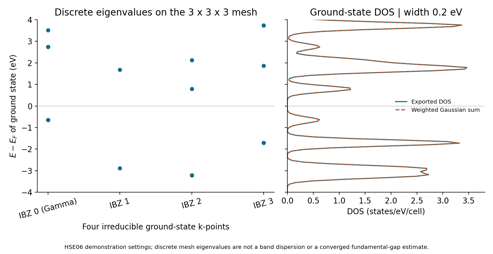
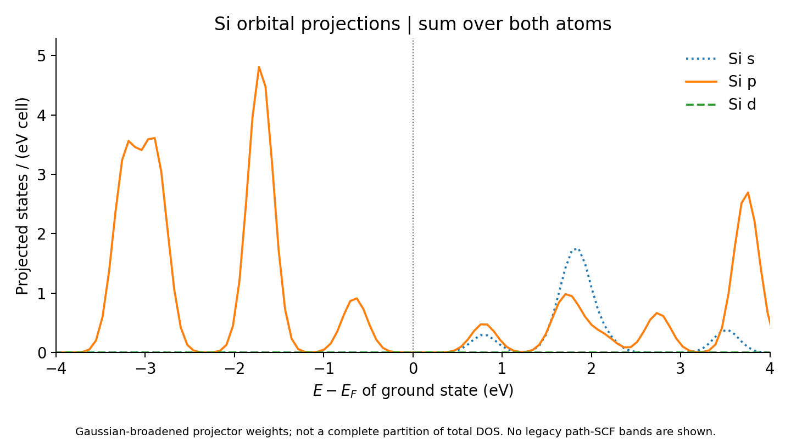

Silicon with HSE06: ground-state DOS and a hybrid-band caveat
=============================================================

.. note::

   These settings are chosen to demonstrate the Nanoworks workflow with a
   short runtime. The numerical results are illustrative; quantitative
   materials predictions require appropriate convergence tests and validation
   of the physical model.

This tutorial uses the ground-state and DOS records from ``GPAW/si-hse`` in
``example-runs-Va5NDWGi``. It shows how a hybrid DOS uses the saved ground-state
eigenvalues and how to distinguish occupation smearing from DOS broadening.
The legacy band-path stage in this recorded run has a separate methodological
problem, described below, and is deliberately excluded from the commands.

Run the ground-state and DOS stages
-----------------------------------

Use Nanoworks with GPAW and its PAW datasets installed. If necessary, install
the examples following :ref:`tutorial-examples-setup`, then run:

.. code-block:: console

   $ cd ~/.nanoworks/examples/Si-with-HSE
   $ dftsolve -E GPAW -p 8 -i Si-with-HSE.py -g Si_mp-149_primitive.cif -s Band_calc=False --check
   $ dftsolve -E GPAW -p 8 -i Si-with-HSE.py -g Si_mp-149_primitive.cif -s Band_calc=False

Adapt the process count to your computer. The shared input enables bands by
default; the explicit override excludes that stage for this GPAW tutorial
without editing the original input. This caveat concerns the inspected GPAW
hybrid path and does not establish a failure of the separate QE hybrid path.
Outputs use ``Si_mp-149_primitive/`` and the same filename prefix.

The recorded input and starting CIF match the inspected repository files
byte for byte. The run used Nanoworks 27.2.0rc0, GPAW 26.7.0, ASE 3.29.0 and
eight processes on 28 October 2026. Its exact run source commit was not
recorded. No new DFT calculation was performed for this review.

Read the settings
-----------------

.. list-table:: Ground-state and DOS settings
   :header-rows: 1
   :widths: 45 55

   * - Quantity
     - Value
   * - Structure
     - Two-atom diamond Si primitive cell; fixed input geometry
   * - Functional and representation
     - HSE06, legacy GPAW plane-wave hybrid backend, 400 eV
   * - Ground-state mesh
     - Gamma-centred 3 x 3 x 3; four irreducible points
   * - SCF profile
     - ``SCF_accuracy='loose'``; occupied bands are the convergence target
   * - Ground occupations
     - Fermi–Dirac, width 0.2 eV
   * - DOS
     - Gaussian broadening, ``DOS_width=0.2`` eV; 301 points
   * - Band count / electron count
     - Eight bands / eight valence electrons
   * - Other stages
     - No relaxation, spin polarization, SOC, density export or optics

The saved GPW confirms SCF convergence; the ground log reports 12 iterations.
The loose profile and occupied-band target do not establish convergence of
all empty-state eigenvalues. The initial and final CIFs describe the same geometry within numerical
precision (their text formatting differs), consistent with
``Geo_optim=False``. The Si PBE PAW setup has four valence and ten core
electrons, with identifier ``ee77bee481871cc2cb65ac61239ccafa``. A PBE-labelled
PAW dataset does not by itself mean the requested hybrid XC was replaced:
the saved calculator parameters explicitly identify HSE06.

Verify the DOS from the saved eigenvalues
-----------------------------------------

For hybrids, this Nanoworks DOS path reads the saved ground-state eigenvalues;
it does not run a new fixed-density DOS mesh. The recorded log states this
explicitly. Changing a DOS mesh setting alone therefore does not demonstrate
denser hybrid sampling: the ground-state calculation must supply the desired
sampling and enough appropriately converged empty bands.

   Left: discrete eigenvalues, with no lines implying a band path. Right:
   the original total DOS and a Gaussian sum using the original GPW energies
   and k-point weights. Both use the ground-state Fermi reference.

The four irreducible weights are 1/27, 12/27, 6/27 and 8/27; they sum to one.
Including the spin degeneracy, the total DOS is reproduced by

.. math::

   D(E)=2\sum_{kn}w_k\frac{\exp[-((E-(\epsilon_{kn}-E_F))/\sigma)^2]}
                              {\sigma\sqrt{\pi}},\qquad\sigma=0.2\ \mathrm{eV}.

The maximum difference from the exported DOS is below
2e-14 states/(eV cell). The occupation-weighted GPW count is eight electrons.
The Gaussian width here controls the plotted spectral broadening; the
separate Fermi–Dirac width controls ground-state occupations. Both happen
to have the same numerical value in this input.

The ground mesh has a sampled occupied/unoccupied separation of
1.445862 eV. It is not established as a converged fundamental gap. The
finite-window DOS integral is 15.66330 states/cell, compared with the
full Gaussian spectral weight of 16 for eight spin-degenerate bands.
This unweighted integral is not the eight-electron occupation count.
Gaussian tails extend beyond the exported energy window and into the gap;
a small nonzero broadened DOS near Ef is not evidence of metallicity.

Inspect the orbital character
-----------------------------

   Projections are summed over both atoms and expressed per primitive cell.
   They describe orbital weights, not a complete partition of total DOS.

The original atom-resolved table contains two groups of 301 rows. Their
sum agrees with the combined PDOS, and the p/d/total component identities
hold within numerical precision. All exported DOS and projection values
are finite and nonnegative.

Why the recorded band stage is excluded
---------------------------------------

The recorded legacy band stage replaced the uniform mesh with the 61 points
on ``GXWKGLUWLK``, gave them equal weights of 1/61, and ran ten new SCF
iterations. Its Fermi level changed from approximately 5.43236 to 5.28301 eV.
The inspected ``prepare_band_calc`` branch loads the saved calculator with
the new k-points and runs it again; it does not preserve the original occupied
subspace as a fixed hybrid Hamiltonian for path evaluation.

This is a different self-consistent calculation on a line-point set, not
the band dispersion of the original uniform-mesh ground state. Consequently
its 1.552600 eV path separation must not be combined with the ground-state
DOS as a consistent HSE06 band/DOS result. Tightening SCF tolerances alone
does not repair that change of sampling and electronic state. Referencing
its eigenvalues to the old ground-state Ef does not align the two potentials.

The `GPAW hybrid-band documentation
<https://gpaw.readthedocs.io/tutorialsexercises/electronic/bandstructures/bandstructures.html#non-self-consistent-and-self-consistent-hse06>`_
describes a distinct hybrid eigenvalue evaluation based on the ground-state
calculation. Integrating and validating a suitable supported route in
Nanoworks remains follow-up work. No replacement band calculation is claimed
here, and the recorded path-SCF band figure is not presented as a material
result. This methodological caveat is separate from the small example's
ordinary parameter-convergence limitations.

Reference data
--------------

:download:`Download the ground-state DOS reference package <../_static/examples/si-hse-gpaw-dos-reference.zip>`.
It preserves the active input, starting/final CIFs and original DOS/PDOS
tables, together with a derived table of ground-state eigenvalues, weights
and occupations, two figures, checks and SHA256SUMS. The original input
still has ``Band_calc=True``; use the override in the commands above.

The optional ``plot_si_hse.py`` script reproduces the figures and checks
using NumPy 2 or newer and Matplotlib. ``extract_ground.py`` can verify the
source GPW hash and regenerate the eigenvalue table using ASE, without running
GPAW. The GPW itself remains in the original run; neither it nor the invalid
path-SCF band outputs are bundled as reference band data.
