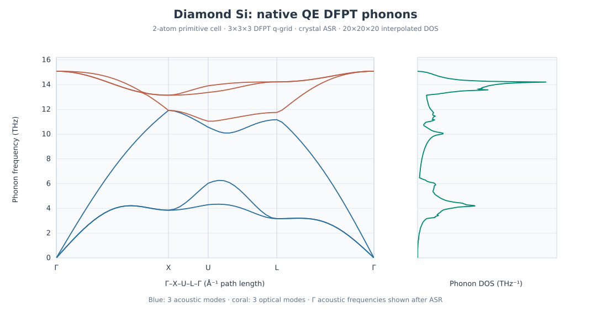

Silicon phonons with native Quantum ESPRESSO DFPT
==================================================

.. note::

   This example explains the QE density-functional perturbation
   theory (DFPT) phonon workflow. The small numerical settings are
   intended for learning, not as converged material predictions.

This tutorial complements :doc:`si-gpaw-phonons`, which
uses GPAW finite-displacement forces and Phonopy. The same
bundled input also supports native QE DFPT, which uses
``ph.x``, ``q2r.x`` and ``matdyn.x``. A quantitative cross-engine comparison requires equivalent physical
models and independently converged electronic and phonon settings.

Prepare the example
-------------------

If needed, install the examples with
``nanoworks --install-examples`` and configure QE
(``pw.x``, ``ph.x``, ``q2r.x`` and ``matdyn.x``)
with suitable pseudopotentials.

.. code-block:: console

   $ cd ~/.nanoworks/examples/Si-phonon
   $ dftsolve -E QE -p 4 -i Si-phonon.py -g Si_mp-149_primitive.cif --check
   $ dftsolve -E QE -p 4 -i Si-phonon.py -g Si_mp-149_primitive.cif

The input defaults to ``Engine='GPAW'``, hence ``-E QE``.
Adapt ``-p`` to your available CPU resources. ``--check`` verifies
input preparation and prerequisites without running DFT.

Understand the DFPT stages
--------------------------

The two-atom diamond-Si example uses PBE,
a 500 eV wavefunction cutoff (fourfold density cutoff),
an 11 x 11 x 11 Gamma-centered electronic mesh,
0.01 eV Fermi-Dirac smearing and the
``SCF_accuracy='very-tight'`` preset. The
QuasiNewton/BFGS variable-cell optimization had
a 0.0001 eV/angstrom force target.

.. list-table:: Native QE stages
   :header-rows: 1

   * - Stage
     - Example settings and purpose
   * - ``pw.x``
     - Variable-cell relaxation, 11 x 11 x 11 electronic mesh
   * - ``ph.x``
     - 3 x 3 x 3 DFPT grid, ``tr2_ph=1e-12``, six inequivalent q-points
   * - ``q2r.x``
     - Transform all 27 q-grid points to real-space force constants
   * - ``matdyn.x`` bands
     - ``asr='crystal'`` and 61 points along Gamma-X-U-L-Gamma
   * - ``matdyn.x`` DOS
     - 20 x 20 x 20 interpolation mesh; 505 saved frequency samples
   * - Thermal analysis
     - Disabled in this input

For QE, ``Phonon_supercell=np.diag([3,3,3])`` defines
the DFPT q-grid, not a displaced 54-atom supercell.
The generated DOS deck uses 20 x 20 x 20; the
input did not explicitly select ``Phonon_qpts_x/y/z``.
``Phonon_PW_cutoff``, ``Phonon_kpts_x/y/z``
and ``Phonon_displacement`` are GPAW-only controls
ignored by native QE DFPT. The QE phonon stage
reuses the ground-state cutoff and k-point mesh.

The ``q2r.x`` output should confirm that all 27 q-grid points were
assembled and the Fourier transform completed successfully.

Inspect the relaxed cell
------------------------

The final rhombohedral primitive edge is
**3.86697465 angstrom**, with 60-degree angles,
equivalent to cubic diamond Si
**a=5.46872800 angstrom**. The CIF serializer
labels the representation P1, despite the
diamond-like coordinates. Its final SCF converged;
the maximum printed stress deviation is
**0.05 kbar** at zero target pressure, and
atomic force components are approximately
1e-8 Ry/Bohr. The SCF does warn that its
force correction is relatively large;
tight convergence remains important.

Acoustic versus optical modes
-----------------------------

   Example 61-point band data and 505-point total DOS, plotted without
   smoothing or further interpolation.

The band path contains **61 points in total**,
not per segment. High-symmetry indices are
Gamma=0, X=21, U=28, L=41 and Gamma=60.
The two-atom primitive cell has six branches,
three acoustic and three optical.

.. list-table:: Selected frequencies (THz), ascending
   :header-rows: 1

   * - Point
     - Six frequencies
   * - Gamma
     - 0, 0, 0, 15.088440, 15.088440, 15.088446
   * - X
     - 3.848343, 3.859429, 11.919409, 11.920719, 13.144958, 13.152228
   * - U
     - 4.297945, 6.029528, 10.562273, 11.046552, 13.374020, 13.910667
   * - L
     - 3.167904, 3.170974, 11.168315, 11.754137, 14.222574, 14.224370

The highest sampled frequency is
**15.08844649 THz** at Gamma.

.. important::

   The *raw* ``ph.x`` Gamma dynamical matrix had
   acoustic frequencies **-0.251776, -0.251776
   and -0.234469 THz**. They become precisely
   zero in the saved band because ``matdyn.x``
   enforces ``asr='crystal'``. Thus, the
   plot's zero Gamma values are ASR-corrected,
   not a demonstration that the uncorrected
   dynamical matrix is converged.

No negative mode appears on the ASR-corrected sampled
path. This cannot establish stability over all
wave vectors or fully converged phonons.

Check DOS normalization and reproducibility
------------------------------------------

The example total/atom-projected DOS table has 505 rows and four columns. Its total DOS integrates to
**5.99279538 modes per primitive cell**,
close to the six required modes. Two symmetry-equivalent
Si atom projections give nearly equal contributions.

The downloadable two-column table provides frequency and total DOS
at the precision of the original export. Verify the integrated mode
count before using a DOS curve for comparisons.

Validate the phonon calculation
-------------------------------

Converge the relaxed cell, residual stress, electronic cutoff, k-point
grid and metallic occupation settings (where applicable) before
calculating phonons. Then vary the **DFPT q-grid** and interpolation
mesh separately: a denser phonon DOS grid cannot compensate for
inaccurate dynamical matrices.

Inspect raw acoustic frequencies at Gamma before applying the
acoustic sum rule. A corrected zero is a useful consistency
requirement but not evidence of force-constant convergence.
Check the total DOS integral against :math:`3N` modes per primitive
cell, then examine branch convergence along the same reciprocal
path and confirm the absence of spurious imaginary frequencies.

Download and inspect numerical tables
-------------------------------------

:download:`Phonon band table <../_static/examples/si-qe-dfpt-band-thz.dat>` |
:download:`Total DOS <../_static/examples/si-qe-dfpt-dos-total.dat>` |
:download:`Final cell CIF <../_static/examples/si-qe-dfpt-final.cif>`.

.. code-block:: python

   import numpy as np

   band = np.loadtxt("si-qe-dfpt-band-thz.dat", skiprows=1)
   dos = np.loadtxt("si-qe-dfpt-dos-total.dat")

   assert band.shape == (61, 10)
   assert dos.shape == (505, 2)
   assert np.max(np.abs(band[[0, 60], 4:7])) < 1e-8

   count = np.sum(np.diff(dos[:, 0]) *
                  (dos[:-1, 1] + dos[1:, 1]) / 2)
   print("Modes per primitive cell:", count)

The Si input does not enable harmonic thermodynamics. For heat capacity
and vibrational free-energy calculations, see :doc:`al-qe-dfpt-phonons`.
The downloadable tables can be rechecked without rerunning QE.
