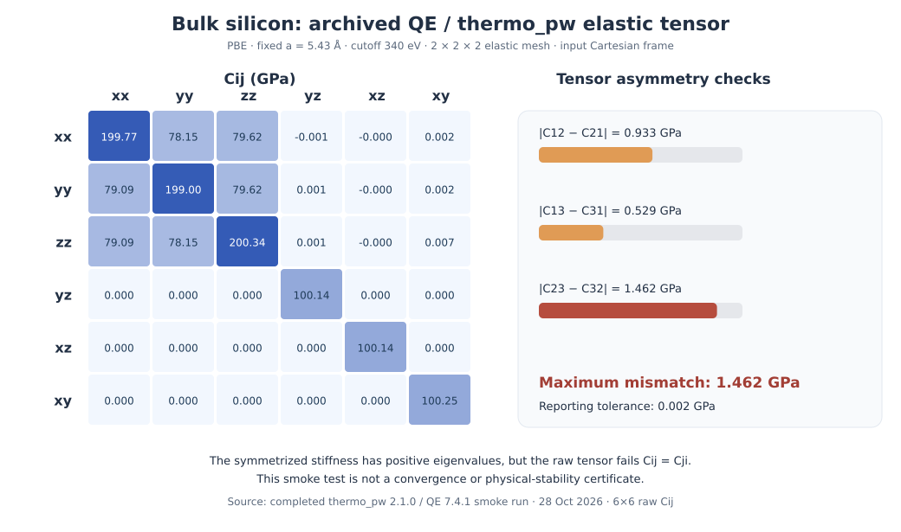

Silicon: elastic constants (QE and thermo_pw)
=============================================

.. literalinclude:: ../../../nanoworks/examples/Si-QE-elastic/Si-QE-elastic-smoke.py
   :language: python
   :lines: 5-
   :caption: Si-QE-elastic-smoke.py

:download:`Download Si-QE-elastic-smoke.py <../../../nanoworks/examples/Si-QE-elastic/Si-QE-elastic-smoke.py>`.

Run
---

Requires QE, thermo_pw and the managed pseudopotentials.

.. code-block:: bash

   cd ~/.nanoworks/examples/Si-QE-elastic
   dftsolve -p 4 -i Si-QE-elastic-smoke.py

Results
-------

.. note::

   This example is a qualitative demonstration. For reliable quantitative
   results, optimize the structure where appropriate and converge the
   numerical settings.

Results are in ``Si-QE-elastic-smoke-results/``. Read the 6 x 6 tensor in
GPa and its bulk and shear moduli. Compare Cij and Cji: the archived coarse
calculation has a maximum 1.462 GPa mismatch, so it is not a converged tensor.
Positive stiffness eigenvalues alone do not remove that numerical problem.
Increase the elastic mesh independently with ``Elastic_kpts_x/y/z`` or
``Elastic_kpts_density`` and repeat the convergence study.

   Recorded example output.

:doc:`Detailed recorded results <../validation/si-qe-elastic-smoke>`.
