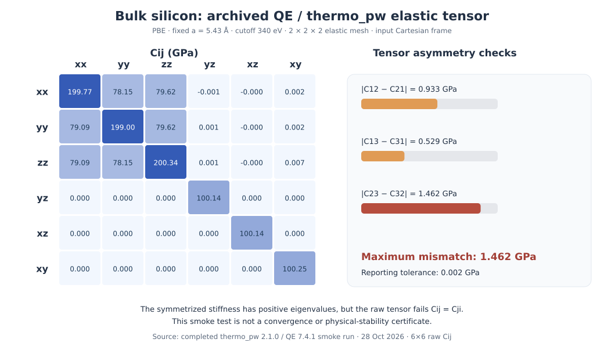

Silicon elasticity with QE and thermo_pw: a convergence-quality audit
=========================================================================

.. note::

   This troubleshooting example explains how to validate elastic tensors
   generated with QE and thermo_pw. The small numerical settings are
   not converged elastic constants; symmetry, numerical stability
   and postprocessing require independent checks.

The purpose is to learn how Nanoworks calls ``thermo_pw.x``, how to
read a full elastic tensor, and why a successful run and positive
stiffness eigenvalues are not sufficient checks on the elastic
response of a material.

Run the installed example
-------------------------

Install the bundled examples once, if needed
(:ref:`tutorial-examples-setup`), and activate an environment with
Nanoworks, Quantum ESPRESSO 7.4.1, thermo_pw 2.1.0 and the managed QE
pseudopotentials. Nanoworks does not silently install QE.

.. code-block:: console

   $ nanoworks --install-examples
   $ cd ~/.nanoworks/examples/Si-QE-elastic
   $ dftsolve -E QE -p 4 -i Si-QE-elastic-smoke.py --check
   $ dftsolve -E QE -p 4 -i Si-QE-elastic-smoke.py --dry-run
   $ dftsolve -E QE -p 4 -i Si-QE-elastic-smoke.py

The check and dry-run steps do not run strained SCFs. Review the
generated ``elastic.in``, ``thermo_control`` and execution deck
before starting the full example. The MPI process count can be
changed for the local workstation.

Read the physical and numerical input
-------------------------------------

The input uses a **two-atom primitive diamond Si** cell generated
by ASE from a cubic reference parameter ``a = 5.43`` angstrom,
without geometric relaxation. The workflow uses:

.. list-table:: Archived input choices
   :header-rows: 1
   :widths: 40 60

   * - Variable
     - Recorded value
   * - Engine and elastic program
     - QE 7.4.1, thermo_pw 2.1.0
   * - XC functional
     - PBE
   * - Wavefunction cutoff
     - 340 eV (about 25 Ry)
   * - Charge-density cutoff
     - Four times wavefunction cutoff
   * - Electronic k-point mesh
     - Gamma-centered 2 x 2 x 2
   * - Occupation
     - Fixed
   * - Elastic geometry
     - Three-dimensional, input Cartesian axes
   * - Ground and geometric relaxation
     - Both disabled; thermo_pw performs the strained SCFs
   * - Tensor order
     - xx, yy, zz, yz, xz, xy (6 x 6)
   * - Numerical purpose
     - Fast execution check, **not** quantitative convergence

The generated ``thermo_control`` selects the ``standard``
strain-stress workflow with ``continue_zero_ibrav=.true.``.
It preserves the supplied ``ibrav=0`` Cartesian setting
instead of using an automatically reoriented conventional cell.
The completed thermo_pw log records **24 SCF calls**. A
``gnuplot: not found`` warning appears near the end of the
historical thermo_pw log, but the tensor and moduli were written
and the run ended with ``JOB DONE.``. Nanoworks does not require
the missing gnuplot plots to read the numerical tensor.

Inspect the recorded tensor
---------------------------

   Original thermo_pw stiffness, expressed in GPa, with selected
   ``Cij-Cji`` differences. The panel emphasizes tensor
   consistency rather than its agreement with experimental Si.

The recorded diagonal and off-diagonal elements include:

.. list-table:: Selected stiffness elements (GPa)
   :header-rows: 1
   :widths: 25 30 45

   * - Element
     - Raw value
     - Interpretation
   * - C11, C22, C33
     - 199.7705, 198.9970, 200.3388
     - These should approach equivalent values for cubic Si
   * - C12, C21
     - 78.1537, 79.0862
     - Major-symmetry mismatch of 0.9326 GPa
   * - C23, C32
     - 79.6156, 78.1537
     - Largest mismatch: 1.4620 GPa
   * - C44, C55, C66
     - 100.1433, 100.1403, 100.2523
     - Shear constants in the reported Voigt order

At true zero-stress equilibrium, the elastic Hessian satisfies
the major symmetry ``Cij = Cji``. The raw tensor has a maximum
difference of **1.461961 GPa**, whereas Nanoworks's reporting
tolerance for this run is **0.002003 GPa**. The asymmetry is
approximately **730 times** that tolerance. It must not be
silently removed from the source tensor.

The arithmetic cubic-family averages are approximately
``C11 = 199.7021``, ``C12 = 78.9518``, and
``C44 = 100.1787`` GPa. These are descriptive averages,
**not** a symmetry-constrained refit or a recommended Si
reference dataset. A different basis, pseudopotential, strain
procedure or convergence quality can also change the numbers.

Distinguish mathematical positivity from physical stability
-----------------------------------------------------------

The symmetrized matrix ``(C+C.T)/2`` has six positive
eigenvalues, from **100.1403** to **357.6088 GPa**. The
*historical* result summary therefore contains the line
``Mechanically stable: yes``, and it separately reports
``Tensor symmetric within tolerance: no``.

Current Nanoworks continues to report the mathematical
positive-definite check but also marks the **physical stability
assessment as inconclusive** when the input tensor fails major
symmetry. The new diagnostic does not alter the original
thermo_pw tensor or archived run.

The source-derived bulk and shear moduli provide another warning:
the reported Reuss bulk modulus (**119.5516 GPa**) is greater
than the Voigt bulk modulus (**119.3196 GPa**). The usual
Voigt upper/Reuss lower ordering is expected for a physically
consistent, positive-definite elastic response, so the
reversed ordering is an additional reason to treat this
smoke run as numerically unqualified.

.. list-table:: Thermo_pw derived isotropic averages
   :header-rows: 1
   :widths: 24 23 23 30

   * - Property
     - Voigt
     - Reuss
     - Hill
   * - Bulk modulus (GPa)
     - 119.3196
     - 119.5516
     - 119.4356
   * - Shear modulus (GPa)
     - 84.2220
     - 79.2531
     - 81.7375
   * - Young modulus (GPa)
     - 204.5407
     - 194.7293
     - 199.6350
   * - Poisson ratio
     - 0.21430
     - 0.22853
     - 0.22120

These are archived thermo_pw outputs. The fact that the calculation
ended normally does not validate the Hill values against a
well-converged stress-strain response or experiment.

Use the original data
---------------------

These files are copied from the completed run, without altering
the underlying thermo_pw numbers:

:download:`Original thermo_pw summary <../_static/examples/si-qe-elastic-allresults.txt>` |
:download:`Canonical stiffness and compliance record <../_static/examples/si-qe-elastic-canonical.dat>` |
:download:`Cij table in GPa <../_static/examples/si-qe-elastic-tensor-gpa.dat>`.

The canonical file contains **36 stiffness values in kbar**,
followed by **36 compliance values in 1/Mbar**, in row-major order.
The GPa table is a convenience conversion of the first 36 values
by dividing by ten. It uses a unit-bearing comment header.
Its original stiffness source has SHA-256:

.. code-block:: text

   b13d4a306bd2728e01f470cefe1e6069c7496a955c9e44e58dd60f5c1d56e646

The data can be independently audited with NumPy:

.. code-block:: python

   import numpy as np

   c = np.loadtxt("si-qe-elastic-tensor-gpa.dat")
   assert c.shape == (6, 6)

   asymmetry = np.abs(c - c.T)
   c_symmetric = (c + c.T) / 2
   eigenvalues = np.linalg.eigvalsh(c_symmetric)

   print("Maximum asymmetry (GPa):", asymmetry.max())
   print("Symmetrized eigenvalues (GPa):", eigenvalues)
   print("C11 family average (GPa):", np.diag(c)[:3].mean())
   print("C44 family average (GPa):", np.diag(c)[3:].mean())

   assert np.isclose(asymmetry.max(), 1.46196117, atol=1e-7)
   assert eigenvalues.min() > 0

This final assertion verifies positive definiteness only. It
does **not** show that the elastic tensor is sufficiently
symmetric or physically converged.

What to do for a research-quality Si tensor
-------------------------------------------

Start by optimizing the lattice parameter and checking residual
stress; retain a consistent cell basis. Increase the plane-wave
cutoff, charge-density cutoff and k-point resolution, and
converge the strained-SCF thresholds. Repeat the stress-strain
fit with different strain amplitudes. Check raw major symmetry
and cubic equivalence before using the tensor for mechanical
stability, derived moduli or comparison with experiment.

This walkthrough is intentionally separate from
:doc:`tic-gpaw`, which audits an ASE/GPAW deformation-fit
workflow. Both tutorials emphasize why tensor basis, fit
quality and numerical validation are as important as obtaining
a complete 6 x 6 matrix.
