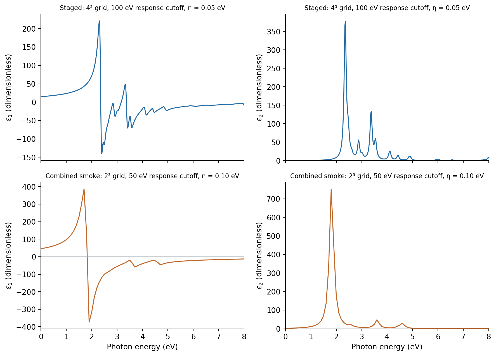

.. _silicon-gpaw-bse:

Silicon: excitonic BSE response (GPAW)
======================================

.. literalinclude:: ../../../nanoworks/examples/Si-2atoms-optical/Si-Step3-optical-BSE.py
   :language: python
   :lines: 5-
   :caption: Si-Step3-optical-BSE.py

:download:`Download Si-Step3-optical-BSE.py <../../../nanoworks/examples/Si-2atoms-optical/Si-Step3-optical-BSE.py>`.

**Companion input: Si-Step1-ground_dos_band.py**

.. literalinclude:: ../../../nanoworks/examples/Si-2atoms-optical/Si-Step1-ground_dos_band.py
   :language: python
   :lines: 5-
   :caption: Si-Step1-ground_dos_band.py

:download:`Download Si-Step1-ground_dos_band.py <../../../nanoworks/examples/Si-2atoms-optical/Si-Step1-ground_dos_band.py>`.

Run
---

Requires GPAW and its PAW datasets.

Run the ground input first, then reuse its saved state for optics.

.. code-block:: bash

   cd ~/.nanoworks/examples/Si-2atoms-optical
   dftsolve -E GPAW -p 4 -i Si-Step1-ground_dos_band.py -g Si_mp-149_primitive_Example.cif
   dftsolve -E GPAW -p 4 -i Si-Step3-optical-BSE.py -g Si_mp-149_primitive_Example.cif

Results
-------

.. note::

   This example is a qualitative demonstration. For reliable quantitative
   results, optimize the structure where appropriate and converge the
   numerical settings.

Results are in ``Si-results/``. Read the real and imaginary dielectric
functions against photon energy. The imaginary part marks optical absorption;
its peaks correspond to transitions, not the DOS itself. BSE includes
electron-hole interactions. A difference from RPA should be assessed using
matched geometry, meshes, band windows and broadening.

   Recorded example output.

:doc:`Detailed recorded results <../validation/silicon-gpaw-bse>`.
