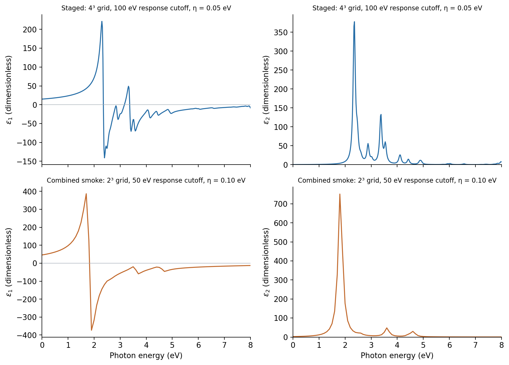
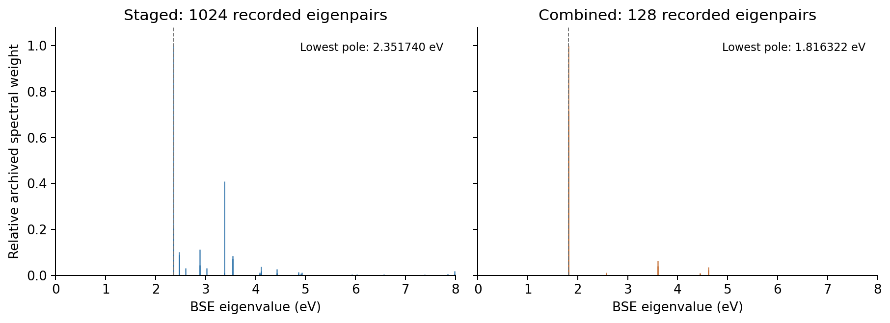

.. _silicon-gpaw-bse:

Silicon BSE optics with GPAW: spectra, poles and sum-rule checks
================================================================

.. note::

   These settings demonstrate the Nanoworks workflow with a short runtime.
   The numerical results are illustrative; quantitative predictions require
   convergence tests and validation of the physical model.

This tutorial follows the completed BSE stage in
``GPAW/silicon-optical-stages`` and the separate
``GPAW/silicon-combined-bse`` case from ``example-runs-Va5NDWGi``.
It connects a saved electronic state, selected valence/conduction bands,
BSE eigenvalues and weights, the dielectric spectrum and its sum-rule checks.
See :doc:`silicon-gpaw-rpa` for the earlier RPA exercise.

Run the staged or combined example
----------------------------------

Activate an environment with Nanoworks, GPAW and its PAW datasets; see
:doc:`../installation`. Use the installed example directory. If needed,
run ``nanoworks --install-examples`` as described in
:ref:`tutorial-examples-setup`.

For the staged calculation:

.. code-block:: console

   $ cd ~/.nanoworks/examples/Si-2atoms-optical
   $ dftsolve -E GPAW -p 8 -i Si-Step1-ground_dos_band.py -g Si_mp-149_primitive_Example.cif --check
   $ dftsolve -E GPAW -p 8 -i Si-Step1-ground_dos_band.py -g Si_mp-149_primitive_Example.cif
   $ dftsolve -E GPAW -p 8 -i Si-Step3-optical-BSE.py -g Si_mp-149_primitive_Example.cif --check
   $ dftsolve -E GPAW -p 8 -i Si-Step3-optical-BSE.py -g Si_mp-149_primitive_Example.cif

Step 3 reads the ground-state file in ``Si-results``. Despite its name, it
does not require the Step 2 RPA spectrum; the successful Step 1 ground state
is the prerequisite. If Step 1 has already completed with matching settings,
proceed to Step 3 without rerunning it.

Alternatively, from the same directory:

.. code-block:: console

   $ dftsolve -E GPAW -p 8 -i Si-Combined-BSE-smoke.py -g Si_mp-149_primitive_Example.cif --check
   $ dftsolve -E GPAW -p 8 -i Si-Combined-BSE-smoke.py -g Si_mp-149_primitive_Example.cif

The combined input runs ground state and BSE into ``Si-BSE-smoke-results``.
The recorded wrapper shows an electronic process followed by a fresh optical
process. It does not request DOS, band or density exports. Adjust ``-p`` to
your machine; no memory benchmark for larger BSE matrices is implied here.

Understand the selected BSE basis
---------------------------------

The two Si atoms supply eight valence electrons. Both inputs select nominal
spin-paired valence bands 0–3 and conduction bands 4–7, using zero-based indices:

.. code-block:: python

   Opt_BSE_valence = range(0, 4)
   Opt_BSE_conduction = range(4, 8)
   Opt_num_of_bands = 8
   Opt_shift_en = 0.0

``Opt_num_of_bands`` also supplies the screening band count in this workflow.
A small transition window does not demonstrate that eight bands adequately
converge the screened interaction. The windows and screening band count must
both be examined before interpreting excitation energies.

The logs identify an optical q = 0 BSE calculation in the Tamm–Dancoff
approximation, without spinors or Coulomb truncation and with spherical Gamma
integration. The staged basis has 64 x 4 x 4 = 1024 pair orbitals; the combined
basis has 8 x 4 x 4 = 128. These counts use full k-point sets, rather than
only the 8 or 3 irreducible representatives. Neither log reports eliminated
pair orbitals; the saved eigenvalue tables contain exactly 1024 and 128 rows.

For the method and the distinction between screening and transition bands,
see the `GPAW BSE silicon tutorial
<https://gpaw.readthedocs.io/tutorialsexercises/opticalresponse/bse_tutorial/bse_tutorial.html#absorption-spectrum-of-bulk-silicon>`_.

Recorded settings
-----------------

The three active Python inputs and both starting CIF copies match the
bundled examples byte for byte. Both runs retain the same fixed two-atom
bulk Si cell: edges 3.86697465 angstrom, angles 60 degrees and volume
40.888292745 cubic angstrom per primitive cell. Geometry optimization is off.
Final CIF serialization differs, while its cell and positions are unchanged
within numerical precision.

The 28 October 2026 runs used Nanoworks 27.2.0rc0, GPAW 26.7.0, ASE 3.29.0 and
eight processes. Both use PBE without spin polarization or SOC and a
Fermi–Dirac occupation width of 0.05 eV. The Si PBE setup identifier is
``ee77bee481871cc2cb65ac61239ccafa``. The exact run commit and PAW dataset
package release were not recorded.

.. list-table:: Recorded settings that differ
   :header-rows: 1
   :widths: 42 29 29

   * - Quantity
     - Staged BSE
     - Combined BSE smoke
   * - Ground-state plane-wave cutoff
     - 340 eV
     - 250 eV
   * - Ground / optical k-point mesh
     - Gamma-centred 4 x 4 x 4
     - Gamma-centred 2 x 2 x 2
   * - BSE response cutoff
     - 100 eV
     - 50 eV
   * - Broadening ``Opt_eta``
     - 0.05 eV
     - 0.10 eV
   * - Photon-energy range
     - 0–20 eV
     - 0–10 eV
   * - Number of samples / spacing
     - 1001 / 0.02 eV
     - 101 / 0.10 eV

Both have eight screening bands, four valence/four conduction bands and zero
scissors shift. Unlike GPAW RPA's nonlinear grid, BSE here uses a linear grid
from ``Opt_min_en`` to ``Opt_max_en`` with ``Opt_num_of_data`` points.
``Opt_shift_en`` changes transition energies in the Hamiltonian; it does not
translate the exported photon-energy axis after the calculation.

Several parameters change together between these two cases. Their spectral
differences cannot isolate the effect of a single convergence parameter or
of staged versus combined execution.

Inspect the dielectric spectra
------------------------------

   Original sampled spectra, with straight lines joining the saved points.
   No smoothing, energy shift or amplitude normalization was applied.
   Each row uses its own vertical scale and different numerical settings.

.. list-table:: Recorded excitation and spectral quantities
   :header-rows: 1

   * - Quantity
     - Staged
     - Combined smoke
   * - Lowest BSE eigenvalue (eV)
     - 2.351740
     - 1.816322
   * - Largest epsilon2 sample: energy (eV)
     - 2.36
     - 1.80
   * - Largest epsilon2 sample: height
     - 377.937745
     - 751.351375
   * - epsilon2 at 0 eV
     - 0.262335
     - 2.395627

A discrete Hamiltonian eigenvalue and the maximum of a broadened, sampled
spectrum are different quantities. For example, the combined table's
0.10 eV spacing places its maximum at 1.80 eV, while the first poles lie near
1.8163 eV. A plotted peak position therefore depends on both broadening and
frequency sampling.

The archived finite-broadening spectra also have nonzero epsilon2 at zero
energy. These values must not be interpreted as a measured dc response or
as evidence that Si is metallic. The exported absorption coefficient is
zero at that point because its conversion contains an explicit photon-energy
factor. None of these zero-energy table values is a converged static
material constant.

Read the eigenvalue and weight file
-----------------------------------

``BSE_eig.dat`` has a comment header, then columns for the eigenpair index,
energy in eV and the archived GPAW spectral weight. The numerical weights
are retained in their original convention; they are not probabilities.
All saved energies are positive, all weights are finite and nonnegative,
and the indices run consecutively from zero. The energy ranges are
2.351740–17.776597 eV for staged and 1.816322–17.777111 eV for combined.
The latter includes eigenvalues above its 10 eV plotted frequency limit.

   Weights divided by the largest weight in each case, solely for display.
   Only 0–8 eV is shown; the archive retains all eigenpairs. The spectra in
   the preceding figure retain their original amplitudes.

Near-degenerate states can share spectral weight, so individual members
should not be ranked as distinct physical excitons solely by their printed
weight. These files do not contain exciton eigenvectors; a spatial exciton
wavefunction or electron–hole localization cannot be reconstructed from them.
Only one BSE optical response was exported per case, so this review does not
establish x/y/z agreement for BSE.

.. important::

   Neither the lowest pole nor an RPA/BSE peak difference is an exciton
   binding energy. These runs use PBE energies and ``Opt_shift_en=0``;
   no GW quasiparticle energies were supplied. A binding-energy analysis
   requires a consistent continuum reference and converged screening,
   transition basis and k-point sampling. These coarse spectra do not
   provide that result, nor a phonon-assisted indirect absorption onset.

Keep the sum-rule diagnostics
-----------------------------

Both BSE logs contain a completed diagonalization and an f-sum check:

.. list-table:: Archived electron-equivalent sum-rule diagnostics
   :header-rows: 1

   * - Quantity
     - Staged
     - Combined smoke
   * - Valence-electron target
     - 8
     - 8
   * - Frequency integral
     - 7.210555
     - 10.650007
   * - Logged sum of weights
     - 7.190621
     - 10.864520
   * - Frequency-integral difference from target
     - -9.87 percent
     - +33.13 percent

The plotting script independently reproduces the frequency-integral entries
within ``1.1e-6`` using the exported epsilon2 and the cell volume. In atomic
units the diagnostic is

.. math::

   N_{\mathrm{eff}} = \frac{\Omega}{2\pi^2}
       \int_0^{\omega_{\max}} \omega\,\epsilon_2(\omega)\,d\omega.

Here the script converts the volume to bohr cubed and photon energy to
Hartree before comparing to the log. It integrates only the archived
frequency window. The logged weight sums are preserved as separate
diagnostics; they are not obtained by simply adding the raw third column
of ``BSE_eig.dat`` without its normalization convention.

These results do not show agreement with the eight-electron target.
Transition-window, screening, spectral-range and broadening limitations
have not been isolated by this review. In particular, a successful exit code
and a smooth line do not erase the discrepancy. The spectra are not rescaled
to force a sum of eight.

Verify and redraw
-----------------

The two seven-column optical DAT tables agree exactly with the corresponding
three-column raw BSE CSVs in energy, epsilon1 and epsilon2. Both completion
summaries identify BSE and match their DAT SHA256 hashes. All optical outputs
are finite; epsilon2, n, kappa and absorption are nonnegative and reflectivity
lies in [0,1]. The n/k, absorption and normal-incidence reflectivity identities
from :doc:`silicon-gpaw-rpa` hold within output rounding.

:download:`Download inputs, spectra, eigenvalues, BSE logs and plotting script <../_static/examples/silicon-gpaw-bse-reference.zip>`.
Extract the archive, install NumPy 2 or newer and Matplotlib, then run:

.. code-block:: console

   $ python plot_bse.py

The script verifies source SHA256 hashes, CSV/DAT identities, eigenpair
counts, optical conversions and the logged frequency integrals. It writes
``checks.dat`` with units and redraws both figures without GPAW or new
calculations. Original input/CIF/DAT/CSV and method-specific BSE-log bytes
are preserved; large GPW files and machine-specific logs are omitted.

The staged folder's shared optical summary now refers to this BSE step,
while its earlier RPA files remain method-specific. Keep the method-labelled
spectra together; do not infer an earlier RPA configuration from the latest
shared summary. Converge the electronic cutoff, k grid, screening bands,
response cutoff, transition windows, broadening and frequency grid before
using BSE excitation energies quantitatively.
