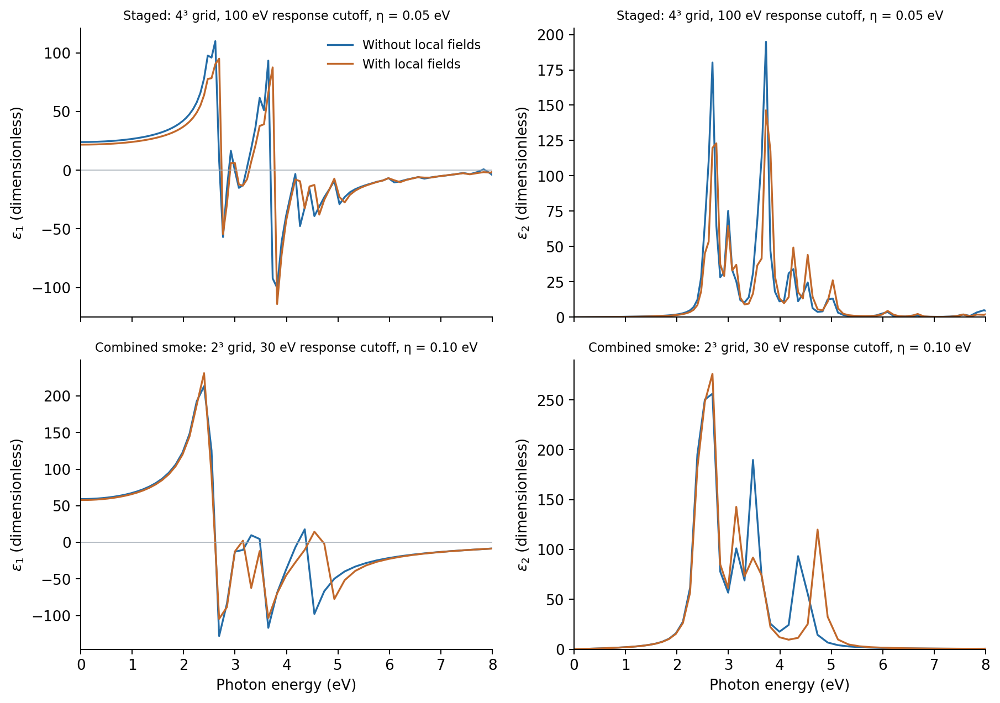

.. _silicon-gpaw-rpa:

Silicon: RPA optical response (GPAW)
====================================

.. literalinclude:: ../../../nanoworks/examples/Si-2atoms-optical/Si-Step2-optical-RPA.py
   :language: python
   :lines: 5-
   :caption: Si-Step2-optical-RPA.py

:download:`Download Si-Step2-optical-RPA.py <../../../nanoworks/examples/Si-2atoms-optical/Si-Step2-optical-RPA.py>`.

**Companion input: Si-Step1-ground_dos_band.py**

.. literalinclude:: ../../../nanoworks/examples/Si-2atoms-optical/Si-Step1-ground_dos_band.py
   :language: python
   :lines: 5-
   :caption: Si-Step1-ground_dos_band.py

:download:`Download Si-Step1-ground_dos_band.py <../../../nanoworks/examples/Si-2atoms-optical/Si-Step1-ground_dos_band.py>`.

Run
---

Requires GPAW and its PAW datasets.

Run the ground input first, then reuse its saved state for optics.

.. code-block:: bash

   cd ~/.nanoworks/examples/Si-2atoms-optical
   dftsolve -E GPAW -p 4 -i Si-Step1-ground_dos_band.py -g Si_mp-149_primitive_Example.cif
   dftsolve -E GPAW -p 4 -i Si-Step2-optical-RPA.py -g Si_mp-149_primitive_Example.cif

Results
-------

Results are in ``Si-results/``. Read the real and imaginary dielectric
functions against photon energy. The imaginary part marks optical absorption;
its peaks correspond to transitions, not the DOS itself. Compare NLFC and
LFC outputs to see the local-field contribution. Converge the k mesh,
empty bands, response cutoff and frequency grid before comparing peaks.

   Recorded example output.

These example settings need convergence tests before quantitative use.

:doc:`Detailed recorded results <../validation/silicon-gpaw-rpa>`.
