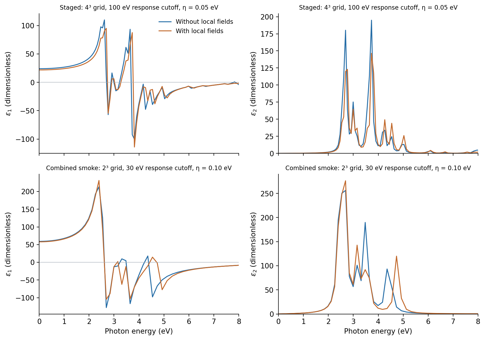
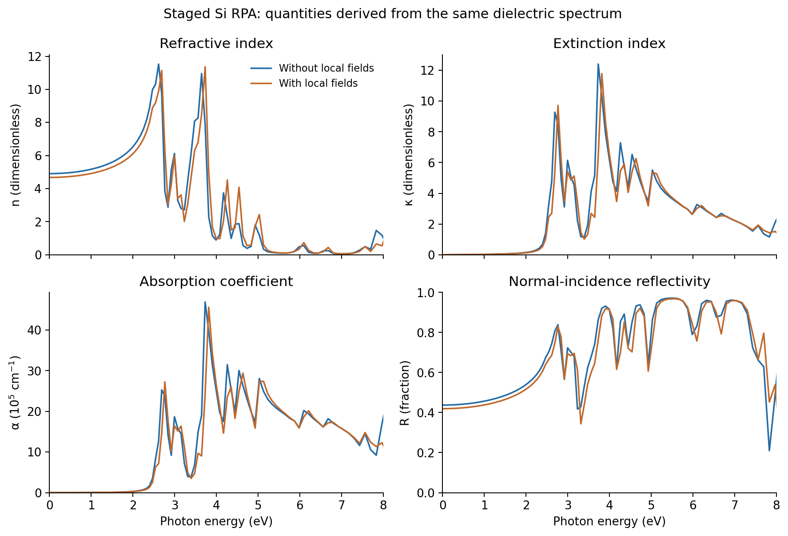

.. _silicon-gpaw-rpa:

Silicon RPA optics with GPAW: staged and combined workflows
===========================================================

.. note::

   These settings are chosen to demonstrate the Nanoworks workflow with a
   short runtime. The numerical results are illustrative; quantitative
   materials predictions require convergence tests and validation of the
   physical model.

This tutorial uses the completed ``GPAW/silicon-optical-stages`` and
``GPAW/silicon-combined-rpa`` cases from ``example-runs-Va5NDWGi``. It shows
how to run optics from a saved ground state or from one combined input,
read dielectric spectra with and without local-field effects, and check the
optical quantities derived from them.

Both runs completed, but their numerical settings differ. They are two
workflow demonstrations, not a controlled test of staged versus combined
execution. This page focuses on RPA; see :doc:`silicon-gpaw-bse` for the BSE results
and their eigenvalue and sum-rule checks.

Run from the installed examples
-------------------------------

Activate an environment with Nanoworks, GPAW and its PAW datasets; see
:doc:`../installation`. If needed, run ``nanoworks --install-examples`` as
explained in :ref:`tutorial-examples-setup`.

For separate electronic and optical steps:

.. code-block:: console

   $ cd ~/.nanoworks/examples/Si-2atoms-optical
   $ dftsolve -E GPAW -p 8 -i Si-Step1-ground_dos_band.py -g Si_mp-149_primitive_Example.cif --check
   $ dftsolve -E GPAW -p 8 -i Si-Step1-ground_dos_band.py -g Si_mp-149_primitive_Example.cif
   $ dftsolve -E GPAW -p 8 -i Si-Step2-optical-RPA.py -g Si_mp-149_primitive_Example.cif --check
   $ dftsolve -E GPAW -p 8 -i Si-Step2-optical-RPA.py -g Si_mp-149_primitive_Example.cif

Step 1 writes the ground-state file and electronic results into ``Si-results``.
Step 2 has ``Ground_calc=False`` and the same ``Outdirname``; it reads that
saved state and prepares optical wavefunctions before evaluating the RPA
response. Run Step 1 successfully before checking or executing Step 2.

For a combined run from the same installed directory:

.. code-block:: console

   $ dftsolve -E GPAW -p 8 -i Si-Combined-RPA-smoke.py -g Si_mp-149_primitive_Example.cif --check
   $ dftsolve -E GPAW -p 8 -i Si-Combined-RPA-smoke.py -g Si_mp-149_primitive_Example.cif

This input writes into ``Si-combined-RPA-smoke-results`` and runs ground,
DOS/PDOS, band, density and RPA optics. Nanoworks finishes the electronic
process before launching optics in a fresh process. The recorded wrapper log
confirms that sequence. A single input is sufficient; the process separation
releases the preceding process's memory but does not establish a particular
peak-memory requirement for larger calculations. Change ``-p`` to suit your
machine.

Recorded model and sampling
---------------------------

The three active Python inputs and both starting CIF copies match the bundled
examples byte for byte. Both calculations use the same fixed two-atom bulk
Si geometry: primitive edges 3.86697465 angstrom, angles 60 degrees and
volume 40.888292745 cubic angstrom per cell. Geometry optimization is off;
the final CIFs preserve that structure despite serialization differences.

Both runs used non-spin-polarized PBE, a 340 eV plane-wave ground-state cutoff,
Fermi–Dirac occupations of width 0.05 eV, and eight optical bands. The logs
record GPAW 26.7.0 and ASE 3.29.0; the wrapper records Nanoworks 27.2.0rc0 and
eight processes on 28 October 2026. The exact source commit and PAW dataset
package release were not recorded. Both Si PBE setup identifiers are
``ee77bee481871cc2cb65ac61239ccafa``.

.. list-table:: Settings that differ between the recorded runs
   :header-rows: 1
   :widths: 42 29 29

   * - Quantity
     - Staged RPA
     - Combined smoke RPA
   * - Ground and optical k-point mesh
     - Gamma-centred 4 x 4 x 4
     - Gamma-centred 2 x 2 x 2
   * - Full / irreducible optical k points
     - 64 / 8
     - 8 / 3
   * - ``Opt_cut_of_energy`` (response cutoff)
     - 100 eV
     - 30 eV
   * - Response plane waves, as logged
     - 89
     - 15
   * - ``Opt_eta`` (response broadening)
     - 0.05 eV
     - 0.10 eV
   * - ``Opt_domega0`` (initial frequency spacing)
     - 0.05 eV
     - 0.10 eV
   * - ``Opt_omega2``
     - 5 eV
     - 5 eV
   * - Exported photon-energy samples
     - 157
     - 79

The response cutoff controls the dielectric-matrix basis; it is distinct
from the 340 eV electronic plane-wave cutoff. The optical occupation width
and response broadening are also different controls, even where their
numerical values happen to coincide.

GPAW RPA uses a nonlinear photon-energy grid. ``Opt_omega2=5`` marks where
its spacing doubles relative to the initial spacing; it does not set a
5 eV upper limit. The archived spectra extend from 0 to 22.044681 eV.
The electronic plotting window ``Energy_min``/``Energy_max`` likewise does
not define the RPA frequency grid. See the `GPAW frequency-grid documentation
<https://gpaw.readthedocs.io/tutorialsexercises/opticalresponse/dielectric_response/dielectric_response.html#frequency-grid>`_.

Read local-field and no-local-field spectra
-------------------------------------------

Each raw ``RPA_dielec_xdirection.csv`` has five columns:
photon energy (eV), no-local-field epsilon1, no-local-field epsilon2,
local-field epsilon1, local-field epsilon2. Corresponding y/z files use the
same convention. ``NLFC`` in the processed filenames means without
local-field corrections; ``LFC`` means with them.

The no-local-field spectrum uses the head of the dielectric matrix.
The local-field result includes the matrix inversion when constructing
the macroscopic dielectric response. These are two treatments of the
microscopic field in the same RPA calculation, not RPA and BSE.
See the `GPAW dielectric-response introduction
<https://gpaw.readthedocs.io/tutorialsexercises/opticalresponse/dielectric_response/dielectric_response.html#a-short-introduction>`_.

   Recorded x-direction spectra over 0–8 eV. Lines join the saved samples;
   no smoothing, energy shift or amplitude rescaling was applied. The two
   rows use different settings and separate vertical scales.

.. list-table:: Selected x-direction values in the recorded spectra
   :header-rows: 1

   * - Case / treatment
     - epsilon1 at 0 eV
     - Energy of largest epsilon2 sample (eV)
     - Largest epsilon2 sample
   * - Staged / NLFC
     - 24.068132
     - 3.730863
     - 194.888208
   * - Staged / LFC
     - 21.866059
     - 3.730863
     - 146.409241
   * - Combined / NLFC
     - 59.194140
     - 2.690322
     - 256.268452
   * - Combined / LFC
     - 57.823064
     - 2.690322
     - 276.260615

The large, sharp peaks and strongly differing zero-energy values are recorded
outputs of coarse example settings, not converged Si material constants.
Within each case, the LFC/NLFC comparison isolates the field treatment.
Between cases, the k mesh, response cutoff, broadening and frequency sampling
change together, so neither a k-point convergence trend nor an execution-mode
effect can be extracted from this pair.

At zero photon energy the table gives the broadened electronic response of
this model. It is not a separately converged static dielectric constant
including lattice contributions. A small low-energy tail is not sufficient
to determine an optical gap. The response here has no quasiparticle scissor
correction, electron–hole BSE kernel or phonon-assisted absorption treatment;
it should not be used to infer an exciton binding energy or the indirect
absorption onset of bulk Si.

Check the derived optical quantities
------------------------------------

Each processed ``AllData`` DAT file has seven columns with units:
energy, epsilon1, epsilon2, refractive index n, extinction index kappa,
absorption coefficient alpha (1/cm), and reflectivity R (fraction).
For these passive spectra:

.. math::

   n^2-\kappa^2=\epsilon_1,\qquad 2n\kappa=\epsilon_2,

.. math::

   \alpha=\frac{2E\kappa}{\hbar c},\qquad
   R=\frac{(n-1)^2+\kappa^2}{(n+1)^2+\kappa^2}.

The absorption formula uses E in eV, hbar in eV seconds and c in cm/s.
R is the normal-incidence intensity reflectivity from vacuum into a
homogeneous, semi-infinite medium in this optical model, rather than a
thin-film interference calculation.

   Staged x-direction data with and without local fields. The absorption axis
   is expressed in units of 10^5 per centimetre; the downloadable table keeps
   the original 1/cm values. These curves are derived from the same epsilon,
   not four independent material-property validations.

All twelve processed tables are finite, have strictly increasing nonnegative
energy grids and agree exactly with their six source CSVs for epsilon1 and
epsilon2. The n/k identities hold within ``1.4e-9`` in dimensionless absolute
residuals; absorption and reflectivity agree within output rounding.
Epsilon2, n, kappa and alpha are nonnegative and R lies in [0,1].
Epsilon1 can be negative without implying negative absorption.

Within each recorded case, all x/y/z processed tables are identical. This is
consistent with the cubic structure; it does not establish k-point or band
convergence. The combined run's completion summary also reproduces the SHA256
hashes of its six optical tables.

.. important::

   The staged folder was subsequently used for BSE. Its shared
   ``OPTICAL-GPAW-Result-Summary.json`` therefore describes BSE, and the
   shared optical state/log files can belong to the later stage. The RPA
   checks here use the method-specific RPA log, raw RPA CSVs and RPA DATs,
   together with the zero RPA exit code. Do not use the latest shared
   summary as RPA provenance.

Download and redraw
-------------------

:download:`Download the two RPA data sets, inputs and plotting script <../_static/examples/silicon-gpaw-rpa-reference.zip>`.
Extract the archive, install NumPy and Matplotlib, then run:

.. code-block:: console

   $ python plot_rpa.py

The script verifies source SHA256 hashes, compares all raw/processed spectra,
checks the optical identities and cubic-direction agreement, writes
``checks.dat`` with units, and recreates both figures. It imports no GPAW
and launches no calculations. The original input, CIF, CSV and DAT bytes are
preserved. Large electronic states and the later BSE summary are not part
of this RPA plotting package.

For a material prediction, converge the electronic and optical k grids,
unoccupied bands, response cutoff, occupation width, response broadening
and photon-energy sampling independently. A controlled staged/combined
comparison must use matching numerical settings. The separate
:doc:`silicon-qe-optics` tutorial covers QE's optical workflow; these two
GPAW cases do not establish agreement between engines.
