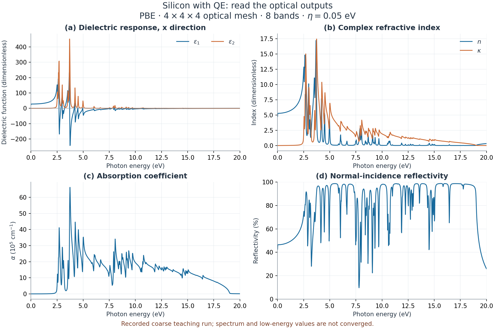

Silicon: optical response with epsilon.x (QE)
=============================================

.. literalinclude:: ../../../nanoworks/examples/Si-2atoms-optical/Si-Step2-optical-RPA.py
   :language: python
   :lines: 5-
   :caption: Si-Step2-optical-RPA.py

:download:`Download Si-Step2-optical-RPA.py <../../../nanoworks/examples/Si-2atoms-optical/Si-Step2-optical-RPA.py>`.

**Companion input: Si-Step1-ground_dos_band.py**

.. literalinclude:: ../../../nanoworks/examples/Si-2atoms-optical/Si-Step1-ground_dos_band.py
   :language: python
   :lines: 5-
   :caption: Si-Step1-ground_dos_band.py

:download:`Download Si-Step1-ground_dos_band.py <../../../nanoworks/examples/Si-2atoms-optical/Si-Step1-ground_dos_band.py>`.

Run
---

Requires QE and the managed pseudopotentials.

Run the ground input first, then reuse its saved state for optics. ``-E QE`` selects QE for the shared inputs.

.. code-block:: bash

   cd ~/.nanoworks/examples/Si-2atoms-optical
   dftsolve -E QE -p 4 -i Si-Step1-ground_dos_band.py -g Si_mp-149_primitive_Example.cif -s DOS_integration=tetrahedron
   dftsolve -E QE -p 4 -i Si-Step2-optical-RPA.py -g Si_mp-149_primitive_Example.cif

Results
-------

.. note::

   This example is a qualitative demonstration. For reliable quantitative
   results, optimize the structure where appropriate and converge the
   numerical settings.

Results are in ``Si-results/``. Read the real and imaginary dielectric
functions against photon energy. The imaginary part marks optical absorption;
its peaks correspond to transitions, not the DOS itself. The seven-column
DAT files also give refractive index, extinction coefficient, absorption
and reflectivity. The finite linewidth smooths the spectrum; converge the
k mesh, empty bands and frequency grid before comparing peak positions.

   Recorded example output.

:doc:`Detailed recorded results <../validation/silicon-qe-optics>`.
