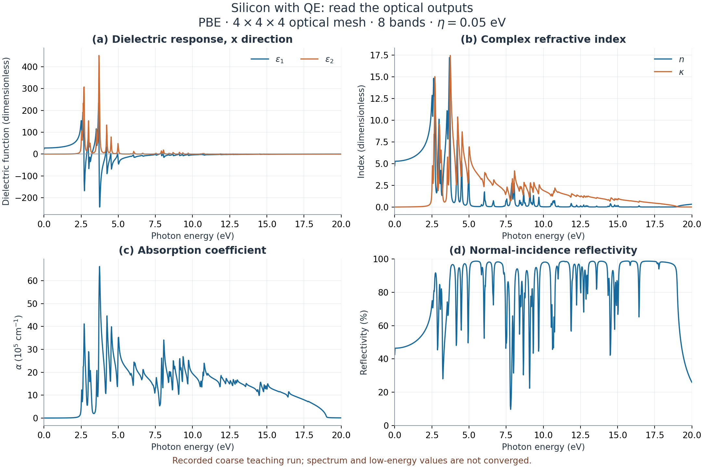
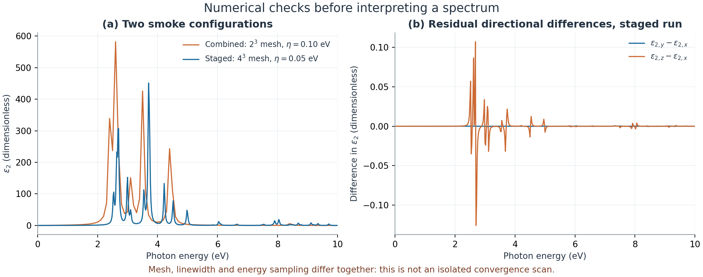

Silicon with QE: optical workflow and result checks
===================================================

.. note::

   These settings are chosen to demonstrate the Nanoworks workflow with a
   short runtime. The numerical results are illustrative; quantitative
   materials predictions require appropriate convergence tests and validation
   of the physical model.

This exercise reads a completed ground-state, DOS, band and optical workflow
for two-atom silicon. It shows how to calculate the dielectric response with
QE's ``epsilon.x`` and how Nanoworks converts it to refractive index,
absorption and reflectivity. The recorded runs completed, but their coarse
spectra are **teaching data, not converged material reference values**.

Open the installed example
--------------------------

Use a Nanoworks environment with QE 7.4.1, MPI and the managed scalar PBE
norm-conserving pseudopotentials installed.
Open the installed example folder shown below. If needed, install the
examples first with ``nanoworks --install-examples``; see
:ref:`tutorial-examples-setup`.

.. code-block:: bash

   cd ~/.nanoworks/examples/Si-2atoms-optical

Run the electronic stages first:

.. code-block:: bash

   dftsolve -E QE -p 8 -i Si-Step1-ground_dos_band.py \
     -g Si_mp-149_primitive_Example.cif -s DOS_integration=tetrahedron --check
   dftsolve -E QE -p 8 -i Si-Step1-ground_dos_band.py \
     -g Si_mp-149_primitive_Example.cif -s DOS_integration=tetrahedron

Then reuse their state for the optical calculation:

.. code-block:: bash

   dftsolve -E QE -p 8 -i Si-Step2-optical-RPA.py \
     -g Si_mp-149_primitive_Example.cif --check
   dftsolve -E QE -p 8 -i Si-Step2-optical-RPA.py \
     -g Si_mp-149_primitive_Example.cif

The explicit ``-E QE`` is important: the shared optical-only input otherwise
selects GPAW. Eight processes match the recorded run; adapt the number to your
machine. Do not wrap these commands in another MPI launcher. ``--check``
checks prerequisites without running DFT.

The output folder is ``Si-results/``. Keep its ground-state directory between
the two commands. ``Ground_calc=False`` in the second input reuses that state;
it does not remove the need for a completed first calculation. This fixed-cell
exercise does not optimize the supplied geometry.

Read the actual optical settings
--------------------------------

.. list-table:: Recorded staged QE calculation
   :header-rows: 1
   :widths: 45 55

   * - Setting
     - Value
   * - Engine, XC, spin
     - QE 7.4.1, PBE, non-spin-polarized
   * - Structure
     - Two-atom diamond Si; primitive edge 3.86697465 angstrom, angles 60 degrees
   * - ``Wavefunction_cutoff``
     - 340 eV; generated ``ecutwfc`` 24.98954 Ry
   * - Ground-state mesh
     - Gamma-centered 4 x 4 x 4; 13 irreducible points printed in the SCF log
   * - ``Opt_kpts_x/y/z``, ``Opt_gamma``
     - 4, 4, 4; ``True``
   * - Optical NSCF mesh and bands
     - Full 64-point mesh, 8 Kohn-Sham bands
   * - ``Opt_FD_smearing``
     - 0.05 eV occupation width
   * - ``Opt_eta``
     - 0.05 eV interband linewidth
   * - Effective energy grid
     - 1001 samples, 0.001 to 20 eV
   * - ``Opt_shift_en``
     - 0 eV; no rigid spectral shift

The generated optical NSCF input has both ``nosym=.true.`` and
``noinv=.true.``. Its log prints 64 equal weights of 0.03125. Check the actual
output, rather than assuming that an automatic mesh remained unreduced.
These non-spin-polarized QE weights sum to two; they must not be replaced by
a second manual normalization of the exported spectrum.

For QE, ``Opt_eta`` maps to ``epsilon.x``'s ``intersmear``. The occupation width
and optical linewidth are different quantities; tetrahedron DOS is another
separate setting. The input's GPAW response-basis settings, such as
``Opt_cut_of_energy``, do not define a QE response cutoff.

The requested minimum energy is zero. This run uses smeared occupations, so
``epsilon.x`` labels its occupation branch as metallic and moves its first
energy to 0.001 eV. That message alone is not evidence that silicon became a
metal. The saved eigenvalues give positive sampled valence-to-conduction
separations: 0.7356 eV on the optical mesh and 0.5975 eV along the separate
40-point band path. Neither sample establishes the converged fundamental gap
or an optical absorption threshold.

Read the tables and figures
---------------------------

The three direction files end in
``-OPTICAL-QE-Result-Calculation-RPA-AllData_xdirection.dat`` (and ``y``/``z``).
Each has one header line and seven columns:

.. list-table:: Optical DAT columns
   :header-rows: 1
   :widths: 35 65

   * - Column
     - Meaning
   * - ``Energy(eV)``
     - Photon energy; it is not an electron energy relative to the Fermi level
   * - ``Eps_real(1)``, ``Eps_img(1)``
     - Real and imaginary dielectric response
   * - ``Refractive_Index(1)``, ``Extinction_Index(1)``
     - Real index n and extinction coefficient kappa
   * - ``Absorption(1/cm)``
     - Absorption coefficient in inverse centimeters
   * - ``Reflectivity(1)``
     - Dimensionless normal-incidence intensity reflectivity, from zero to one

   Replotted directly from the staged run's x-direction DAT table. Reflectivity
   is displayed as a percentage; absorption is divided by 100000 for its axis
   scale. The very sharp peaks and large indices are reasons to test numerical
   convergence, not quantitative predictions for experimental silicon.

At the first tabulated energy, 0.001 eV, the x-direction values are
``epsilon_1=22.66158``, ``n=4.76042`` and ``R=0.426152``. The largest sampled
``epsilon_2`` is 451.089 at 3.700815 eV. These numbers identify this data set;
**do not quote the first sample as a converged static dielectric constant or
the largest peak as a converged optical transition**.

Nanoworks' derived columns obey, for a nonmagnetic medium and incidence from
vacuum,

.. math::

   \epsilon_1 = n^2-\kappa^2,\qquad
   \epsilon_2 = 2n\kappa,\qquad
   R = \frac{(n-1)^2+\kappa^2}{(n+1)^2+\kappa^2}.

With photon energy E in eV,

.. math::

   \alpha\,[\mathrm{cm}^{-1}]
   \simeq 1.01354614\times10^5\,E\,[\mathrm{eV}]\,\kappa.

All three direction tables passed these identities at their printed precision.
Their dielectric columns match the raw ``epsr_nanoworks.dat`` and
``epsi_nanoworks.dat`` files exactly. The summary-file hashes also match the
table bytes. Such checks establish consistent exports; they do not establish
convergence of the underlying electronic calculation.

Compare with the one-command workflow
-------------------------------------

The supplied ``Si-QE-Combined-RPA-smoke.py`` example performs ground, DOS, band,
density and optical stages in one command. It is already in this installed
example folder; run:

.. code-block:: bash

   dftsolve -E QE -p 8 -i Si-QE-Combined-RPA-smoke.py \
     -g Si_mp-149_primitive_Example.cif --check
   dftsolve -E QE -p 8 -i Si-QE-Combined-RPA-smoke.py \
     -g Si_mp-149_primitive_Example.cif

This writes a separate ``Si-QE-combined-RPA-smoke-results/`` folder. It uses a
2 x 2 x 2 mesh, eight bands, a 0.10 eV linewidth and 101 samples up to 10 eV.
The input is intentionally small to exercise the complete sequence.

   The two successfully completed workflows produce substantially different
   spectra. Mesh, ground-state sampling, linewidth and energy grid differ
   together, so this comparison is not a controlled k-point convergence scan.
   The right panel magnifies the staged run's small residual directional
   differences instead of hiding them under overlapping curves.

The combined run's first x-direction ``epsilon_1`` is 69.11020 and its largest
sampled ``epsilon_2`` occurs at 2.60074 eV. Their differences from the staged
run show why completion is not a sufficient accuracy test. For cubic silicon,
the diagonal dielectric components should agree in the converged limit. The
staged tables have a maximum directional spread of 0.125969 in ``epsilon_2``
over the full grid, about 0.028 percent of the largest peak. This is a useful
consistency check, not proof of a converged spectrum.

Before scientific use, increase the optical k mesh and empty-band count while
holding linewidth and energy window fixed; check wavefunction cutoff and the
starting geometry as well. Then vary linewidth separately. Eight bands cannot
be assumed sufficient throughout a 20 eV window. PBE independent-particle
optics here does not calculate an excitonic BSE spectrum or phonon-assisted
indirect absorption. A broadened low-energy tail is not a measured band gap.

Reference data and provenance
-----------------------------

The inspected runs are ``QE/silicon-optical-stages`` and
``QE/silicon-combined-rpa`` from ``example-runs-Va5NDWGi``, completed on
28 October 2026 with Nanoworks 27.2.0rc0, ASE 3.29.0 and eight MPI processes.
SCF, optical NSCF and ``epsilon.x`` logs contain ``JOB DONE``; every wrapper
stage has exit code zero. The exact source commit and pseudopotential package
version were not recorded in the run, so this is a recorded teaching example,
not a fully pinned benchmark.

:download:`Download the inputs, six optical DAT tables, raw staged dielectric files, checks and plotting script <../_static/examples/silicon-qe-optics-reference.zip>`.
After extracting the archive, run ``python plot_optics.py`` with NumPy and
Matplotlib installed to reproduce both figures without QE, GPAW or saved
wavefunctions. ``checks.dat`` summarizes both configurations; ``SHA256SUMS``
identifies the included files. No private state directories are distributed.

The method and native output conventions are documented in the
`QE 7.4.1 epsilon.x manual <https://github.com/QEF/q-e/blob/qe-7.4.1/PP/Doc/eps_man.tex>`_.
