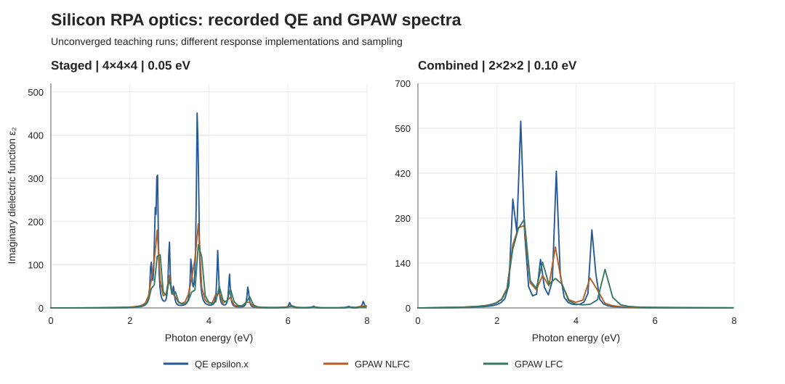

.. _silicon-rpa-cross-engine-audit:

Silicon RPA optics: interpreting the QE and GPAW archives
=========================================================

.. note::

   This is an **audit of completed teaching calculations**, not a
   cross-engine benchmark or an accuracy ranking. No new DFT calculation
   or empirical correction is introduced here.

The two-atom silicon example has RPA optical outputs from both QE 7.4.1
(``epsilon.x``) and GPAW 26.7.0. The archived 28 October 2026 runs are
described independently in :doc:`silicon-qe-optics` and
:doc:`silicon-gpaw-rpa`. This page compares recorded *x*-direction values
without conflating different response definitions or silently renormalizing
a spectrum. The underlying inputs, tables, figures, and reproduction scripts
are available in the reference downloads on those two pages.

What can be compared?
---------------------

Both engines used the same fixed primitive Si geometry, PBE, no spin
polarization, eight optical bands, and nominal 340 eV ground-state
wavefunction cutoffs. Within each engine the staged example has a
4 x 4 x 4 optical mesh and 0.05 eV response broadening, whereas the
combined smoke example has a 2 x 2 x 2 mesh and 0.10 eV broadening.

Those common choices **do not** define an identical optical model:

* QE's ``epsilon.x`` returns diagonal dielectric responses without
  microscopic local-field corrections in this workflow. It requires a
  full, unreduced optical k mesh; the saved staged NSCF has 64 k points.
* GPAW exports the response without local-field corrections
  (``NLFC``) and *also* with local-field corrections (``LFC``).
  ``NLFC`` is the relevant qualitative counterpart of the QE output.
  The ``LFC`` spectrum is a distinct physical approximation, not a
  second estimate of the same ``NLFC`` quantity.
* The engines have different pseudopotential/PAW descriptions and
  response implementations. GPAW has a separate dielectric-matrix
  response cutoff (100 eV staged, 30 eV combined), which is not a QE
  ``epsilon.x`` setting. Equal nominal broadening numbers do not
  guarantee identical spectral line shapes or normalizations.
* The saved photon-energy grids differ: QE staged has 1001 points over
  0.001--20 eV and combined has 101 over 0.001--10 eV; GPAW RPA has
  157 and 79 nonlinearly spaced points, respectively, over 0--22.044681 eV.
  A maximum taken from one table is not sampled at the same energies
  as a maximum taken from the other.

For the method distinction, see the
`QE epsilon.x manual <https://github.com/QEF/q-e/blob/qe-7.4.1/PP/Doc/eps_man.tex>`_
and the
`GPAW dielectric-response documentation <https://gpaw.readthedocs.io/tutorialsexercises/opticalresponse/dielectric_response/dielectric_response.html>`_.
In GPAW's convention ``NLFC`` uses the head of the dielectric matrix,
while ``LFC`` uses the inverse dielectric matrix to obtain the
macroscopic response.

Why equal Opt_eta values do not imply equal linewidths
-------------------------------------------------------

The source-level distinction matters even before comparing PAW setups and
pseudopotentials. For QE 7.4.1, the ``eps_calc`` routine receives
``intersmear`` but **does not receive** ``smeartype``. The latter is
used by the separate ``jdos_calc`` routine. Therefore, writing
``smeartype='gauss'`` in an ``epsilon.x`` input does **not** make its
dielectric-function calculation Gaussian. See the
`QE 7.4.1 epsilon.f90 source
<https://github.com/QEF/q-e/blob/qe-7.4.1/PP/src/epsilon.f90>`_.

For an isolated interband transition with energy :math:`\Delta`,
the frequency-dependent part of the QE imaginary response contains

.. math::

   \epsilon_2^{\mathrm{QE}}(\omega) \propto
   \frac{\Gamma\omega}
   {(\Delta^2-\omega^2)^2+\Gamma^2\omega^2},

where :math:`\Gamma` is the ``intersmear`` value. Near a positive
resonance, its approximate full width at half maximum is
``FWHM = Gamma``. Additional transition-energy factors in the
complete QE expression do not change this leading linewidth estimate.

GPAW's direct frequency-domain independent-particle susceptibility instead
contains denominators of the form

.. math::

   (\omega-\Delta+i\eta)^{-1},

giving an isolated Lorentzian resonance with approximate
``FWHM = 2 * eta``. See the
`GPAW response-function description
<https://gpaw.readthedocs.io/documentation/tddft/dielectric_response.html>`_.
These are **isolated-line estimates**, not width measurements from the
overlapping archived Si peaks.

Currently Nanoworks passes ``Opt_eta`` unchanged to GPAW ``eta``
and to QE ``intersmear`` for backward compatibility. Thus the staged
inputs use nominal FWHM values of about **0.10 eV in GPAW versus 0.05 eV
in QE**; the combined inputs use about **0.20 eV versus 0.10 eV**.
This factor-of-two difference in the *meaning of the parameter* can
substantially influence peak heights. It does **not** prove that it
explains all differences in spectra, because transition strengths,
electronic states, response algorithms, local fields, and frequency
sampling also matter.

Do not rescale ``epsilon_2`` by two or alter historical results.
For a *new*, controlled no-local-field comparison with a target
isolated-line FWHM :math:`W`, candidate settings would be
``Opt_eta=W`` for QE and ``Opt_eta=W/2`` for GPAW, with the
full line shape and actual computed width independently checked.
There is no automatic cross-engine conversion in the current wrapper.

Read the recorded numbers
-------------------------

The following values were checked against the *original* archived
seven-column ``AllData_xdirection.dat`` files. The "near-zero" entries
refer to the first tabulated photon energy: 0.001 eV for QE, exactly
0 eV for GPAW. They are **not** jointly extrapolated static constants.
Each peak is the largest *sampled* imaginary dielectric value in its
own grid, not a fitted peak or a transition energy.

.. list-table:: Archived x-direction dielectric response (dimensionless)
   :header-rows: 1
   :widths: 25 23 20 16 16

   * - Workflow
     - Engine and treatment
     - First-sample epsilon1
     - E at max epsilon2 (eV)
     - Max epsilon2
   * - Staged, 4 x 4 x 4
     - QE ``epsilon.x``
     - 22.661582
     - 3.700815
     - 451.089106
   * - Staged, 4 x 4 x 4
     - GPAW ``NLFC``
     - 24.068132
     - 3.730863
     - 194.888208
   * - Staged, 4 x 4 x 4
     - GPAW ``LFC``
     - 21.866059
     - 3.730863
     - 146.409241
   * - Combined, 2 x 2 x 2
     - QE ``epsilon.x``
     - 69.110195
     - 2.600740
     - 581.993527
   * - Combined, 2 x 2 x 2
     - GPAW ``NLFC``
     - 59.194140
     - 2.690322
     - 256.268452
   * - Combined, 2 x 2 x 2
     - GPAW ``LFC``
     - 57.823064
     - 2.690322
     - 276.260615

   Archived x-direction epsilon2 values plotted at their original photon
   energies. The left panel uses the staged settings; the right uses
   combined smoke settings. There is no spectral shift, remapping to a
   shared energy grid, amplitude renormalization or extra smoothing.
   Straight lines between original samples are only a visual aid.

The near-zero values and peak positions have some similarities, but the
recorded peak *heights* differ substantially between QE and GPAW NLFC.
For example, the staged sampled maxima are approximately 451 and 195.
This discrepancy is **an item for controlled investigation**, not evidence
by itself of a normalization bug, a superior engine, or a physical Si
dielectric constant.

Compare peaks with finite-window spectral area
-----------------------------------------------

A peak height alone is an especially poor amplitude-normalization test for
very narrow, differently sampled transitions. Direct trapezoidal integration
of the original x-direction data over the **common 0.001--8.0 eV**
interval gives:

.. list-table:: Finite-window spectral diagnostics (not f-sum rules)
   :header-rows: 1
   :widths: 38 22 22 18

   * - Measurement
     - QE ``epsilon.x``
     - GPAW ``NLFC``
     - QE/GPAW
   * - Staged max epsilon2 (dimensionless)
     - 451.0891
     - 194.8882
     - 2.3146
   * - Staged integral epsilon2 dE (eV)
     - 136.6502
     - 115.7123
     - 1.1809
   * - Combined max epsilon2 (dimensionless)
     - 581.9935
     - 256.2685
     - 2.2710
   * - Combined integral epsilon2 dE (eV)
     - 314.4812
     - 262.5430
     - 1.1978

For each original energy grid, only the two interval endpoints are
linearly interpolated when necessary; interior samples remain unchanged.
QE starts at 0.001 eV, while GPAW starts at 0 eV. The integrals have
units of eV because dielectric epsilon2 is dimensionless. The common
window stops at 8 eV to cover both archived energy ranges and emphasize
the main resonances.

The **approximately 2.3-fold peak ratios** contrast with
**only 18--20% larger QE finite-window areas**. This is consistent with
linewidth and sampling contributing strongly to the height mismatch.
It is not a unique explanation, a converged oscillator-strength
comparison, or an evaluation of the f-sum rule. Those require common
line widths, independently converged settings, and suitably sampled
full frequency ranges. The current integrals must not be multiplied
by a guessed normalization factor.

In particular, the GPAW local-field correction decreases the staged
sampled peak yet increases the combined sampled peak. That observation is
not contradictory: the two coarse grids have different numerical settings
and sample different response shapes. Neither comparison isolates the
effect of k-point density, and the QE-versus-GPAW difference does not
isolate the local-field correction.

How to interpret and reproduce
------------------------------

Use the two source tutorials' plots to inspect the *full* spectra rather
than comparing only peak heights. Their reference ZIP files preserve the
original QE x/y/z ``AllData`` tables, GPAW NLFC/LFC tables, inputs and
plotting scripts. No archived spectrum was scaled or edited for this
cross-engine summary.

Download the
:download:`stdlib-only numerical audit script
<../_static/examples/check_silicon_rpa.py>`,
plus ``silicon-qe-optics-reference.zip`` and
``silicon-gpaw-rpa-reference.zip`` from the two linked tutorial pages.
Put all three in one directory and run:

.. code-block:: console

   $ python check_silicon_rpa.py silicon-qe-optics-reference.zip silicon-gpaw-rpa-reference.zip

The checker reads only the original direction-*x* ``AllData`` tables
inside the ZIPs; no QE, GPAW, NumPy or Matplotlib is needed. It validates
the expected point counts, peak energies, peak heights and finite-window
trapezoidal integrals, then prints CSV-format rows with units in the
header and SHA-256 identifiers for the exact table bytes used. It detects
duplicate or missing case matches instead of choosing one arbitrarily.
The source tutorial archives and the original spectra remain unchanged.

For a controlled study, first converge the electronic cutoff, k mesh,
unoccupied band count, response cutoff where applicable, line broadening
and frequency grid **within each engine**. Keep the structure fixed and
record the exact pseudopotentials or PAW setups. Only then compare a
consistent no-local-field observable over a common interpolated frequency
grid, including peak shapes and integrated spectral weight. Repeat with
GPAW local-field corrections as a *separate* study.

The existing archived outputs prove that both example pipelines completed
and that their exported optical columns are internally consistent. They
**do not** establish convergence, agreement between the engines, or
experimental accuracy. Do not infer an exciton binding energy from these
RPA data; the separate :doc:`silicon-gpaw-bse` tutorial addresses the
recorded BSE example and its unresolved sum-rule deviations.
