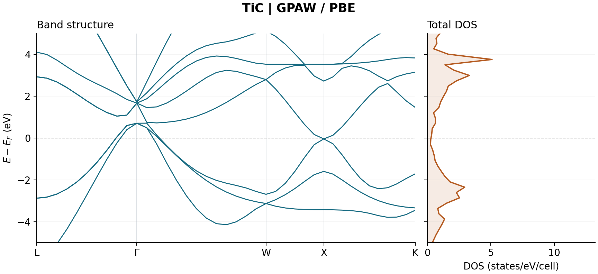

TiC: elasticity and metallic bands with GPAW
============================================

This exercise uses ``TiC-elastic-electronic/TiC.py`` to relax a two-atom TiC
primitive cell, fit elastic constants from strained calculations, and export
DOS and bands. It is a substantial example: the recorded elastic stage alone
took about four hours ten minutes on eight MPI processes.

Prepare and run
---------------

Activate the Nanoworks environment with GPAW, PAW setups and the Python
``elastic`` dependency installed. These commands assume a source checkout at
``~/nanoworks`` and a new working folder:

.. code-block:: bash

   mkdir -p ~/nanoworks-work
   mkdir ~/nanoworks-work/tic-gpaw
   cd ~/nanoworks-work/tic-gpaw
   cp ~/nanoworks/nanoworks/examples/TiC-elastic-electronic/TiC.py .
   cp ~/nanoworks/nanoworks/examples/TiC-elastic-electronic/TiC_primitive_geooptimized.cif .
   dftsolve -E GPAW -p 8 -i TiC.py -g TiC_primitive_geooptimized.cif --check
   dftsolve -E GPAW -p 8 -i TiC.py -g TiC_primitive_geooptimized.cif

The output folder and filename prefix are ``TiC_primitive_geooptimized``.
``-p`` controls MPI processes within this calculation. When using the batch
example queue, ``tsp -S 1`` separately limits concurrent jobs to one.

Follow the input through the stages
-----------------------------------

.. list-table:: Settings used in the recorded run
   :header-rows: 1
   :widths: 45 55

   * - Setting
     - Value
   * - ``Mode``, ``XC_calc``, ``Wavefunction_cutoff``
     - ``PW``, ``PBE``, 700 eV
   * - ``Ground_kpts_x/y/z``, ``Gamma``
     - 21 x 21 x 21, ``True``
   * - ``SCF_accuracy``
     - ``very-tight``
   * - ``Occupation_scheme``, ``Smearing_width``
     - ``fermi-dirac``, 0.05 eV
   * - ``Geometry_optimizer``, ``Geometry_force_tolerance``
     - ``QuasiNewton``, 0.0005 eV/angstrom
   * - ``Relax_cell``, ``Fix_symmetry``
     - ``[True, True, True, False, False, False]``, ``False``
   * - ``DOS_integration``, ``DOS_width``, ``DOS_npoints``
     - ``smearing``, 0.1 eV Gaussian width, 301 samples
   * - ``Band_path``, ``Band_npoints``
     - ``LGWXK``, 40 total sampled points
   * - Spin and SOC
     - Both disabled

There is no explicit elastic mesh override in this input. Inspect the
deformation logs when checking inherited sampling and SCF settings. The
recorded run used the default five strain samples per direction, from -0.01
to +0.01, including the reference. Retain the deformation trajectory and logs
to audit the stress-strain fit; the tensor summary alone cannot establish
linearity or strain-window convergence.

Read the elastic result
-----------------------

The recorded run started on 19 October 2026 and used Nanoworks 27.2.0rc0,
ASE 3.29.0, GPAW 26.7.0 and eight MPI processes. The logs identify ``Ti.PBE``
and ``C.PBE`` setups with 12 and 4 valence electrons. A source commit and PAW
data package version were not recorded. The final primitive edge is
3.06541585 angstrom with 60-degree angles, corresponding to a conventional
cubic lattice parameter of **4.33515 angstrom**. Ti and C occupy fractional
coordinates (0, 0, 0) and (1/2, 1/2, 1/2).

Nanoworks identified Fm-3m symmetry for the elastic reconstruction and wrote
three independent cubic stiffnesses:

.. list-table:: Recorded stiffnesses and derived isotropic properties
   :header-rows: 1
   :widths: 60 40

   * - Quantity
     - Value
   * - C11
     - 486.92 GPa
   * - C12
     - 136.66 GPa
   * - C44
     - 185.99 GPa
   * - Bulk modulus B
     - 253.41 GPa
   * - Hill shear modulus G
     - 181.57 GPa
   * - Hill Young's modulus E
     - 439.69 GPa
   * - Hill Poisson ratio
     - 0.211

The cubic checks give C11-C12 = 350.26 GPa, C11+2C12 = 760.24 GPa and
C44 = 185.99 GPa, all positive. Thus the reported tensor passes the cubic
small-strain mechanical stability conditions near zero pressure. This does
not establish phonon stability or stability against other phases.

Recomputing ``B = (C11 + 2*C12)/3`` and the Voigt-Reuss-Hill averages from
the displayed tensor reproduces the reported moduli to rounding precision.
The Hill values describe an isotropic aggregate; they are not direction-specific
single-crystal Young's moduli. The Zener ratio ``2*C44/(C11-C12)`` is about
1.062, indicating modest elastic anisotropy within this cubic fit.

Read the electronic result
--------------------------

   Recorded TiC bands and total DOS, redrawn from the DAT tables. The dashed
   line is Ef; DOS is per two-atom primitive cell.

Several sampled bands cross Ef and the ground-state log reports no gap.
Linear interpolation of the broadened DOS table gives approximately
**0.295 states/eV/cell at Ef**, consistent with metallic behavior in this
calculation. That DOS value depends on sampling and the 0.1 eV broadening;
it is not a converged transport coefficient. Orbital projections can help
identify contributions but do not constitute a unique decomposition of bonding.

Archive and repeat
------------------

The :download:`reference input, final CIF, DATs and elastic summary
<../_static/examples/tic-gpaw-reference.zip>` contain the numerical results
used here, with provenance and hashes. The long and XYYY band tables match;
DOS/PDOS entries and orbital sums were checked. The moduli were independently
recomputed from the reported tensor. The full deformation fit and numerical
parameter convergence remain separate validation tasks.

Important files inside the output folder include:

* ``*-GROUND-GPAW-Log-SCF.txt`` and ``*-GROUND-GPAW-Result-Final.cif`` for
  the reference calculation and final structure.
* ``*-ELASTIC-GPAW-Result-Elastic-AllResults.txt`` for the tensor and moduli.
* ``*-ELASTIC-GPAW-Result-Elastic-deformations.traj`` and the deformation
  logs for fit auditing and compatible cache reuse.
* DOS/PDOS, band and matching KPath DATs for numerical electronic results.
* ``*-TIMINGS-GPAW-Log-Timings.txt`` for individual stage durations.

The recorded stage durations were 253.04 s for ground state, 15020.16 s for
elasticity, 8.68 s for DOS and 2.39 s for bands. They are not queue-inclusive
wall-clock benchmarks and will depend on the machine.

Keep the GPW until all DFT postprocessing is finished. After archiving the
inputs, logs, geometry, deformation records, tables and figures, it can be
removed from a closed run; restarting a DFT stage then requires a regenerated
ground state. DAT replotting remains available without GPW:

.. code-block:: bash

   dftsolve --plot TiC_primitive_geooptimized/TiC_primitive_geooptimized-BAND-GPAW-Result-Band-XYYY.dat

For research, check cutoff and electronic sampling, then stress accuracy,
strain magnitude and the linear fitting window. A completed calculation with
tight SCF settings is useful evidence, but does not replace those studies.
