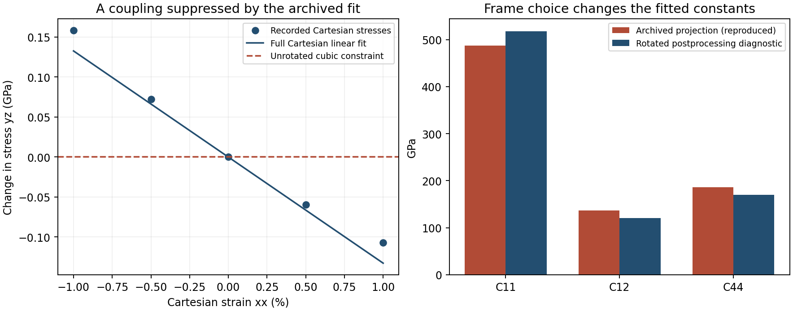
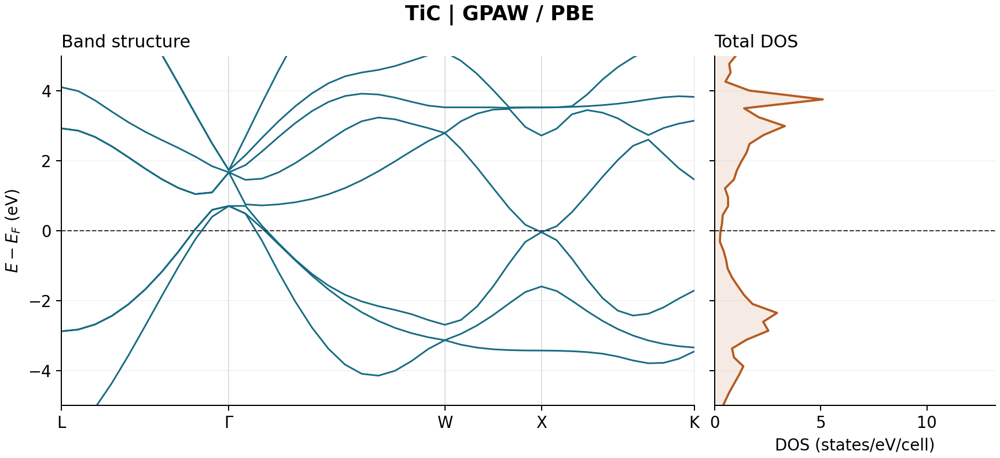

TiC: elasticity and metallic bands with GPAW
============================================

.. note::

   These settings are chosen to demonstrate the Nanoworks workflow with a
   short runtime. The numerical results are illustrative; quantitative
   materials predictions require appropriate convergence tests and validation
   of the physical model.

This exercise uses ``TiC-elastic-electronic/TiC.py`` to relax a two-atom TiC
primitive cell, fit elastic constants from strained calculations, and export
DOS and bands. It is a substantial example: the recorded elastic stage alone
took about four hours ten minutes on eight MPI processes.

.. warning::

   The deformation audit below exposes a coordinate-frame error in the
   archived cubic elastic fit. Its printed constants and derived moduli are
   retained as historical outputs, not validated material properties.
   The current GPAW elastic path still needs an orientation-aware fit.
   Use ``-s Elastic_calc=False`` for the electronic exercise until that
   backend correction is available.

Prepare and run
---------------

Activate the Nanoworks environment with GPAW, PAW setups and the Python
``elastic`` dependency installed.
Open the installed example folder shown below. If needed, install the
examples first with ``nanoworks --install-examples``; see
:ref:`tutorial-examples-setup`.

.. code-block:: bash

   cd ~/.nanoworks/examples/TiC-elastic-electronic
   dftsolve -E GPAW -p 8 -i TiC.py -g TiC_primitive_geooptimized.cif -s Elastic_calc=False --check
   dftsolve -E GPAW -p 8 -i TiC.py -g TiC_primitive_geooptimized.cif -s Elastic_calc=False

The output folder and filename prefix are ``TiC_primitive_geooptimized``.
``-p`` controls MPI processes within this calculation. When using the batch
example queue, ``tsp -S 1`` separately limits concurrent jobs to one.

Follow the input through the stages
-----------------------------------

.. list-table:: Settings used in the recorded run
   :header-rows: 1
   :widths: 45 55

   * - Setting
     - Value
   * - ``Mode``, ``XC_calc``, ``Wavefunction_cutoff``
     - ``PW``, ``PBE``, 700 eV
   * - ``Ground_kpts_x/y/z``, ``Gamma``
     - 21 x 21 x 21, ``True``
   * - ``SCF_accuracy``
     - ``very-tight``
   * - ``Occupation_scheme``, ``Smearing_width``
     - ``fermi-dirac``, 0.05 eV
   * - ``Geometry_optimizer``, ``Geometry_force_tolerance``
     - ``QuasiNewton``, 0.0005 eV/angstrom
   * - ``Relax_cell``, ``Fix_symmetry``
     - ``[True, True, True, False, False, False]``, ``False``
   * - ``DOS_integration``, ``DOS_width``, ``DOS_npoints``
     - ``smearing``, 0.1 eV Gaussian width, 301 samples
   * - ``Band_path``, ``Band_npoints``
     - ``LGWXK``, 40 total sampled points
   * - Spin and SOC
     - Both disabled

There is no explicit elastic mesh override in this input. Inspect the
deformation logs when checking inherited sampling and SCF settings. The
recorded run used the default five strain samples per direction, from -0.01
to +0.01, including the reference. Retain the deformation trajectory and logs
to audit the stress-strain fit; the tensor summary alone cannot establish
linearity or strain-window convergence.

Read the elastic result
-----------------------

The recorded run started on 19 October 2026 and used Nanoworks 27.2.0rc0,
ASE 3.29.0, GPAW 26.7.0 and eight MPI processes. The logs identify ``Ti.PBE``
and ``C.PBE`` setups with 12 and 4 valence electrons. A source commit and PAW
data package version were not recorded. The final primitive edge is
3.06541585 angstrom with 60-degree angles, corresponding to a conventional
cubic lattice parameter of **4.33515 angstrom**. Ti and C occupy fractional
coordinates (0, 0, 0) and (1/2, 1/2, 1/2).

Nanoworks identified Fm-3m symmetry for the elastic reconstruction and wrote
three independent cubic stiffnesses:

.. list-table:: Historical printed values: affected by the fit-frame error
   :header-rows: 1
   :widths: 60 40

   * - Quantity
     - Value
   * - C11
     - 486.92 GPa
   * - C12
     - 136.66 GPa
   * - C44
     - 185.99 GPa
   * - Bulk modulus B
     - 253.41 GPa
   * - Hill shear modulus G
     - 181.57 GPa
   * - Hill Young's modulus E
     - 439.69 GPa
   * - Hill Poisson ratio
     - 0.211

The cubic expressions C11-C12 = 350.26 GPa, C11+2C12 = 760.24 GPa and
C44 = 185.99 GPa are positive. These are algebraic checks on the printed
matrix. Because its fit used the wrong axes, they do not validate the
mechanical stability of the recorded TiC model.

Recomputing ``B = (C11 + 2*C12)/3`` and the Voigt-Reuss-Hill averages from
the displayed tensor reproduces the reported moduli to rounding precision.
The Hill values describe an isotropic aggregate; they are not direction-specific
single-crystal Young's moduli. The Zener ratio ``2*C44/(C11-C12)`` is about
1.062 within this fit; it should not be used as a validated anisotropy
prediction for TiC.

.. _tutorial-tic-elastic-audit:

Audit the deformation trajectory
--------------------------------

The repeat started on 28 October 2026 with the same input bytes. Its printed
elastic summary is byte-identical to the earlier one, but this repeat also
provides the full 30-frame deformation trajectory. Six Cartesian strain
modes each contain five amplitudes: -1%, -0.5%, 0, +0.5%, +1%. For shear,
these are tensor off-diagonal components; engineering shear is twice that
value. Fractional atomic positions are unchanged throughout the trajectory:
these are affine deformations without additional internal-coordinate
relaxation.

The primitive cell is represented in Cartesian axes rotated relative to
the conventional cubic crystal axes. The GPAW wrapper passes Cartesian
strains and stresses directly to ``elastic.get_elastic_tensor``, then
reconstructs a canonical three-constant cubic matrix. The fitting routine
identifies cubic symmetry but does not rotate these components. Cubic
symmetry alone does not make the canonical matrix valid in arbitrary axes.
See the `Elastic implementation
<https://elastic.readthedocs.io/rc/_modules/elastic/elastic.html#get_elastic_tensor>`_
and its ``regular`` strain matrix.

   Left: a Cartesian normal strain produces a shear-stress response that
   the archived cubic constraint forces to zero. Right: reprocessing the
   same stresses in crystal axes changes the fitted constants substantially.

The independent audit uses ASE's Voigt order ``xx yy zz yz xz xy`` and
engineering strains ``[exx, eyy, ezz, 2eyz, 2exz, 2exy]``. With row-vector
cells, construct the canonical fcc primitive cell ``A_c`` and determine
``R`` from ``A_c @ R = A_lab``. ``R`` is orthogonal with determinant +1.
Transform both tensors as ``e_c = R @ e_lab @ R.T`` and
``dsigma_c = R @ dsigma_lab @ R.T`` before fitting the three cubic slopes.
The supplied script retains the original data and writes derived tables
separately.

.. list-table:: Same trajectory, different fitting frames
   :header-rows: 1
   :widths: 40 20 20 20

   * - Fit
     - C11 (GPa)
     - C12 (GPa)
     - C44 (GPa)
   * - Unrotated projection, reproduced
     - 486.91569
     - 136.65878
     - 185.99410
   * - Crystal-axis diagnostic, all 30 frames
     - 518.22421
     - 121.00452
     - 170.30432
   * - Crystal-axis diagnostic, inner 18 frames
     - 518.07492
     - 120.97283
     - 170.43882

The reference normal stress is +0.00786223 GPa, corresponding to pressure
-0.00786223 GPa. The table applies the same small hydrostatic
Birch-to-stiffness correction as Elastic. Its sign and magnitude cannot
explain the large frame-dependent difference. Calling Elastic 5.2.5.3 on
the unrotated archived trajectory independently reproduces the first row.
The original run did not record its Elastic package version.

After subtracting the reference stress, the Cartesian cubic fit has a
stress-component RMS residual of 0.085285 GPa. Rotating the tensors before
the cubic fit reduces this to 0.049230 GPa. A fully unconstrained Cartesian
linear response gives 0.047145 GPa and normal/shear couplings of about
13.3 GPa. The inner window uses only amplitudes up to 0.5% per tensor
component, including the six reference frames; its rotated RMS is
0.015220 GPa. Residuals are descriptive measures, not uncertainty bars.

The rotated rows are postprocessing diagnostics, not replacement production
results. The strain-window comparison does not test cutoff, k sampling,
SCF stress accuracy, internal relaxation or the choice of stress/strain
measure at finite deformation. Fixing and validating the orientation-aware
backend remains necessary before publishing material constants.

Download the :download:`repeat data, deformation trajectory and audit script
<../_static/examples/tic-gpaw-elastic-audit-reference.zip>`. Extract it and run:

.. code-block:: bash

   python plot_elastic_audit.py

The script requires NumPy, Matplotlib and ASE, verifies source hashes,
checks all strain modes and the frame transformation, and regenerates the
figure, fitted coefficients, rotation and strain/stress tables. The archive
also contains a separate electronic consistency check script.

Read the electronic result
--------------------------

   Recorded TiC bands and total DOS, redrawn from the DAT tables. The dashed
   line is Ef; DOS is per two-atom primitive cell.

Several sampled bands cross Ef and the ground-state log reports no gap.
Linear interpolation of the broadened DOS table gives approximately
**0.295 states/eV/cell at Ef**, consistent with metallic behavior in this
calculation. That DOS value depends on sampling and the 0.1 eV broadening;
it is not a converged transport coefficient. Orbital projections can help
identify contributions but do not constitute a unique decomposition of bonding.

The 28 October repeat preserves this electronic result. Long/XYYY band
tables and the saved band state agree exactly; four bands span Ef along the
sampled path. The repeat DOS gives 0.295223420880 states/eV/cell at Ef.
Orbital and atom-resolved PDOS sums agree within 2e-14 states/eV/cell.
Against the earlier reference, maximum differences are below 2.41e-11 eV
for bands, 2.62e-8 states/eV/cell for total DOS and
1.59e-7 states/eV/cell for PDOS. These repetitions use the same settings,
so agreement is a reproducibility check rather than a convergence study.

Archive and repeat
------------------

The :download:`reference input, final CIF, DATs and elastic summary
<../_static/examples/tic-gpaw-reference.zip>` contain the numerical results
used here, with provenance and hashes. The long and XYYY band tables match;
DOS/PDOS entries and orbital sums were checked. The moduli were independently
recomputed from the reported tensor. The repeat deformation audit above
now identifies the fit-frame defect; numerical parameter convergence remains
untested.

Important files inside the output folder include:

* ``*-GROUND-GPAW-Log-SCF.txt`` and ``*-GROUND-GPAW-Result-Final.cif`` for
  the reference calculation and final structure.
* ``*-ELASTIC-GPAW-Result-Elastic-AllResults.txt`` for the tensor and moduli.
* ``*-ELASTIC-GPAW-Result-Elastic-deformations.traj`` and the deformation
  logs for fit auditing and compatible cache reuse.
* DOS/PDOS, band and matching KPath DATs for numerical electronic results.
* ``*-TIMINGS-GPAW-Log-Timings.txt`` for individual stage durations.

The recorded stage durations were 253.04 s for ground state, 15020.16 s for
elasticity, 8.68 s for DOS and 2.39 s for bands. They are not queue-inclusive
wall-clock benchmarks and will depend on the machine.
The repeat recorded 390.06 s, 23799.67 s, 12.58 s and 3.43 s respectively;
its elastic stage took about six hours 37 minutes.

Keep the GPW until all DFT postprocessing is finished. After archiving the
inputs, logs, geometry, deformation records, tables and figures, it can be
removed from a closed run; restarting a DFT stage then requires a regenerated
ground state. DAT replotting remains available without GPW:

.. code-block:: bash

   dftsolve --plot TiC_primitive_geooptimized/TiC_primitive_geooptimized-BAND-GPAW-Result-Band-XYYY.dat

For research, check cutoff and electronic sampling, then stress accuracy,
strain magnitude and the linear fitting window. A completed calculation with
tight SCF settings is useful evidence, but does not replace those studies.
