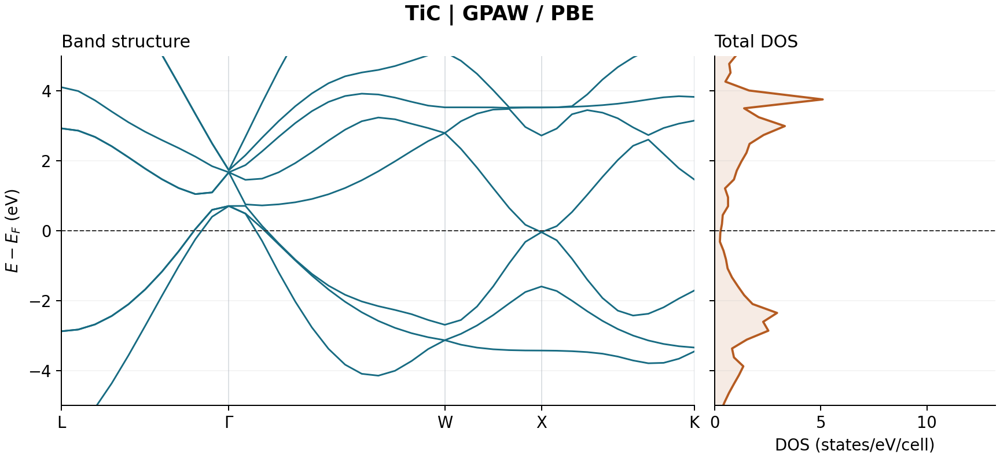

TiC: elasticity and electronic structure (GPAW)
===============================================

.. literalinclude:: ../../../nanoworks/examples/TiC-elastic-electronic/TiC.py
   :language: python
   :lines: 5-
   :caption: TiC.py

:download:`Download TiC.py <../../../nanoworks/examples/TiC-elastic-electronic/TiC.py>`.

Run
---

Requires GPAW and its PAW datasets.

.. code-block:: bash

   cd ~/.nanoworks/examples/TiC-elastic-electronic
   dftsolve -p 4 -i TiC.py -g TiC_primitive_geooptimized.cif

Results
-------

.. note::

   This example is a qualitative demonstration. For reliable quantitative
   results, optimize the structure where appropriate and converge the
   numerical settings.

Results are in ``TiC_primitive_geooptimized/``. Bands crossing Ef and a
nonzero DOS there indicate metallic behavior in the recorded calculation.
Read elastic constants in GPa and compare tensor symmetry and cubic
relations before interpreting moduli. The archived legacy elastic fit
is an audit example, not a validated TiC tensor.

   Recorded example output.

:doc:`Detailed recorded results <../validation/tic-gpaw>`.
