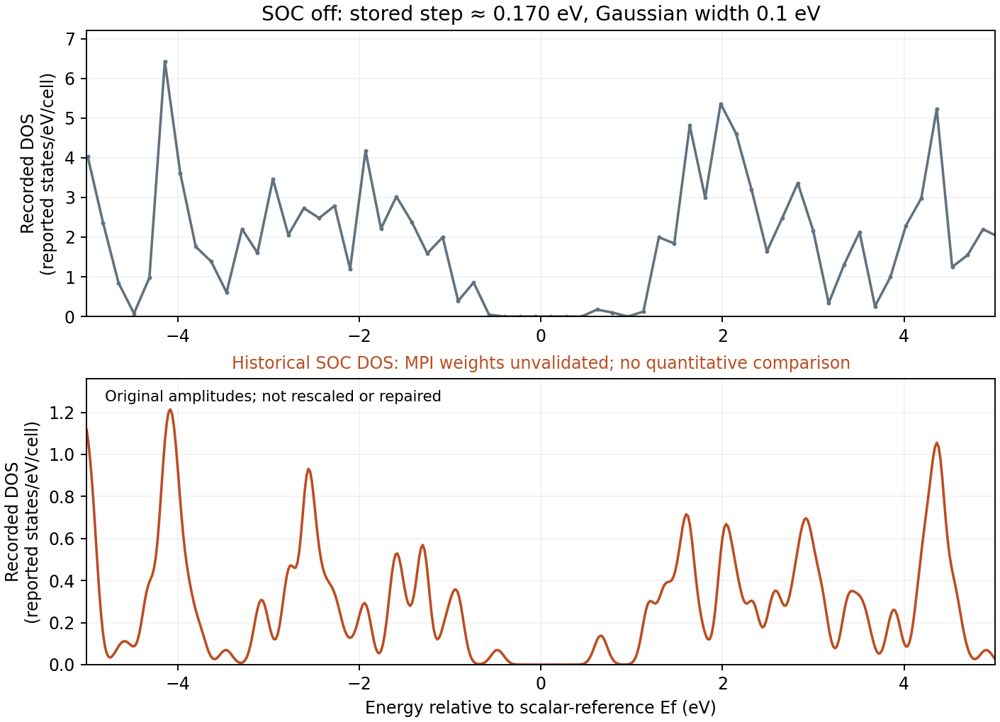

GPAW spin-orbit DOS: checking k-point weights
=============================================

.. note::

   This is a numerical-validation reference for an older GPAW SOC
   postprocessing path. The stored WSe2 output illustrates a limitation
   diagnosed from source code and synthetic data. It does **not**
   constitute a new WSe2 calculation or a converged DOS comparison.

For the step-by-step calculation of spin-orbit band splitting, start with
:doc:`wse2-gpaw-soc`. A reliable density of states (DOS) must integrate
eigenvalues over the Brillouin zone with the **matching k-point weights**.
Peak heights additionally depend on energy sampling and the chosen
broadening.

Frequency sampling in the reference tables
------------------------------------------

The scalar WSe2 table contains 501 energies from -74.33815 to
10.64777 eV, spaced by approximately 0.170 eV. The SOC table also
has 501 samples, but over -5 to 5 eV, with approximately 0.020 eV
spacing. Both requested 0.1 eV Gaussian broadening. An equal
number of samples therefore says nothing about whether the two DOS
curves have comparable resolution. In particular, a 0.170 eV grid
cannot reliably capture the height of every 0.1 eV broadened feature.

   The original curves are shown without scaling or correction.
   The SOC amplitudes are retained as historical numerical data, not
   as validated material properties.

A rank-local weight-list problem
--------------------------------

An earlier GPAW 26.7 ``DOSCalculator`` path could combine different
k-point coverages: ``BZWaveFunctions.eigenvalues()`` gathered the
full-Brillouin-zone SOC eigenvalues while ``weights()`` produced a
list sized for rank-local wavefunctions. The Gaussian DOS implementation
paired the lists with ``zip``, silently omitting eigenvalues if the
weights list was shorter. This gives an unreliable DOS normalization
when MPI divides the k-point data.

An isolated synthetic test illustrates the effect: nine full-BZ points
with two spinor eigenvalues per point yield an integrated spectral weight
of **2 states per cell** when every point contributes. A two-element
rank-local weight list instead yields **4/9**. Restoring one appropriate
weight per full-BZ point recovers 2. This test identifies a
postprocessing failure mode; it is not a physical WSe2 prediction.

Nanoworks validates the eigenvalue/weight layout when assembling GPAW
SOC DOS, and rejects unexpected layouts before replacing an existing
table. The correction does not introduce a second spin-degeneracy factor.
For implementation background see the
`GPAW DOS source <https://gpaw.readthedocs.io/_modules/gpaw/dos.html>`_
and `GPAW SOC source
<https://gpaw.readthedocs.io/_modules/gpaw/spinorbit.html>`_.

What the sample data can establish
----------------------------------

The preserved SOC DOS integrates to **2.78785** over its limited
[-5, 5] eV interval. On its own this finite-window integral
does **not** prove a normalization failure because spectral tails
and bands outside the window are omitted. The source-level
eigenvalue/weight mismatch independently explains why the original
absolute amplitudes are not suitable for quantitative SOC/non-SOC
comparison.

The reference file was deliberately not rescaled or replaced with a
synthetic corrected spectrum. An overall multiplier cannot reconstruct
k-point contributions that were never included. Recompute the DOS from
a compatible saved electronic state with a corrected workflow if
quantitative weights are needed. This example does not export
GPAW SOC-projected DOS.

Checks applicable to other materials
------------------------------------

1. Inspect the energy grid and compare its step with the intended
   broadening; use a finer grid to resolve narrow features.
2. Confirm that full-BZ eigenvalues and their weights cover the same
   k points and that spinor occupations are counted consistently.
3. Compare finite-window DOS integrals with their expected band-state
   weights only after accounting for the sampling window and tails.
4. Check energy zeros and convergence of electronic sampling and
   empty-state coverage before comparing absolute peak heights.
5. Keep the raw DOS and the calculator settings with any
   diagnostic reconstruction; never silently renormalize a spectrum.

The :download:`original WSe2 numerical data and plotting scripts
<../_static/examples/wse2-gpaw-soc-reference.zip>` permit inspection of
the raw curves without running GPAW. See also
:doc:`wse2-qe-soc` for QE's distinct fully relativistic implementation.
