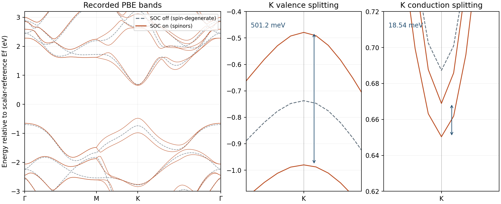
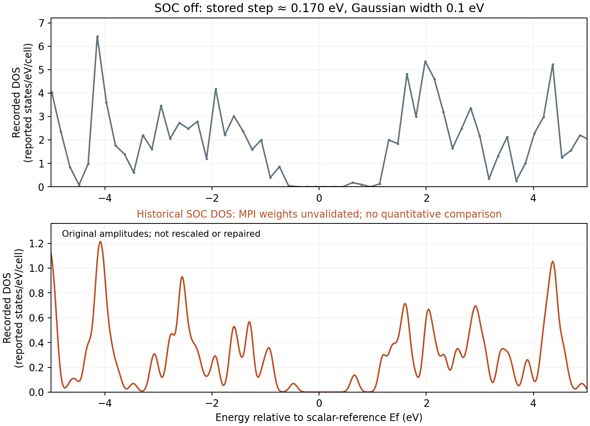

WSe2: compare bands with and without SOC in GPAW
================================================

.. note::

   These settings are chosen to demonstrate the Nanoworks workflow with a
   short runtime. The numerical results are illustrative; quantitative
   materials predictions require appropriate convergence tests and validation
   of the physical model.

This exercise uses the two existing ``SOC-WSe2-noCIF`` GPAW inputs to
compare a fixed WSe2 monolayer with and without spin-orbit coupling (SOC).
The recorded bands support a useful comparison. The historical SOC DOS
has a normalization limitation diagnosed below and should not be used for
quantitative spectral-weight comparisons.

Prepare and run
---------------

Activate the Nanoworks environment with GPAW and PAW setups installed.
Install the examples with ``nanoworks --install-examples`` if needed;
see :ref:`tutorial-examples-setup`. Use an updated development version
containing the full-BZ SOC DOS weight correction described below.

.. code-block:: bash

   cd ~/.nanoworks/examples/SOC-WSe2-noCIF
   dftsolve -E GPAW -p 8 -i WSe2-wo-SOC.py --check
   dftsolve -E GPAW -p 8 -i WSe2-wo-SOC.py
   dftsolve -E GPAW -p 8 -i WSe2-with-SOC.py --check
   dftsolve -E GPAW -p 8 -i WSe2-with-SOC.py

The outputs go to ``WSe2-wo-SOC/`` and ``WSe2-with-SOC/`` beside the inputs.
Each command handles its own MPI launch. Adapt ``-p`` to the machine.
The inputs construct the geometry directly with ASE:

.. code-block:: python

   from ase.build import mx2
   bulk_configuration = mx2(
       formula='WSe2', kind='2H', a=3.28, thickness=3.14,
       size=(1, 1, 1), vacuum=15,
   )

The three-atom cell has a = b = 3.28 angstrom, c = 33.14 angstrom and
an in-plane angle of 120 degrees. ``thickness`` is the Se-plane separation;
``vacuum=15`` adds 15 angstrom on each side. Geometry optimization is off.
Both final CIFs are byte-identical and reproduce the input coordinates.
The Python construction sets ASE periodic flags to ``[True, True, False]``;
CIF readers normally return three periodic directions, so use the original
Python inputs to preserve the intended boundary flags.

Understand what changes
-----------------------

Apart from ``Outdirname``, the two inputs differ only in ``SOC_calc``.
They share PBE/PW at 400 eV, a Gamma-centered 9 x 9 x 1 mesh,
``SCF_accuracy='normal'``, Fermi-Dirac width 0.05 eV,
``DOS_integration='smearing'`` and Gaussian DOS width 0.1 eV.
The band path is ``GMKG`` with 100 total sampled points.
``Spin_calc=False`` specifies a nonmagnetic starting state; SOC still
mixes the spin components in the postprocessed eigenstates.

Nanoworks uses GPAW's ``soc_eigenstates`` after the scalar-relativistic
calculation. This diagonalizes the SOC Hamiltonian in the scalar-state
basis without making the density self-consistent with SOC. See the
`GPAW SOC tutorial
<https://gpaw.readthedocs.io/tutorialsexercises/electronic/spinorbit/spinorbit.html>`_.
Consequently, the SOC run's ordinary SCF and band-stage logs still print
scalar-relativistic gaps. Read the exported SOC eigenvalues to obtain
the SOC band edges.

The recorded runs started on 28 October 2026 and identify Nanoworks
27.2.0rc0, GPAW 26.7.0, ASE 3.29.0 and eight MPI processes.
Both scalar SCFs converged in 17 steps; the fixed-density band calculations
converged in one step. The ground mesh has 81 full-BZ and 12 irreducible
points. The setups report W with 14 and Se with 6 valence electrons:
26 electrons per primitive cell. The source commit and PAW package version
were not recorded.

Read the band comparison
------------------------

   All recorded branches are retained. The two right panels enlarge the
   K-point splittings; straight segments connect the finite path samples.

The scalar export has 26 spin-degenerate bands; the SOC export has 52
spinor eigenvalues. There are 13 occupied scalar bands or 26 occupied
spinors. Doubling the number of columns does not double the electron count.
The SOC branches do not represent separately conserved up/down channels;
no spin texture was exported here.

K is sampled explicitly at index 56, between M at index 36 and the final
Gamma at index 99. The initial Gamma is index 0. From the SOC table,
the two upper valence eigenvalues at K are -0.98007188 and -0.47888258 eV,
giving **0.50118930 eV** splitting. The two lowest conduction eigenvalues
are 0.65036292 and 0.66890700 eV, giving **18.54408 meV** splitting.
These are differences within one calculation and do not depend on the
choice of energy zero.

.. list-table:: Edges on the recorded 100-point path
   :header-rows: 1
   :widths: 45 27 28

   * - Quantity
     - SOC off
     - SOC on
   * - Valence maximum
     - Gamma, -0.69734156 eV
     - K, -0.47888258 eV
   * - Conduction minimum
     - K, 0.68727475 eV
     - K, 0.65036292 eV
   * - Smallest path gap
     - 1.38461631 eV, Gamma to K
     - 1.12924551 eV, K to K
   * - Minimum direct path gap
     - 1.42465035 eV at K
     - 1.12924551 eV at K

Without SOC, the Gamma valence state is only about 40 meV above the K
state. With SOC, the upper K valence state is about 175 meV above Gamma.
The change in the location of the sampled valence maximum is therefore
visible in this comparison. It does not establish the global gap over the
two-dimensional Brillouin zone: off-path extrema were not searched.
Geometry, cutoff, mesh and SOC basis-size convergence also remain untested.
These Kohn-Sham gaps are not optical excitation energies.

Long-format, XYYY and saved band-state energies agree exactly in both
runs. The JSON reference is zero and the DATs are already relative to each
run's scalar-state Fermi level. Do not subtract the approximately -1.906 eV
printed Fermi level again. This overlay is not an absolute vacuum-level
band alignment.

Audit the DOS before comparing amplitudes
-----------------------------------------

   Original stored amplitudes on separate axes. The historical SOC curve
   is shown to document the audit finding, not as a quantitative SOC DOS.

The scalar table samples 501 energies from -74.33815 to 10.64777 eV,
with a step of about 0.170 eV. The SOC table samples 501 energies from
-5 to 5 eV, with a step of 0.020 eV. Equal sample counts therefore do not
mean equal energy resolution. Both requested a 0.1 eV Gaussian width;
the scalar table is too coarse for reliable peak-height or spectral-integral
work without further sampling checks. The orbital and atom sums of its
PDOS tables agree to within 4e-15 states/eV/cell, but projected DOS is
not an exact total-DOS decomposition.

The GPAW 26.7 source reveals an additional MPI issue:
``BZWaveFunctions.eigenvalues()`` gathers all full-BZ SOC eigenvalues,
whereas ``weights()`` builds a list with the number of rank-local
wavefunctions. The Gaussian DOS implementation pairs eigenvalues and
weights with ``zip``, which truncates the sum when that list is shorter.
The current Nanoworks workflow checks this layout against the full-BZ
point count and restores one uniform weight per collected point before
evaluating SOC DOS. Unexpected layouts raise an error before the previous
table is overwritten. This correction does not add another spin factor.
See the `GPAW DOS source
<https://gpaw.readthedocs.io/_modules/gpaw/dos.html>`_ and
`SOC source <https://gpaw.readthedocs.io/_modules/gpaw/spinorbit.html>`_.

An isolated reproduction using the original GPAW 26.7 ``DOSCalculator``
and synthetic eigenvalues verifies the failure: nine full-BZ points with
two spinors each integrate to 2 states/cell, but a two-element local weight
list yields only 4/9. Restoring the full list recovers 2. This is a
postprocessing check, not a new WSe2 calculation.

The stored SOC DOS has an integral of 2.78785 over its limited [-5, 5] eV
window. A limited-window integral alone cannot prove a normalization
failure, but the source-level MPI defect prevents trusting its absolute
amplitudes. The exact original code revision was not recorded. The archive
therefore retains the original spectrum without rescaling it or claiming
a corrected WSe2 DOS. Re-evaluate DOS from a compatible GPW with the
corrected workflow before making quantitative SOC/non-SOC DOS comparisons;
an overall scale factor cannot recover omitted k-point contributions.
Nanoworks does not export GPAW SOC PDOS in this workflow.

Archive and repeat
------------------

Download the :download:`original inputs, final CIFs, band/DOS tables and
replotting script <../_static/examples/wse2-gpaw-soc-reference.zip>`.
Extract the archive and run:

.. code-block:: bash

   python plot_wse2.py

NumPy, Matplotlib and ASE are sufficient. The script verifies source
hashes, identical settings and geometry, band formats, path positions,
splittings, sampled gaps and scalar PDOS sums. It recreates both figures
and ``checks.dat``. Logs and the large GPWs are not included; provenance
and inspected-log hashes are provided.

Recorded scalar stage times were 17.50 s for ground state, 6.66 s for DOS
and 43.10 s for bands. The SOC record lists 15.79 s for ground and
39.87 s for bands but omits a DOS duration; its timing file cannot be used
to reconstruct a complete workflow duration. These are machine-dependent
stage timings.

Keep GPWs for DFT postprocessing. DAT replotting remains available after
they are removed, for example:

.. code-block:: bash

   dftsolve --plot WSe2-with-SOC/WSe2-with-SOC-BAND-GPAW-Result-Band-XYYY.dat

The bundled QE SOC input uses a fully relativistic pseudopotential workflow
with different implementation details. Its recorded results need a separate
audit; the numerical values on this page refer only to the two GPAW runs.
