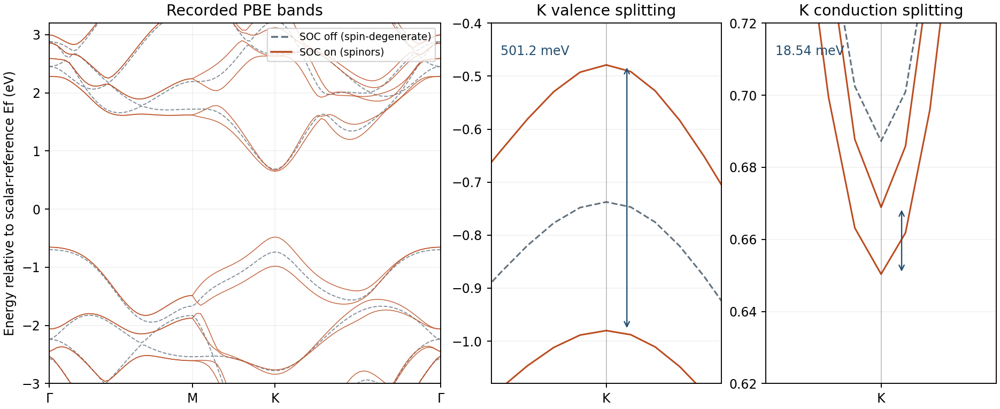

WSe2: spin-orbit coupling (GPAW)
================================

.. literalinclude:: ../../../nanoworks/examples/SOC-WSe2-noCIF/WSe2-with-SOC.py
   :language: python
   :lines: 5-
   :caption: WSe2-with-SOC.py

:download:`Download WSe2-with-SOC.py <../../../nanoworks/examples/SOC-WSe2-noCIF/WSe2-with-SOC.py>`.

**Companion input: WSe2-wo-SOC.py**

.. literalinclude:: ../../../nanoworks/examples/SOC-WSe2-noCIF/WSe2-wo-SOC.py
   :language: python
   :lines: 5-
   :caption: WSe2-wo-SOC.py

:download:`Download WSe2-wo-SOC.py <../../../nanoworks/examples/SOC-WSe2-noCIF/WSe2-wo-SOC.py>`.

Run
---

Requires GPAW and its PAW datasets.

.. code-block:: bash

   cd ~/.nanoworks/examples/SOC-WSe2-noCIF
   dftsolve -p 4 -i WSe2-wo-SOC.py
   dftsolve -p 4 -i WSe2-with-SOC.py

Results
-------

.. note::

   This example is a qualitative demonstration. For reliable quantitative
   results, optimize the structure where appropriate and converge the
   numerical settings.

Compare bands in ``WSe2-wo-SOC/`` and ``WSe2-with-SOC/`` at the same K point.
The recorded SOC valence splitting is about 0.5012 eV. Measure splitting
within one spectrum; separate Fermi zeros do not align the two spectra absolutely.
Use the bands for this comparison: the legacy GPAW SOC DOS does not contain
a separately evaluated spinor DOS.

   Recorded example output.

:doc:`Detailed recorded results <../validation/wse2-gpaw-soc>`.
