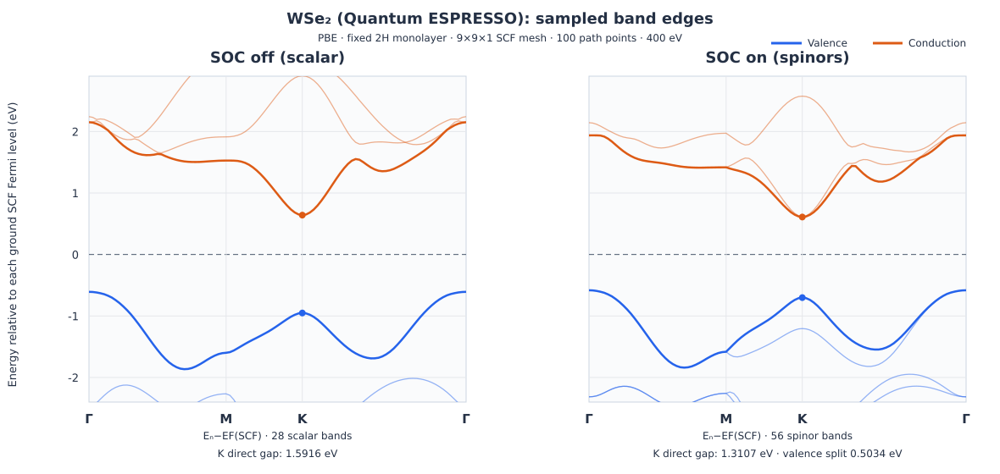

WSe2 with QE: check SOC bands and spectral energy references
=============================================================

.. note::

   These examples illustrate spin-orbit coupling and energy-reference
   alignment; quantitative predictions require convergence checks and
   compatible scalar/fully-relativistic pseudopotentials.

This tutorial compares scalar-relativistic and fully relativistic WSe2
monolayer calculations. It explains how to compare SOC bands when DOS
and band exports use different energy zeros and why a common reference
must be established before interpreting energy differences.

Prepare the two inputs
----------------------

Activate the Nanoworks environment with QE 7.4.1 and the managed PBE
PseudoDojo pseudopotentials installed. See :ref:`tutorial-examples-setup`
to install the examples into ``~/.nanoworks/examples``.

.. code-block:: bash

   cd ~/.nanoworks/examples/SOC-WSe2-noCIF
   dftsolve -E QE -p 8 -i WSe2-wo-SOC.py \
       -s DOS_integration=tetrahedron --check
   dftsolve -E QE -p 8 -i WSe2-wo-SOC.py \
       -s DOS_integration=tetrahedron
   dftsolve -E QE -p 8 -i WSe2-QE-with-SOC.py --check
   dftsolve -E QE -p 8 -i WSe2-QE-with-SOC.py

The two inputs use independent result directories; adapt the MPI process
count to the machine. The original non-SOC Python input defaults to GPAW and
smearing DOS, so its ``-E QE`` and tetrahedron override are essential.
The SOC input is QE-native. Their separate output directories are
``WSe2-wo-SOC`` and ``WSe2-QE-with-SOC``. Do not reuse one mode's
ground-state folder for the other.

The common geometry is a fixed three-atom 2H-WSe2 monolayer constructed
with ASE ``mx2('WSe2', kind='2H', a=3.28, thickness=3.14,
size=(1, 1, 1), vacuum=15)``. The calculations use PBE, a
400 eV wavefunction cutoff (29.39946 Ry), a Gamma-centered 9 x 9 x 1
ground mesh, Fermi-Dirac width 0.05 eV and a
Gamma-M-K-Gamma path with 100 total samples. The example uses tetrahedron integration for DOS. No geometry optimization was performed.

SOC is not merely a plotting switch
-----------------------------------

The scalar run uses PseudoDojo ``pbe/scalar/standard``. The SOC run
uses ``pbe/full/standard``, with QE ``noncolin=.true.`` and
``lspinorb=.true.``. These pseudopotential data are distinct even
though the cutoff, structure and XC functional are the same.

Both SCF logs report W with 14 and each Se with 16 valence electrons:
**46 electrons per primitive cell**. The scalar calculation exports
28 bands with 23 occupied scalar orbitals; the SOC calculation exports
56 spinor eigenvalues with 46 occupied spinors. Doubling the columns
does not double the electron count. The SOC result is a native
noncollinear, spin-orbit QE calculation, unlike the post-SCF SOC
diagonalization used in the separate GPAW tutorial
:doc:`wse2-gpaw-soc`.

Read the sampled bands
----------------------

   Selected branches closest to the occupied/unoccupied boundary, drawn
   from the example band tables. Blue lines are valence branches and
   orange lines are conduction branches. Each panel has its own SCF
   energy reference; the two energy zeros must not be compared as an
   absolute band offset. Other deep-lying and high-energy branches are
   intentionally omitted from this diagnostic figure.

The k-path files agree byte for byte. Their special-point indices are
Gamma=0, M=36, K=56 and Gamma=99. Counting occupied states from the
actual 46-electron record gives:

.. list-table:: Checked eigenvalues and path gaps
   :header-rows: 1
   :widths: 46 27 27

   * - Quantity
     - SOC off
     - SOC on
   * - Sampled VBM (Gamma)
     - -0.6075 eV
     - -0.5818 eV
   * - Sampled CBM (K)
     - +0.6401 eV
     - +0.6093 eV
   * - Sampled indirect gap (Gamma to K)
     - 1.2476 eV
     - 1.1911 eV
   * - Minimum direct path gap (K)
     - 1.5916 eV
     - 1.3107 eV
   * - Top two occupied spinor levels at K
     - Not separately resolved
     - -1.2048, -0.7014 eV
   * - Lowest two unoccupied spinor levels at K
     - Not separately resolved
     - +0.6093, +0.6163 eV

The SOC valence splitting at the sampled K point is **0.5034 eV**.
The first two conduction spinors differ by **0.0070 eV** (7.0 meV).
These are within-run differences, independent of the selected energy zero
to the printed precision. The path-gap values are not globally minimized
over the complete two-dimensional Brillouin zone, and must not be labelled
optical or quasiparticle gaps.

These examples illustrate the two relativistic approaches, but they are not
a strict numerical isolation of spin-orbit coupling: the scalar and
fully relativistic pseudopotentials are different. Neither the
400 eV cutoff nor the 9 x 9 x 1 integration mesh has been demonstrated
converged for these splittings, gap edges or DOS.

Align DOS and band energy references
------------------------------------

Electronic energies in a DOS table and a band plot are comparable only
when they use the **same energy zero**. Fermi levels reported by separate
SCF and NSCF stages can differ, especially when k-point meshes and
occupations differ. The reference outputs illustrate this problem: the
band stage used the ground-SCF zero, but DOS/PDOS used the DOS-NSCF zero.

.. list-table:: Reported Fermi energies (absolute QE eV)
   :header-rows: 1
   :widths: 40 30 30

   * - Calculation stage
     - SOC off
     - SOC on
   * - Ground SCF
     - -2.1451
     - -2.1107
   * - DOS NSCF
     - -1.6395
     - -2.6577
   * - NSCF minus ground
     - +0.5056
     - -0.5470

For a previously exported table with a DOS-NSCF zero, translation onto
the ground-SCF energy reference uses the signed Fermi-level difference:
``E_DOS_ground = E_DOS_archived + E_F(NSCF) - E_F(ground)``.
For these **specific saved tables**, the offsets are +0.5056 eV
(scalar) and -0.5470 eV (SOC). They are not general corrections to
other calculations and do **not** represent physical band-edge shifts.
The printed Fermi levels limit the offset precision. Apply this
translation only when working with data actually referenced to the
NSCF Fermi level; do not shift newly exported tables that already
share a ground-state reference.

Nanoworks ordinarily uses the available ground-SCF reference for both
QE DOS/PDOS and bands. If the ground reference is unavailable, standalone
DOS processing can fall back to the NSCF reference. Inspect each
output's reference before combining files. Regenerating DOS with a
different reference may also change the requested energy window;
avoid comparing rows by their indices alone.

The archived total DOS contains 501 energy rows per run; the assembled
PDOS tables contain 502 because of their extra final grid point.
The first 501 energy coordinates match between DOS and PDOS within
each run. In the SOC PDOS table, the summed ``s_j0.5``, ``p_j0.5``,
``p_j1.5``, ``d_j1.5`` and ``d_j2.5`` channels reproduce the
exported projected ``TOTAL`` column to numerical precision.

The projected ``TOTAL`` is not the global DOS: incomplete
atomic-projector weight means that their magnitudes need not agree.
The SOC ``l_j`` channels are total-angular-momentum projections,
not the non-SOC Cartesian ``px/py/pz`` or ``dxy`` channels,
and cannot be compared as identical orbital decompositions.

Validate an SOC comparison
--------------------------

To compare calculations with and without SOC, preserve the same
geometry, XC functional, cutoff policy, and comparable electronic
sampling. The fully relativistic and scalar pseudopotentials must
represent appropriate valence states; switching potentials is itself
a change of the physical model. Converge the in-plane k-point mesh,
wavefunction cutoff, empty bands, vacuum and relaxation protocol
before interpreting band splittings.

Measure each SOC splitting as a **difference between eigenvalues in
the same run at the same k-point**. Do not interpret the difference
between two independently chosen Fermi zeros as an absolute energy
shift. A high-symmetry path samples only part of the Brillouin zone,
so a reported path gap is not automatically the fundamental gap.
Check DOS and band energy references before overlaying results.

Reproduce the band checks from reference data
----------------------------------------

:download:`Scalar QE band table <../_static/examples/wse2-qe-bands-scalar.dat>` |
:download:`SOC QE band table <../_static/examples/wse2-qe-bands-soc.dat>` |
:download:`Common k-path <../_static/examples/wse2-qe-kpath.dat>`.

The files are unmodified exports, including their original ordering.
:download:`Download the reference data checksums
<../_static/examples/wse2-qe-band-checksums.txt>` to verify the
unmodified input tables separately from this tutorial.

To repeat the path-gap checks without running QE, place the two band
tables in the same folder and run the following in a Python environment
with NumPy:

.. code-block:: python

   import numpy as np

   def read_bands(filename, nbands):
       rows = np.loadtxt(filename, skiprows=1)
       result = np.stack([
           np.sort(rows[rows[:, 0] == i, 1]) for i in range(100)
       ])
       assert result.shape == (100, nbands)
       return result

   scalar = read_bands("wse2-qe-bands-scalar.dat", 28)
   soc = read_bands("wse2-qe-bands-soc.dat", 56)

   for name, bands, filled in (("scalar", scalar, 23), ("SOC", soc, 46)):
       valence = bands[:, filled - 1]
       conduction = bands[:, filled]
       print(name, "sampled gap:", conduction.min() - valence.max())
       print(name, "K direct gap:", conduction[56] - valence[56])

   print("SOC K valence splitting:", soc[56, 45] - soc[56, 44])
   print("SOC K conduction splitting:", soc[56, 47] - soc[56, 46])

