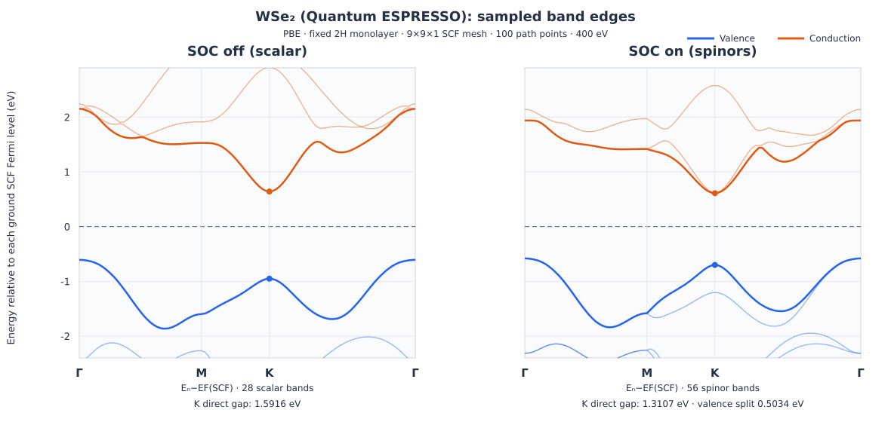

WSe2: spinor bands and orbital weights (QE)
===========================================

.. literalinclude:: ../../../nanoworks/examples/SOC-WSe2-noCIF/WSe2-QE-with-SOC.py
   :language: python
   :lines: 5-
   :caption: WSe2-QE-with-SOC.py

:download:`Download WSe2-QE-with-SOC.py <../../../nanoworks/examples/SOC-WSe2-noCIF/WSe2-QE-with-SOC.py>`.

Run
---

Requires QE and the managed pseudopotentials.

The first command uses the shared non-SOC input with QE selected explicitly.

.. code-block:: bash

   cd ~/.nanoworks/examples/SOC-WSe2-noCIF
   dftsolve -E QE -p 4 -i WSe2-wo-SOC.py -s DOS_integration=tetrahedron
   dftsolve -p 4 -i WSe2-QE-with-SOC.py

Results
-------

.. note::

   This example is a qualitative demonstration. For reliable quantitative
   results, optimize the structure where appropriate and converge the
   numerical settings.

Compare the scalar and SOC band tables at K. The recorded SOC valence
splitting is 0.5034 eV and the conduction splitting is 7.0 meV.
The projected bands distinguish the selected angular-momentum components.
Measure splittings within the same calculation.

   Recorded example output.

:doc:`Detailed recorded results <../validation/wse2-qe-soc>`.
