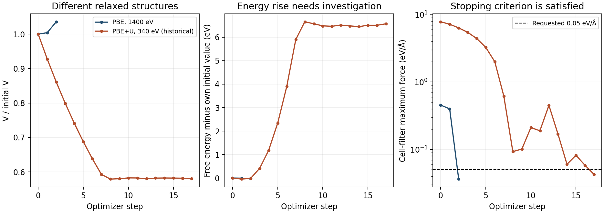
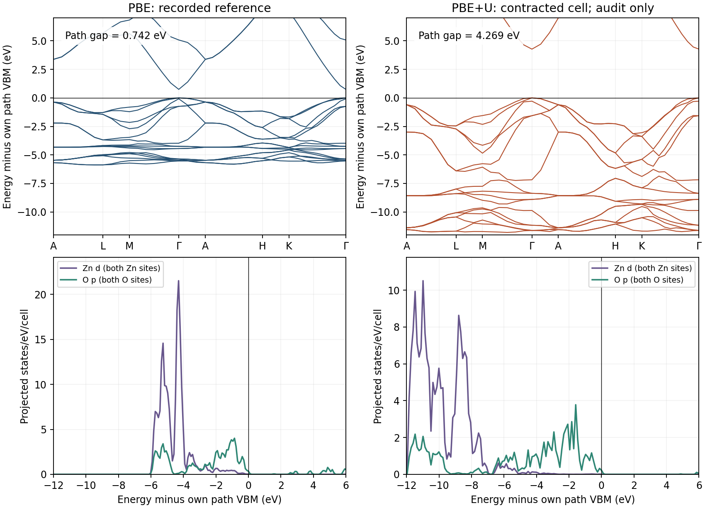

ZnO: audit geometry before comparing PBE and PBE+U
==================================================

.. note::

   These settings are chosen to demonstrate the Nanoworks workflow with a
   short runtime. The numerical results are illustrative; quantitative
   materials predictions require appropriate convergence tests and validation
   of the physical model.

This exercise examines the two GPAW inputs in ``ZnO-with-Hubbard``.
The recorded reference provides a PBE geometry, bands and orbital projections.
The recorded Hubbard run illustrates why a completed calculation is not
enough to validate a materials prediction: its cell contracts strongly and
its energy rises during relaxation. Its spectra are retained for auditing.

.. warning::

   The two archived runs use different cutoffs and different final cells.
   Their 0.742 eV and 4.269 eV path gaps are not a controlled measure of the
   Hubbard correction. The contracted PBE+U structure and its stress/energy
   consistency require investigation before quantitative use.

Prepare a controlled fixed-geometry exercise
--------------------------------------------

Activate the Nanoworks environment with GPAW and PAW setups installed.
Install the examples with ``nanoworks --install-examples`` if needed;
see :ref:`tutorial-examples-setup`.

Both inputs construct the same four-atom wurtzite cell using ASE:

.. code-block:: python

   from ase.build import bulk
   bulk_configuration = bulk('ZnO', 'wurtzite', a=3.25, c=5.2)

For the exercise below, hold that geometry fixed and use the same cutoff
in both calculations. Separate new output directories avoid reusing the
archived relaxed structures. The commands use existing CLI overrides:

.. code-block:: bash

   cd ~/.nanoworks/examples/ZnO-with-Hubbard
   dftsolve -E GPAW -p 8 -i ZnO_woHubbard.py \
       -s Geo_optim=False -s Wavefunction_cutoff=1400 \
       -s Outdirname=ZnO_PBE_fixed --check
   dftsolve -E GPAW -p 8 -i ZnO_woHubbard.py \
       -s Geo_optim=False -s Wavefunction_cutoff=1400 \
       -s Outdirname=ZnO_PBE_fixed
   dftsolve -E GPAW -p 8 -i ZnO_withHubbard.py \
       -s Geo_optim=False -s Wavefunction_cutoff=1400 \
       -s Outdirname=ZnO_PBE_U_fixed --check
   dftsolve -E GPAW -p 8 -i ZnO_withHubbard.py \
       -s Geo_optim=False -s Wavefunction_cutoff=1400 \
       -s Outdirname=ZnO_PBE_U_fixed

Adapt the process count to the machine. These commands define a new
comparison protocol; the figures below come from the original relaxed runs
and are not reference results for this fixed-cell exercise. The common
1400 eV cutoff is an example setting, not a convergence certificate for
GPAW or DFT+U. Converge the quantities of interest against cutoff, mesh,
SCF tolerance and the chosen PAW data before research use.

Read the Hubbard model
----------------------

The portable input is:

.. code-block:: python

   Hubbard_U = {'O-2p': 7.0, 'Zn-3d': 10.0}

The reference has ``Hubbard_U = {}``. Nanoworks maps the corrected input to
GPAW setup strings ``{'O': ':p,7.0', 'Zn': ':d,10.0'}``.
The logs confirm angular momenta l=1 and l=2 and ``scale: True``.
GPAW uses the Dudarev effective U convention and normalizes these orbital
projections by default. Its
`DFT+U documentation
<https://gpaw.readthedocs.io/tutorialsexercises/energetics/hubbardu/hubbardu.html>`_
explains why normalization can have a particularly strong influence on
p-orbital corrections. These example U values are not calibrated material
parameters or a linear-response determination.

The same portable dictionary can select a QE workflow, but projector
definitions, PAW/pseudopotential data and normalization are part of the
model. Identical U numbers across engines do not establish identical
corrections. The numerical results here refer only to GPAW.

Inspect the recorded relaxations first
--------------------------------------

The runs started on 28 October 2026 with Nanoworks 27.2.0rc0, GPAW 26.7.0,
ASE 3.29.0 and eight MPI processes. Both active input files match the
bundled versions byte for byte. Apart from ``Outdirname``, their input
assignments differ in ``Hubbard_U`` and ``Wavefunction_cutoff``.
The exact source commit and PAW package version were not recorded; the
Zn and O setup identifiers agree between the two logs.

Shared settings include PBE, a Gamma-centered 5 x 5 x 5 mesh, normal SCF
accuracy, Fermi-Dirac width 0.05 eV, nonmagnetic neutral cells,
``LBFGS``, force tolerance 0.05 eV/angstrom and maximum step 0.1 angstrom.
``Fix_symmetry=True`` and ``Relax_cell=[True, True, True, False, False, False]``
preserve the hexagonal cell form while allowing its size to change.
The full mesh has 125 points and 19 irreducible points. Zn has 12 and O
has 6 valence electrons: 36 electrons in the four-atom cell.

   Each energy curve is shifted by its own initial free energy. The panel
   does not compare absolute energies between different functionals.

.. list-table:: Recorded structures and stopping diagnostics
   :header-rows: 1
   :widths: 44 28 28

   * - Quantity
     - PBE reference
     - Historical PBE+U
   * - Cutoff
     - 1400 eV
     - 340 eV
   * - Initial volume
     - 47.56645 angstrom cubed
     - 47.56645 angstrom cubed
   * - Final volume
     - 49.27273 angstrom cubed
     - 27.63737 angstrom cubed
   * - Final a, c
     - 3.28531, 5.27138 angstrom
     - 2.70034, 4.37651 angstrom
   * - Trajectory frames, including initial
     - 3
     - 18
   * - Final cell-filter maximum force
     - 0.0362664 eV/angstrom
     - 0.0425403 eV/angstrom
   * - Final pressure
     - +0.26846 GPa
     - -0.72750 GPa
   * - Free-energy change within the run
     - -0.0291498 eV/cell
     - +6.5726514 eV/cell

The reference expands by 3.59%; the Hubbard trajectory contracts by
41.90%. The nearest Zn-O minimum-image separation changes from about
1.997 angstrom in the final reference to 1.649 angstrom in the final
Hubbard cell. These are substantially different structures.

Both optimizations meet the requested cell-filter force criterion. This
criterion combines atomic and cell degrees of freedom; it is not a direct
pressure threshold. Reconstructing ``FrechetCellFilter`` with the original
reference cell reproduces every printed optimizer force and free energy
to the log's rounding precision. All 3 and 18 recorded SCF cycles report
convergence, respectively.

Nevertheless, the large contraction and a final energy more than 6.5 eV
above the initial value make the Hubbard relaxation unsuitable as a
validated equilibrium structure. LBFGS is not required to lower the energy
at every individual step, so this record alone does not identify a specific
force, stress or optimizer bug. A finite-strain energy/stress consistency
test, cutoff and basis convergence, and electronic-state checks are still
needed. Do not attribute the contraction to physical U effects or use it
to select U parameters without those checks.

Read the spectra with their geometry attached
---------------------------------------------

   Each column uses its own relaxed cell and its own path VBM as energy
   zero. Reciprocal distances also differ because the cells differ.

Both band exports contain 40 total path samples and 36 spin-degenerate
bands; 18 bands are occupied. The path is A-L-M-Gamma-A-H-K-Gamma,
with the two Gamma samples at indices 15 and 39.
The recorded reference path gap is **0.74210606 eV** at Gamma.
The historical Hubbard path gap is **4.26856284 eV** at Gamma; differences
between the equivalent Gamma endpoints are below 1e-9 eV and do not
indicate an indirect gap. These are sampled Kohn-Sham gaps, not a full
Brillouin-zone search or optical excitation energies.

The Zn-d projection lies deeper relative to the valence edge in the
historical Hubbard spectrum. However, the simultaneous changes in cutoff
and geometry prevent assigning this shift or the gap change solely to U.
The plotted O-p and Zn-d curves sum both sites of each element and are
reported per four-atom cell. Orbital projections are not a unique bonding
decomposition or an exact total-DOS sum rule.

Long-format, XYYY and saved band-state energies agree exactly. The DATs
are already relative to each run's Fermi level and the JSON reference is
zero. The script applies one further shift by the sampled VBM for plotting;
it does not apply the printed Fermi level again. Aligning separate VBMs
does not establish absolute band offsets.

The 501-point DOS tables span approximately -18.181 to 29.623 eV for
PBE and -23.399 to 37.642 eV for PBE+U, with steps 0.09561 and
0.12208 eV. Both use 0.1 eV Gaussian broadening. Equal row counts therefore
give different energy sampling. Orbital and atom-resolved PDOS sums agree
within 8e-15 states/eV/cell. Full stored total-DOS integrals are about
71.936 and 71.937 states/cell, close to 36 bands times spin degeneracy two;
these include unoccupied states and are not the 36-electron count. Finite
bounds and discretization prevent treating them as exact sum-rule tests.

Archive and repeat the audit
----------------------------

The :download:`original inputs, trajectories, CIFs, spectra and audit script
<../_static/examples/zno-gpaw-hubbard-reference.zip>` preserve both recorded
runs. Extract the archive and run:

.. code-block:: bash

   python plot_zno.py

NumPy, Matplotlib, ASE and spglib are required. spglib reconstructs the
stored symmetry constraint. The script checks source hashes, input
differences, trajectory endpoints, every optimizer row, band representations,
path metadata, sampled gaps and orbital sums, then regenerates both figures,
derived audit tables and ``checks.dat``. An optional ``--log-dir`` checks
the hashes of the original log tree if available. Passing these consistency
checks does not validate the contracted Hubbard geometry.

Ground/DOS/band stage durations were 80.41/10.69/15.97 seconds for the
reference and 111.94/2.60/1.55 seconds for Hubbard. The cutoffs and numbers
of geometry steps differ, so this pair is not a controlled performance
benchmark. The large GPWs and machine-specific logs are excluded from the
archive; provenance and log hashes are included.

Before relaxing a corrected model, establish an identical fixed-geometry
comparison, validate the electronic model and energy/stress derivatives,
then converge the separate relaxed structures. Start from the original
geometry rather than treating the contracted archived cell as a validated
restart. The bundled QE inputs and recorded QE results need a separate
audit because their projector and pseudopotential models differ.
