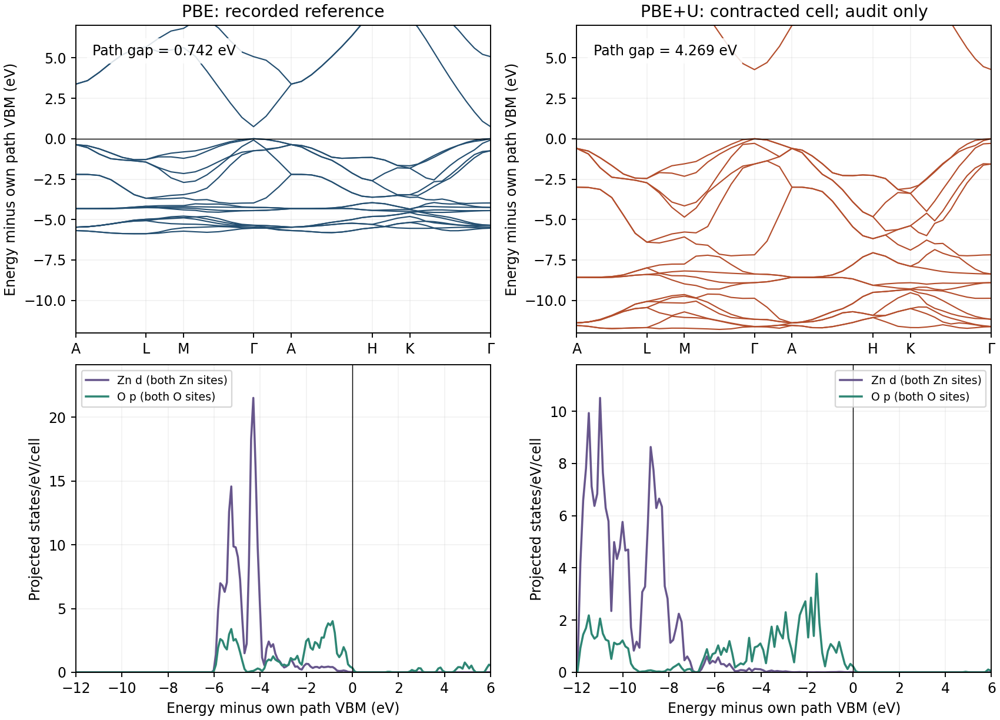

ZnO: compare Hubbard U (GPAW)
=============================

.. literalinclude:: ../../../nanoworks/examples/ZnO-with-Hubbard/ZnO_withHubbard.py
   :language: python
   :lines: 5-
   :caption: ZnO_withHubbard.py

:download:`Download ZnO_withHubbard.py <../../../nanoworks/examples/ZnO-with-Hubbard/ZnO_withHubbard.py>`.

**Companion input: ZnO_woHubbard.py**

.. literalinclude:: ../../../nanoworks/examples/ZnO-with-Hubbard/ZnO_woHubbard.py
   :language: python
   :lines: 5-
   :caption: ZnO_woHubbard.py

:download:`Download ZnO_woHubbard.py <../../../nanoworks/examples/ZnO-with-Hubbard/ZnO_woHubbard.py>`.

Run
---

Requires GPAW and its PAW datasets.

.. code-block:: bash

   cd ~/.nanoworks/examples/ZnO-with-Hubbard
   dftsolve -p 4 -i ZnO_woHubbard.py
   dftsolve -p 4 -i ZnO_withHubbard.py

Results
-------

The two inputs write separate ZnO result directories. Compare the O-p and
Zn-d projected DOS and the sampled band edges. Hubbard U changes their
relative positions. A comparison of U alone requires matched numerical
settings and geometry; independently relaxed results include structural effects.
The recorded comparison uses different cutoffs and is illustrative.

   Recorded example output.

These example settings need convergence tests before quantitative use.

:doc:`Detailed recorded results <../validation/zno-gpaw-hubbard>`.
