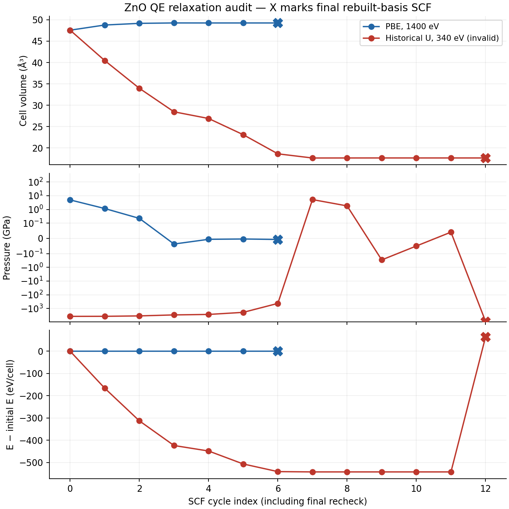
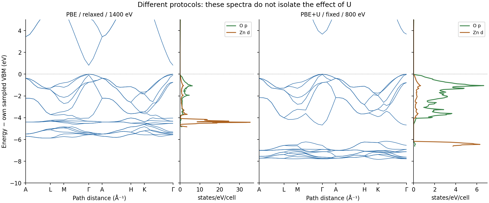

ZnO with QE: verify the final SCF before reading bands
======================================================

.. note::

   These examples demonstrate workflows with short runtimes. The recorded
   spectra are illustrative; quantitative predictions require convergence
   tests and validation of the electronic model.

This exercise audits three QE records from ``ZnO-with-Hubbard``: the shared
PBE reference, the shared PBE+U input and the native QE Hubbard input.
They differ in cutoff, geometry and DOS mesh. Their spectral differences
therefore do not isolate the effect of U. The related GPAW records are
examined in :doc:`zno-gpaw-hubbard`; the engines use different projector
and valence models.

.. warning::

   The historical 340 eV shared Hubbard relaxation is invalid. After BFGS
   reported convergence, QE rebuilt the plane-wave basis for the final cell.
   The final SCF produced a force component of 0.612397 eV/angstrom against
   a requested 0.05 eV/angstrom tolerance, and pressure -8747.477 GPa.
   Its archived SUCCESS status does not validate the structure or its spectra.

Prepare a matched fixed-cell exercise
-------------------------------------

Install QE and the required pseudopotentials, activate the Nanoworks
installation and install examples as described in :ref:`tutorial-examples-setup`.
Use the native QE input for both members of a new comparison:

.. code-block:: bash

   cd ~/.nanoworks/examples/ZnO-with-Hubbard
   dftsolve -E QE -p 8 -i ZnO_QE_Hubbard.py \
       -s Hubbard_U='{}' -s Wavefunction_cutoff=1400 \
       -s Outdirname=ZnO_QE_PBE_fixed --check
   dftsolve -E QE -p 8 -i ZnO_QE_Hubbard.py \
       -s Hubbard_U='{}' -s Wavefunction_cutoff=1400 \
       -s Outdirname=ZnO_QE_PBE_fixed
   dftsolve -E QE -p 8 -i ZnO_QE_Hubbard.py \
       -s Wavefunction_cutoff=1400 \
       -s Outdirname=ZnO_QE_U_fixed --check
   dftsolve -E QE -p 8 -i ZnO_QE_Hubbard.py \
       -s Wavefunction_cutoff=1400 \
       -s Outdirname=ZnO_QE_U_fixed

Adapt the MPI count to the machine. This input holds the original ASE
wurtzite cell fixed (a=3.25, c=5.2 angstrom), uses a Gamma-centered 5 x 5 x 5
SCF mesh, 7 x 7 x 7 tetrahedron DOS mesh and 40 bands. The two new output
directories keep the exercise separate from archived relaxations.
The common 1400 eV cutoff is an example starting point, not a convergence
certificate. These commands define a new protocol; the figures below are
historical results and are not reference outputs for these commands.
Converge energies, forces, stress, meshes and band counts before research use.

Inspect the actual model and settings
-------------------------------------

The three records started on 28 October 2026 using Nanoworks 27.2.0rc0,
QE 7.4.1 and eight MPI processes. Their active Python inputs match the bundled
inputs byte for byte. The shared PBE record uses ``ZnO_woHubbard.py``;
it is not a run of ``ZnO_QE_reference.py``.

All three are nonmagnetic, neutral PBE calculations with norm-conserving
PseudoDojo potentials. The logs report Zn valence 20 and O valence 6:
52 electrons and 26 occupied scalar bands in the four-atom cell.
The reported UPF MD5 identifiers agree across records:
``9b7be680307954c2706c150df658ede8`` for Zn and
``3e3f909f7470e8921608ab6b1f57bbae`` for O. These are log-reported
identifiers; the archive does not independently verify the UPF bytes.

Both corrected records contain the following card in the ground-state,
NSCF and path-band input decks:

.. code-block:: text

   HUBBARD (ortho-atomic)
   U O-2p 7.0
   U Zn-3d 10.0

It is generated from ``Hubbard_U = {'O-2p': 7.0, 'Zn-3d': 10.0}``.
The U values are illustrative parameters, not a linear-response determination.
The ``ortho-atomic`` projectors are part of the model; equal U numbers in
GPAW and QE do not establish equivalent corrections. GPAW's recorded Zn
setup has 12 valence electrons, whereas these QE potentials have 20.

.. list-table:: Recorded protocols
   :header-rows: 1
   :widths: 31 23 23 23

   * - Setting
     - Shared PBE
     - Shared PBE+U
     - Native QE PBE+U
   * - Cutoff (eV)
     - 1400
     - 340
     - 800
   * - ecutwfc (Ry)
     - 102.89810
     - 24.98954
     - 58.79892
   * - ecutrho / ecutwfc
     - 4
     - 4
     - 4
   * - Cell relaxation
     - Yes
     - Yes, invalid final SCF
     - No
   * - SCF / DOS mesh
     - 5 cubed / 5 cubed
     - 5 cubed / 5 cubed
     - 5 cubed / 7 cubed
   * - Path bands
     - 31
     - 31
     - 40
   * - Final volume (angstrom cubed)
     - 49.25725
     - 17.65281
     - 47.56645, fixed

The shared records override ``DOS_integration=tetrahedron``; the native
input selects it directly. The shared normal-strain cell mask and retained
crystal symmetry allow the hexagonal cell size to change.

Understand the final basis recheck
----------------------------------

   Each energy curve is relative to its own initial energy. Crosses mark
   the final SCF after QE recalculates G vectors for the final unit cell.
   The pressure axis is symmetric-logarithmic.

The reference reports BFGS convergence after 6 SCF cycles and 5 BFGS steps;
its final basis recheck is the seventh SCF. The largest final Cartesian
force component is 0.005423 eV/angstrom and pressure is -0.007 GPa.
Its final energy changes by only -0.0000268 eV from the preceding SCF.

The shared Hubbard run reports 12 SCF cycles and 11 BFGS steps, then performs
a thirteenth SCF with recalculated G vectors. Its cell has contracted by
62.89% from 47.56645 to 17.65281 angstrom cubed. The preceding pressure
was +0.041 GPa; the final SCF pressure becomes -8747.477 GPa and the
energy jumps by +606.88444 eV from the preceding SCF. The final force
component is 0.02381845 Ry/Bohr, or 0.612397 eV/angstrom.

This is a severe basis/cell consistency failure in the low-cutoff record,
not evidence for a physical Hubbard-driven collapse or metallic ZnO.
A larger cutoff and fresh original geometry are necessary starting points;
these records alone do not determine a complete root cause or certify
another cutoff.

Nanoworks now requires a converged final SCF and complete finite atomic
forces after the BFGS marker. It checks every final Cartesian component
against ``Geometry_force_tolerance`` before accepting the relaxed structure.
This follows QE's ``forc_conv_thr`` component convention, described in the
`QE input reference <https://www.quantum-espresso.org/Doc/INPUT_PW.html>`_.
A previous BFGS convergence message or ``JOB DONE`` cannot bypass the check.
The regression tests accept the recorded reference and reject the shared
Hubbard final recheck. This guard checks forces; it does not replace a
separate stress, cell-constraint or cutoff-convergence assessment.
The fixed-cell native record has no geometry-convergence claim.

Read bands and PDOS on consistent energy axes
---------------------------------------------

   The invalid shared Hubbard spectra are excluded. These two columns also
   have different cells and cutoffs, and are not a controlled U comparison.

Both paths contain 40 samples along A-L-M-Gamma-A-H-K-Gamma. The special
point indices are 0, 6, 9, 15, 18, 26, 29 and 39. Reciprocal distances are
computed from each record's own cell. The shared PBE sampled gap is
**0.8108 eV** at Gamma; the fixed native Hubbard sampled gap is
**3.6692 eV** at Gamma. These are scalar Kohn-Sham path gaps, not a full
Brillouin-zone search, optical gaps or validated experimental predictions.
The invalid shared Hubbard record has overlapping nominal occupied and
unoccupied band manifolds; it must not be assigned a valid insulating gap.

Nanoworks' band tables subtract the ground-state reference, while these DOS
tables subtract the DOS NSCF reference. Their numerical values differ:

.. list-table:: Recorded energy references, eV
   :header-rows: 1

   * - Record
     - Band reference
     - DOS reference
     - DOS minus band reference
   * - Shared PBE
     - 9.5419
     - 9.2717
     - -0.2702
   * - Shared PBE+U, invalid
     - 45.1661
     - 45.6240
     - +0.4579
   * - Native PBE+U
     - 9.5077
     - 10.5289
     - +1.0212

To align the exported DOS to the sampled band VBM, use
``E_DOS_export + Eref_DOS - (VBM_band_export + Eref_band)``.
Simply subtracting the exported band VBM from exported DOS energies mixes
references. The saved XML Fermi level equals the DOS reference, not the
band reference. The script compares absolute XML eigenvalues with the
long/XYYY tables to the printed 0.0001 eV precision before shifting the
figures. Independent VBM alignment does not establish absolute band offsets.

Total DOS has 501 rows in each run; PDOS and atom tables have 502 rows,
including one energy step beyond the nominal maximum. Keep each actual
energy axis rather than truncating the PDOS or assuming identical grids.
The stored total-DOS integrals are 20.9341, 2.5014 and 22.5983 states/cell
for reference, invalid shared Hubbard and native Hubbard, respectively.
They cover limited energy windows, not all occupied states; they are not
52-electron count checks. Spin degeneracy is already included.

The plotted O-p and Zn-d curves sum the two corresponding atoms using
raw atom-file LDOS columns. The aggregate p column also contains Zn p
states and therefore is not an O-p projection. Both Zn s radial channels
contribute to the s total. Processed orbital sums reproduce the source
LDOS/component columns, but separately printed QE total projections differ
slightly because raw values have limited significant digits. Do not demand
an exact total-DOS projection sum rule.

Reproduce and retain the evidence
---------------------------------

Download the :download:`inputs, spectra, metadata and audit script
<../_static/examples/zno-qe-hubbard-reference.zip>`, extract and run:

.. code-block:: bash

   python plot_zno_qe.py

NumPy, Matplotlib and ASE are required. The script verifies source hashes,
band formats and XML-derived eigenvalues, physical path distances, stage
references, DOS/PDOS axes, orbital sums and the final-force classification.
It regenerates both figures, ``derived-audit.json`` and ``checks.dat``.
Passing these consistency checks does not validate the invalid geometry
or certify the other runs' numerical convergence.

The archive preserves original Python inputs, CIFs, DATs and raw orbital
projections. Generated QE decks have only path fields sanitized; numerical
settings and Hubbard cards are retained. Raw logs, full XML and wavefunctions
are excluded. XML-derived numerical metadata and original log/input/XML
hashes retain provenance. If the original download tree is available,
``python plot_zno_qe.py --log-dir /path/to/tree`` also verifies its hashes.
The archive README records the original Drive sources and limitations.
