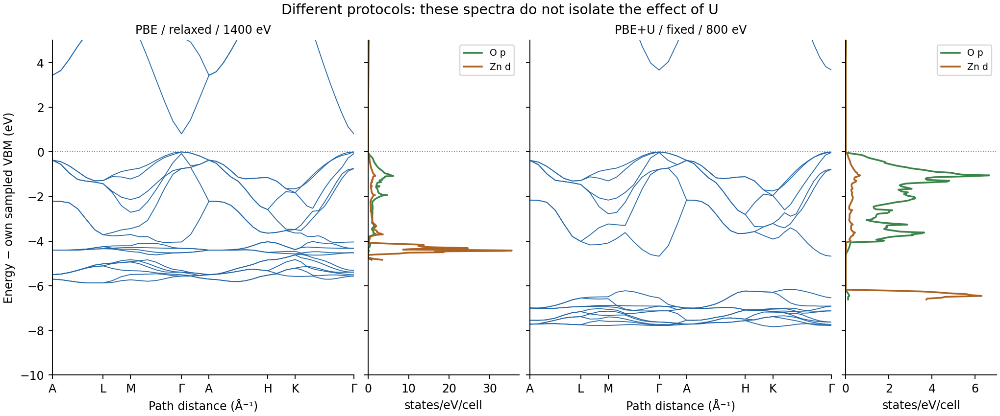

ZnO: Hubbard U, bands and DOS (QE)
==================================

.. literalinclude:: ../../../nanoworks/examples/ZnO-with-Hubbard/ZnO_QE_Hubbard.py
   :language: python
   :lines: 5-
   :caption: ZnO_QE_Hubbard.py

:download:`Download ZnO_QE_Hubbard.py <../../../nanoworks/examples/ZnO-with-Hubbard/ZnO_QE_Hubbard.py>`.

Run
---

Requires QE and the managed pseudopotentials.

The figure below is from archived relaxed comparison runs, not a new run of this fixed-cell input.

.. code-block:: bash

   cd ~/.nanoworks/examples/ZnO-with-Hubbard
   dftsolve -p 4 -i ZnO_QE_Hubbard.py

Results
-------

Results are in ``ZnO-QE-withHubbard-results/``. The DOS uses a denser
7 x 7 x 7 mesh than the 5 x 5 x 5 ground mesh. Compare Zn-d and O-p
contributions and read the band edges on the same ground-state energy reference.
For a controlled U comparison, repeat the same input with an empty
``Hubbard_U`` and a separate output directory. Keep cutoff, cell and meshes matched.

   Recorded example output.

These example settings need convergence tests before quantitative use.

:doc:`Detailed recorded results <../validation/zno-qe-hubbard>`.
