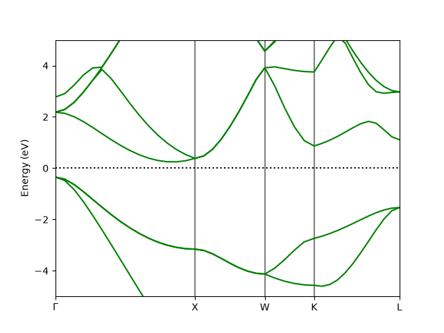
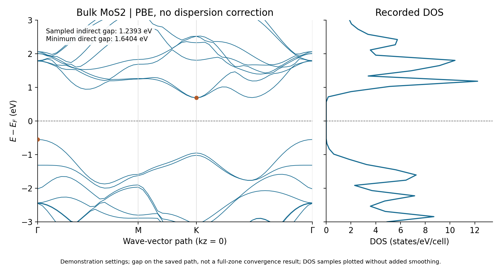
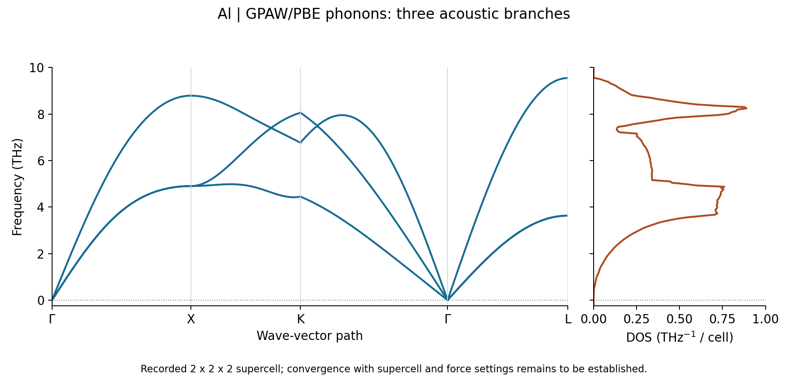

.. _tutorials:

Tutorials
=========

Learn a reusable calculation workflow: prepare an input, verify the setup,
run a calculation, inspect its output and assess numerical reliability.
The named materials provide concrete examples; the steps and checks apply
to other systems as well. All tutorials use the examples installed in
``~/.nanoworks/examples``. Keep your Nanoworks virtual environment active;
see :doc:`installation` for engine installation.

.. _tutorial-examples-setup:

Install the examples once
-------------------------

If the examples are not installed yet, run:

.. code-block:: console

   $ nanoworks --install-examples

The command copies the examples bundled with your installed Nanoworks version
into ``~/.nanoworks/examples``. An existing examples folder is preserved,
including your inputs and results. The command does not refresh older copies;
check your installed version if a tutorial's named input is missing.

Each tutorial starts with ``cd`` into its installed example folder. Results
are written into the output subdirectories specified by the inputs. Use
``dftsolve -i input.py`` to run a DFT input; executing the Python file alone
does not start the Nanoworks workflow.

.. note::

   These settings are chosen to demonstrate the Nanoworks workflow with a
   short runtime. The numerical results are illustrative; quantitative
   materials predictions require appropriate convergence tests and validation
   of the physical model.

First calculations
------------------

Learn the input, preflight, calculation and result sequence with silicon or
Fe. Follow the convergence exercise and learn how to adapt an example
to your own material before choosing research parameters.

.. raw:: html

   
   
   

.. toctree::
   :maxdepth: 1

   tutorials/silicon-gpaw
   tutorials/fe-qe-spin
   tutorials/silicon-convergence
   tutorials/adapt-a-material

   :doc:`tutorials/silicon-gpaw` explains this recorded band plot, the DOS
   figure and their numerical output files.

Electronic structure and defects
--------------------------------

Learn geometry optimization, orbital character, spin and charge with
material examples. Figures and optional reference data show how to read
the outputs; they are not convergence benchmarks.

.. toctree::
   :maxdepth: 1

   examples/gaas-gpaw
   examples/si-hse-gpaw-dos
   examples/cr2o-gpaw-spin
   examples/graphene-gpaw-vacancy
   examples/graphene-gpaw-charge
   examples/mos2-gpaw-reference
   examples/wse2-gpaw-soc
   examples/wse2-qe-soc

   :doc:`examples/mos2-gpaw-reference` connects the relaxed bulk cell to its
   sampled band edges and Mo/S orbital projections.

Optics, phonons and elasticity
------------------------------

Continue from the electronic calculation to the selected material response.

.. toctree::
   :maxdepth: 1

   examples/silicon-qe-optics
   examples/silicon-gpaw-rpa
   examples/silicon-gpaw-bse
   examples/al-gpaw-phonons
   examples/al-qe-dfpt-phonons
   examples/si-gpaw-phonons
   examples/si-qe-dfpt-phonons

   :doc:`examples/al-gpaw-phonons` explains the acoustic modes, phonon DOS
   and harmonic thermal outputs behind this example.

Numerical validation and troubleshooting
----------------------------------------

For more detailed examples of convergence problems, inconsistent
electronic-structure references, and unreliable elastic or phonon results,
see the separate :doc:`reference_cases` section. These analyses complement
the tutorials but are not prerequisites for learning a workflow.

All bundled inputs
------------------

The catalog lists the installed DFT, molecular-dynamics and machine-learning
examples by topic, including batch-run instructions.

.. toctree::
   :maxdepth: 1

   examples
