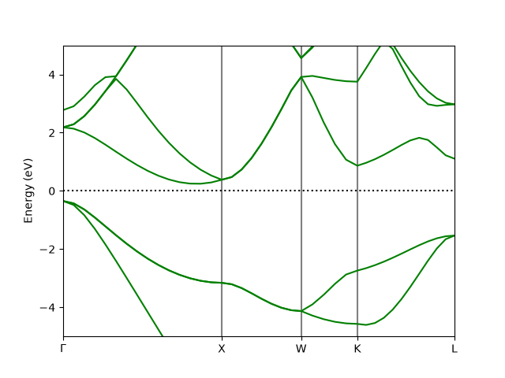
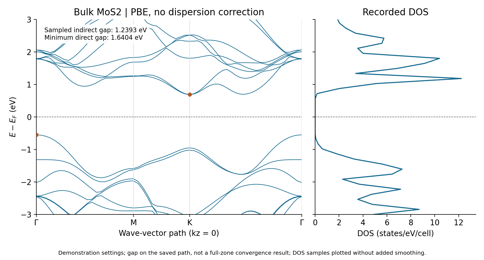
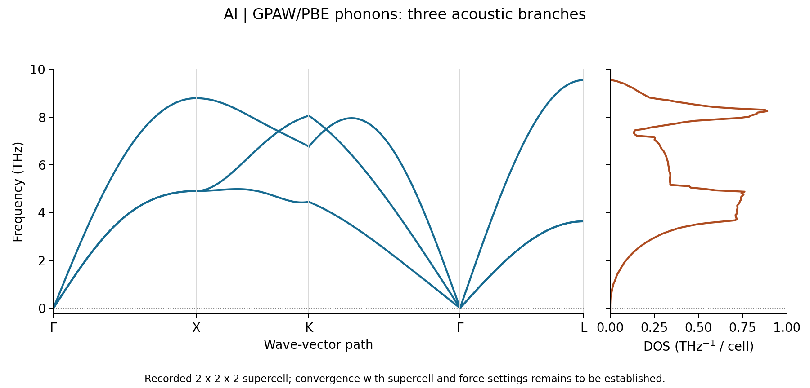

.. _tutorials:

Tutorials and examples
======================

Start with a short calculation, inspect the recorded figures, then follow a
materials workflow. All tutorials use the examples installed in
``~/.nanoworks/examples``. Keep your Nanoworks virtual environment active;
see :doc:`installation` for engine installation.

.. _tutorial-examples-setup:

Install the examples once
-------------------------

If the examples are not installed yet, run:

.. code-block:: console

   $ nanoworks --install-examples

The command copies the examples bundled with your installed Nanoworks version
into ``~/.nanoworks/examples``. An existing examples folder is preserved,
including your inputs and results. The command does not refresh older copies;
check your installed version if a tutorial's named input is missing.

Each tutorial starts with ``cd`` into its installed example folder. Results
are written into the output subdirectories specified by the inputs. Use
``dftsolve -i input.py`` to run a DFT input; executing the Python file alone
does not start the Nanoworks workflow.

.. note::

   These settings are chosen to demonstrate the Nanoworks workflow with a
   short runtime. The numerical results are illustrative; quantitative
   materials predictions require appropriate convergence tests and validation
   of the physical model.

First calculations
------------------

Learn the input, preflight, calculation and result sequence with silicon or
Fe. Follow the convergence exercise before choosing research parameters.

.. raw:: html

   
   
   

.. toctree::
   :maxdepth: 1

   tutorials/silicon-gpaw
   tutorials/fe-qe-spin
   tutorials/silicon-convergence

   :doc:`tutorials/silicon-gpaw` explains this recorded band plot, the DOS
   figure and their numerical output files.

Electronic structure and defects
--------------------------------

Follow geometry optimization, orbital character, spin or charge through
recorded calculations. Each page includes figures and downloadable data.

.. toctree::
   :maxdepth: 1

   examples/gaas-gpaw
   examples/cr2o-gpaw-spin
   examples/graphene-gpaw-vacancy
   examples/graphene-gpaw-charge
   examples/mos2-gpaw-reference

   :doc:`examples/mos2-gpaw-reference` connects the relaxed bulk cell to its
   sampled band edges and Mo/S orbital projections.

Optics, phonons and elasticity
------------------------------

Continue from the electronic calculation to the selected material response.

.. toctree::
   :maxdepth: 1

   examples/silicon-qe-optics
   examples/al-gpaw-phonons
   examples/tic-gpaw

   :doc:`examples/al-gpaw-phonons` explains the acoustic modes, phonon DOS
   and harmonic thermal outputs behind this example.

All bundled inputs
------------------

The catalog lists the installed DFT, molecular-dynamics and machine-learning
examples by topic, including batch-run instructions.

.. toctree::
   :maxdepth: 1

   examples
