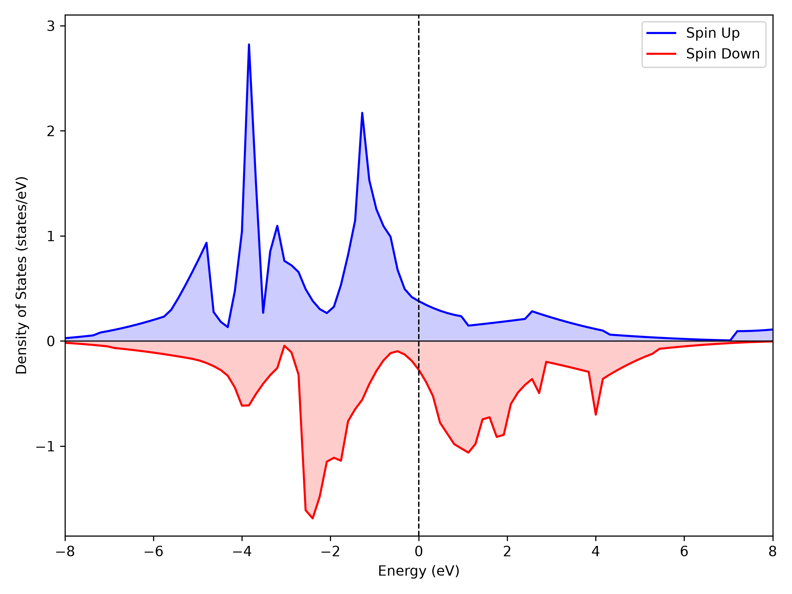
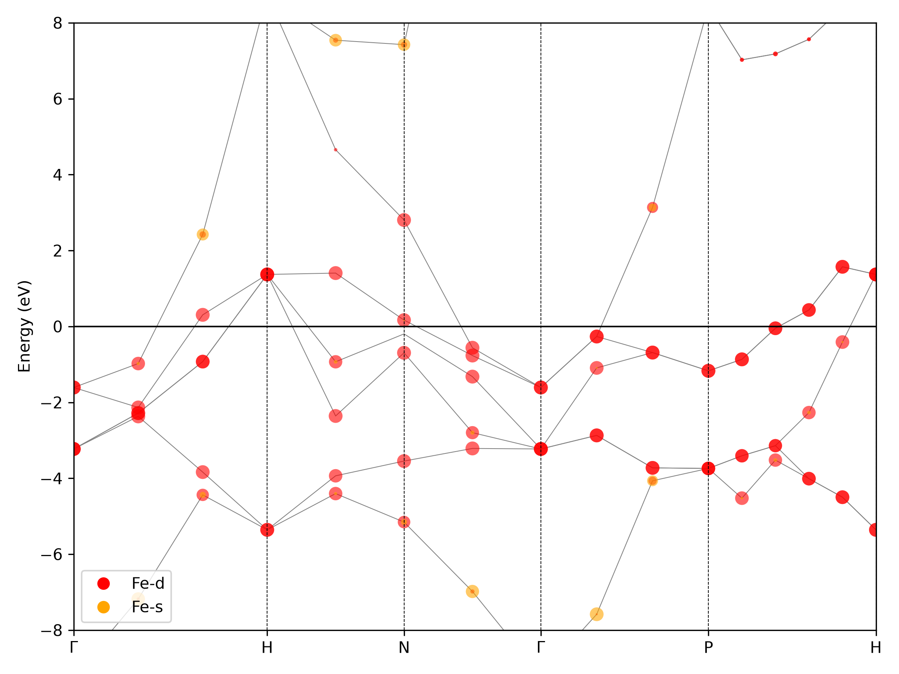

.. _tutorial-fe-spin:

Iron: spin, projected bands and density (QE)
============================================

.. literalinclude:: ../../../nanoworks/examples/Fe-QE-spin-smoke/Fe-QE-spin-smoke.py
   :language: python
   :lines: 5-
   :caption: Fe-QE-spin-smoke.py

:download:`Download Fe-QE-spin-smoke.py <../../../nanoworks/examples/Fe-QE-spin-smoke/Fe-QE-spin-smoke.py>`.

Run
---

Requires QE and the managed pseudopotentials.

.. code-block:: bash

   cd ~/.nanoworks/examples/Fe-QE-spin-smoke
   dftsolve -p 4 -i Fe-QE-spin-smoke.py

Results
-------

.. note::

   This example is a qualitative demonstration. For reliable quantitative
   results, optimize the structure where appropriate and converge the
   numerical settings.

Results are in ``Fe-QE-spin-smoke-results/``. Compare Up and Down bands and
DOS to see the spin asymmetry. The downward DOS curve is a plotting convention.
The larger projected-band markers indicate greater Fe orbital weight.
The initial 2.2 Bohr magneton moment is a starting guess; read the final
magnetization from the SCF log. CUBE files contain the charge and spin densities.

   Recorded example output.

   Recorded example output.

:doc:`Detailed recorded results <../validation/fe-qe-spin>`.
