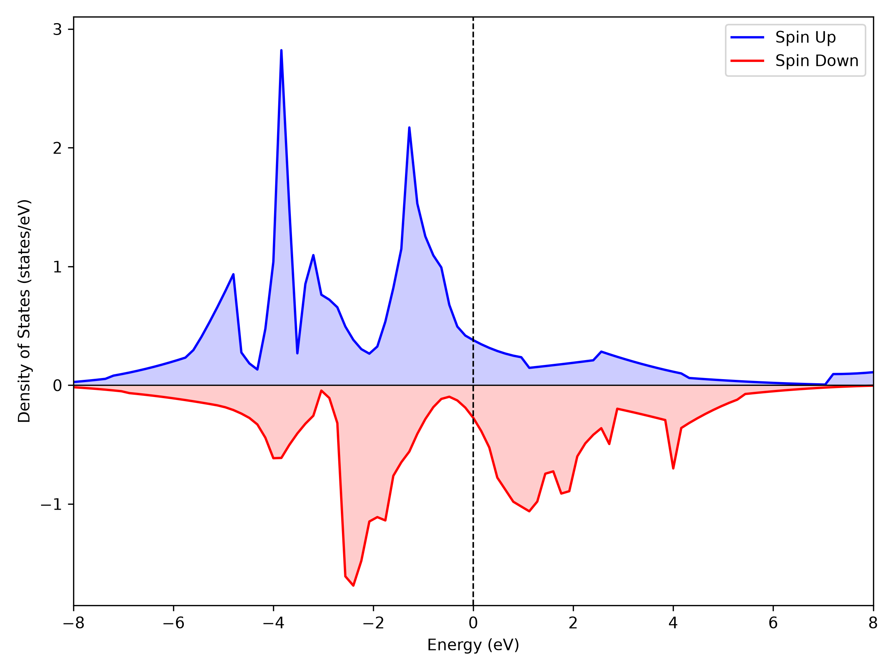
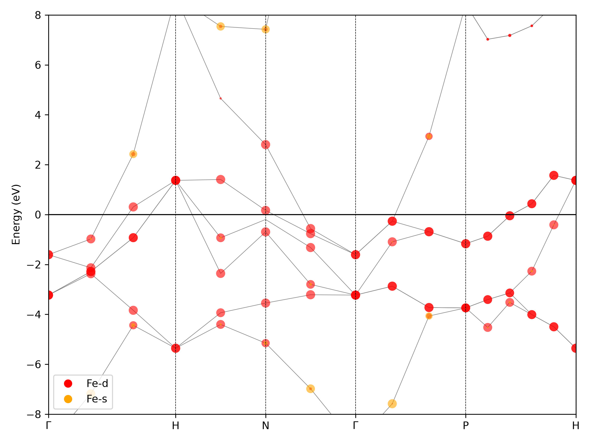

.. _tutorial-fe-spin:

Fe: a native QE spin workflow
=============================

Use the examples installed under ``~/.nanoworks/examples``; see
:ref:`tutorial-examples-setup` for the installation command.

Prepare and inspect the input
-----------------------------

.. code-block:: bash

   cd ~/.nanoworks/examples/Fe-QE-spin-smoke

This input constructs a one-atom bcc Fe cell with ASE, so there is no ``-g``
argument. It sets ``Engine='QE'``, ``Spin_calc=True`` and an initial moment of
2.2 Bohr magnetons per atom. That is an initial guess, not a prescribed final
magnetization. It selects ground, DOS/PDOS, band, projected-band and density
stages. It does not request SOC, optics, phonons, elasticity or relaxation.

Before calculation, ensure ``pw.x``, ``dos.x``, ``projwfc.x``, ``bands.x`` and
``pp.x`` are on ``PATH`` and the scalar-relativistic QE PBE UPFs are installed.

Preflight and inspect the QE deck
---------------------------------

.. code-block:: bash

   dftsolve -i Fe-QE-spin-smoke.py --check
   dftsolve -p 2 -i Fe-QE-spin-smoke.py --dry-run

The dry run writes native QE inputs and execution instructions without running
QE. Read the generated ``pw.x`` input: the initial magnetic state, cutoff,
k-point mesh and calculation type should match the Nanoworks input.
The dry-run plan is optional bookkeeping, not a numerical result.

Run and interpret both channels
-------------------------------

.. code-block:: bash

   dftsolve -p 2 -i Fe-QE-spin-smoke.py

Nanoworks launches QE with the requested process count; do not wrap this command
in another ``mpirun``. Outputs are written in ``Fe-QE-spin-smoke-results/``.
Because the geometry comes from the input, the filename prefix is also
``Fe-QE-spin-smoke-results``. Expect Up/Down DOS, PDOS and band DAT tables,
projected-band figures, and total/Up/Down/spin-density CUBE fields.

   Fe spin-resolved DOS from the recorded QE exercise. Down-channel curves
   are mirrored for display; this does not make the underlying DOS negative.

   Up-channel projected bands from the same run. Marker size represents
   orbital weight, rather than a second energy scale.

Read the ground-state SCF log and final magnetization before interpreting the
spin channels. The Down DOS curve is drawn below zero for display; the DAT
table contains the DOS values rather than that plotting sign. Projected-band
marker size shows the selected Fe s or d contribution. The ``atoms`` selection
in ``Projections`` is zero-based, so ``[0]`` selects this cell's Fe atom.

Both DOS channels can be replotted using either paired table:

.. code-block:: bash

   dftsolve --plot Fe-QE-spin-smoke-results/Fe-QE-spin-smoke-results-DOS-QE-Result-DOS-Up.dat

Keep the Down table beside the Up table. Each DAT begins with column names
and units; DOS energies are relative to Ef.

Before scientific use
---------------------

The example's 4x4x4 meshes, 16 bands and short band path are smoke-test settings.
Check cutoff and k-point convergence separately, then DOS integration and
broadening, empty bands and path sampling. For magnetic systems, verify the
converged magnetic state rather than accepting the initial moment as the answer.
Successful file generation verifies the workflow, not the physical accuracy
of this small setup.
