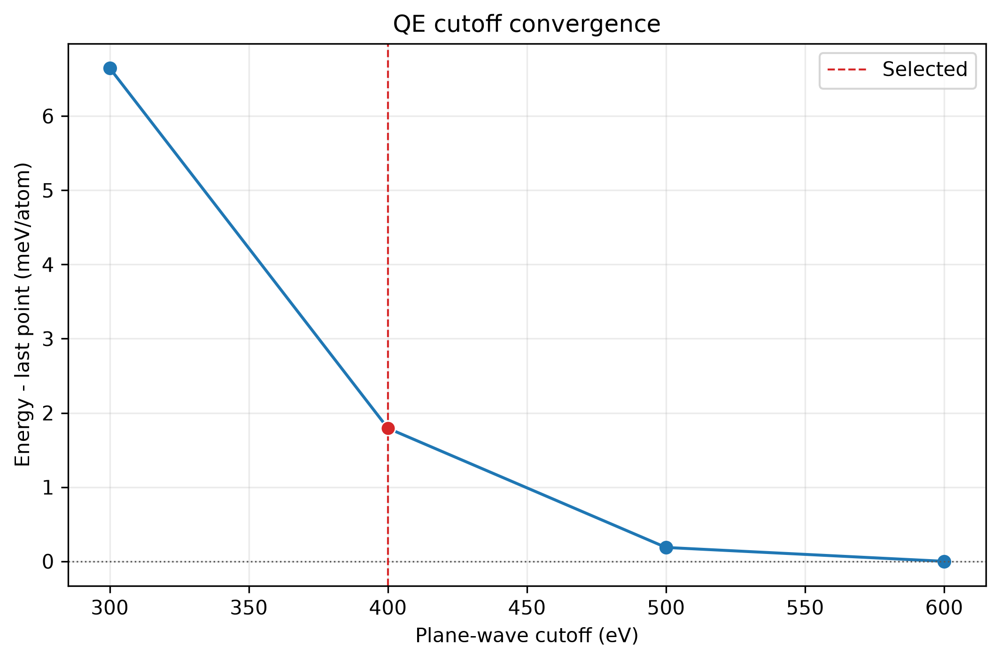
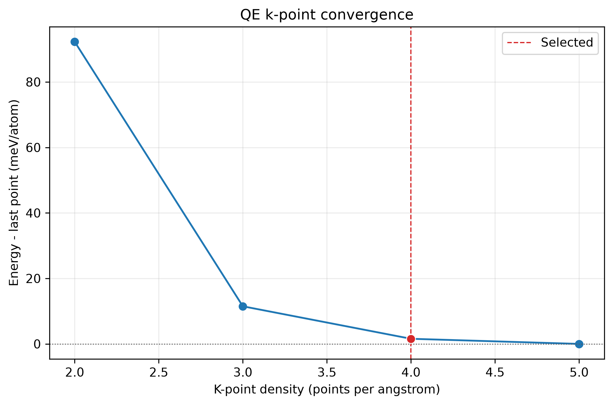
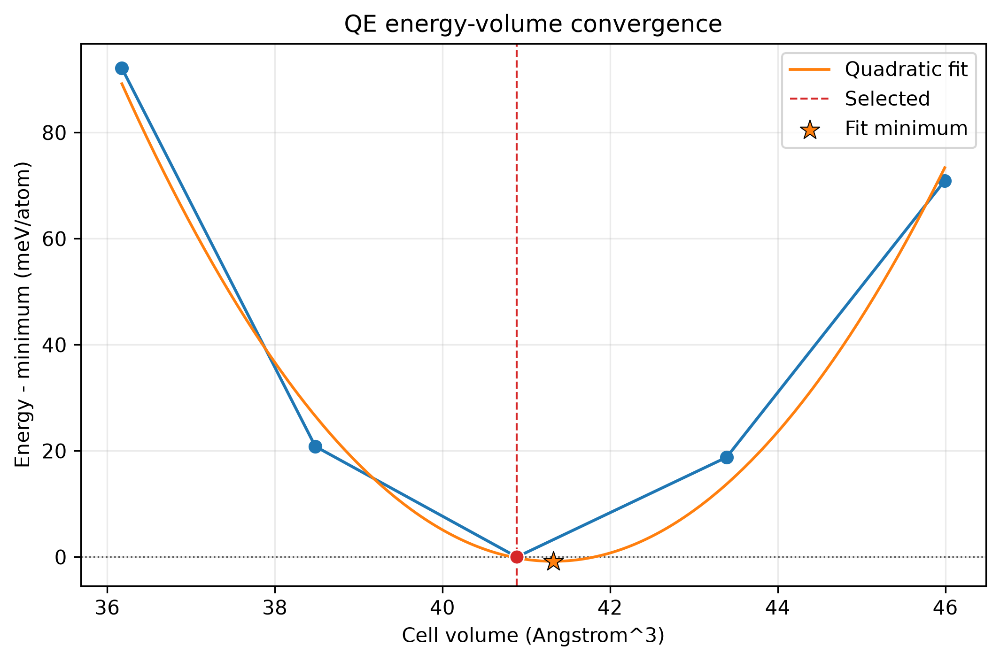

.. _tutorial-convergence:

Silicon: cutoff, k-points and lattice scale
===========================================

Use the examples installed under ``~/.nanoworks/examples``; see
:ref:`tutorial-examples-setup` for the installation command.

Prepare one engine's exercise
-----------------------------

This exercise uses the existing ``Convergence`` inputs. Unlike the first
silicon tutorial, it runs multiple ground-state calculations and does not
calculate DOS or bands. Start with the engine you have installed:

.. code-block:: bash

   cd ~/.nanoworks/examples/Convergence

For GPAW, use ``Si-GPAW-convergence.py`` in the same installed folder.
The two inputs select different output subdirectories. The remaining command sequence is the
same with that input filename. QE needs ``pw.x`` and its Si UPF; the QE
postprocessors used by the Fe tutorial are not needed here.

Read the candidate lists
------------------------

Both supplied inputs use PBE and the following settings:

.. code-block:: python

   Convergence_tasks = ['cutoff', 'kpoints', 'lattice']
   Convergence_cutoffs = [300, 400, 500, 600]
   Convergence_kpoints = [2.0, 3.0, 4.0, 5.0]
   Convergence_lattice_scales = [0.96, 0.98, 1.00, 1.02, 1.04]
   Convergence_energy_tolerance = 0.01
   Convergence_consecutive_points = 2
   Ground_kpts_density = 3.0

Cutoffs are in eV. The numeric k-point candidates are densities in points
per angstrom, not ``2x2x2`` through ``5x5x5`` meshes. The cutoff scan keeps
``Ground_kpts_density = 3.0`` fixed. Nanoworks then passes the selected
cutoff to the k-point scan, and both selected settings to the lattice scan.

The energy tolerance is in eV/atom: ``0.01`` means 10 meV/atom. With two
consecutive differences required, a candidate qualifies when the difference
arriving at that candidate and the next difference both meet the tolerance.
These are demonstration settings; a selected value is not a universal cutoff
for silicon or for another pseudopotential.

Check, then run
---------------

.. code-block:: bash

   dftconverge --check -p 2 -g Si.cif -i Si-QE-convergence.py
   dftconverge -p 2 -g Si.cif -i Si-QE-convergence.py

``--check`` validates the input plan without running an engine. Each completed
calculation reports its total energy and energy per atom. If a cutoff or
k-point scan finds no qualifying candidate, its dependent stages do not
start. Inspect the engine logs and extend the appropriate candidate list before repeating the exercise. Keep earlier results in their own
output subdirectory when changing the input settings.

Read the selected values and output files
-----------------------------------------

The QE input writes ``Si-QE-convergence-results/``; the GPAW input writes
``Si-GPAW-convergence-results/``. These paths are relative to the input file.

.. list-table:: Convergence outputs
   :header-rows: 1
   :widths: 45 55

   * - File
     - Meaning
   * - ``convergence-results.dat``
     - Calculated parameters, energies and lattice-point cell volumes.
   * - ``convergence-cutoff.png`` and ``convergence-kpoints.png``
     - Relative energies and the selected convergence value when found.
   * - ``convergence-lattice.png``
     - Calculated energy-volume points and a valid quadratic fit when available.
   * - ``Si-optimized.cif``
     - Calculated structure at a bracketed lattice minimum, when found.
   * - ``convergence-results.json``
     - Stored selections and sweep records used by ``--plot-results``.

The DAT table uses ``parameter_type`` to distinguish cutoff energy, k-point
density or mesh, and lattice scale. Cell volume is populated for lattice
points; ``nan`` in other rows does not mean that their SCF calculation failed.

   Cutoff scan from the supplied QE convergence example. Read a selected
   value as a result of this candidate list and tolerance.

   The k-point scan follows the cutoff scan. Density values control the
   sampling and are not literal mesh dimensions.

Cutoff and k-point figures show meV/atom relative to the last sampled point.
That plotting reference differs from the adjacent-energy differences used
for selection. A flatter curve suggests reduced sensitivity to that numerical
parameter within the sampled range; compare consistent SCF settings and the
same physical state before interpreting it.

The lattice step scales the cell and atomic positions without relaxing
internal coordinates at each point. A minimum must have calculated neighbours
on both sides. A boundary minimum requires a wider scan. The optimized CIF
uses the selected calculated point, while a valid quadratic fit provides a
separate interpolated minimum. This scan does not supply a bulk modulus.

   Lattice scan from the same recorded run. Distinguish the calculated
   points, selected structure and interpolated fit before using a minimum.

Regenerate the figures from the stored sweep records:

.. code-block:: bash

   dftconverge --plot-results Si-QE-convergence-results/convergence-results.json

This command replaces the available convergence PNGs without rerunning DFT.
It uses the JSON record; ``dftsolve --plot`` is for supported electronic and
optical tables, not this convergence table. See :doc:`../dftconverge` for the
complete keyword reference.
