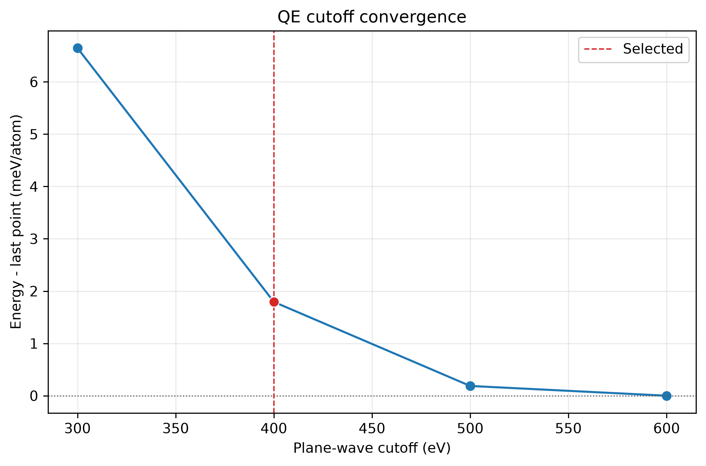
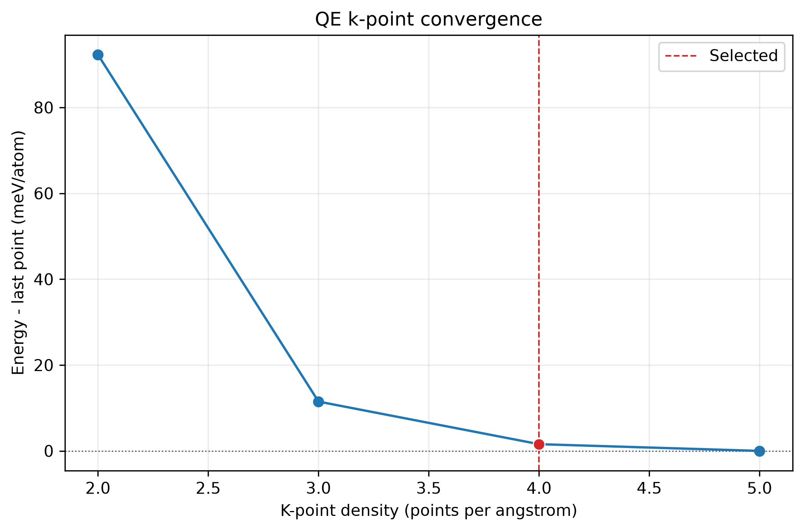
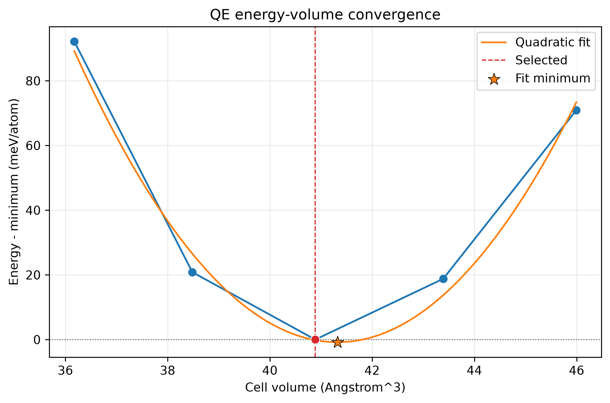
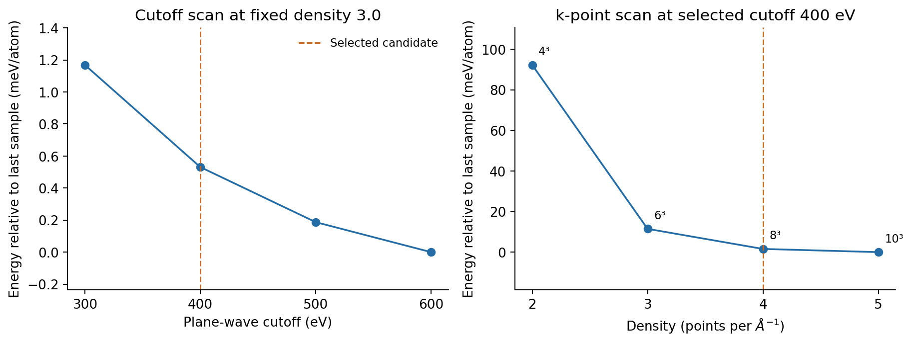
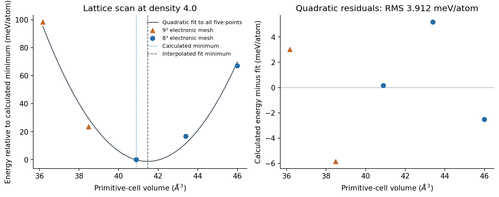

.. _tutorial-convergence:

Silicon: cutoff, k-points and lattice scale
===========================================

Use the examples installed under ``~/.nanoworks/examples``; see
:ref:`tutorial-examples-setup` for the installation command.

Prepare one engine's exercise
-----------------------------

This exercise uses the existing ``Convergence`` inputs. Unlike the first
silicon tutorial, it runs multiple ground-state calculations and does not
calculate DOS or bands. Start with the engine you have installed:

.. code-block:: bash

   cd ~/.nanoworks/examples/Convergence

For GPAW, use ``Si-GPAW-convergence.py`` in the same installed folder.
The two inputs select different output subdirectories. The remaining command sequence is the
same with that input filename. QE needs ``pw.x`` and its Si UPF; the QE
postprocessors used by the Fe tutorial are not needed here.

Read the candidate lists
------------------------

Both supplied inputs use PBE and the following settings:

.. code-block:: python

   Convergence_tasks = ['cutoff', 'kpoints', 'lattice']
   Convergence_cutoffs = [300, 400, 500, 600]
   Convergence_kpoints = [2.0, 3.0, 4.0, 5.0]
   Convergence_lattice_scales = [0.96, 0.98, 1.00, 1.02, 1.04]
   Convergence_energy_tolerance = 0.01
   Convergence_consecutive_points = 2
   Ground_kpts_density = 3.0

Cutoffs are in eV. The numeric k-point candidates are reciprocal-space
densities in points per inverse angstrom (GPAW/ASE convention), not ``2x2x2`` through ``5x5x5`` meshes. The cutoff scan keeps
``Ground_kpts_density = 3.0`` fixed. Nanoworks then passes the selected
cutoff to the k-point scan, and both selected settings to the lattice scan.

The energy tolerance is in eV/atom: ``0.01`` means 10 meV/atom. With two
consecutive differences required, a candidate qualifies when the difference
arriving at that candidate and the next difference both meet the tolerance.
These are demonstration settings; a selected value is not a universal cutoff
for silicon or for another pseudopotential.

Check, then run
---------------

.. code-block:: bash

   dftconverge --check -p 2 -g Si.cif -i Si-QE-convergence.py
   dftconverge -p 2 -g Si.cif -i Si-QE-convergence.py

``--check`` validates the input plan without running an engine. Each completed
calculation reports its total energy and energy per atom. If a cutoff or
k-point scan finds no qualifying candidate, its dependent stages do not
start. Inspect the engine logs and extend the appropriate candidate list before repeating the exercise. Keep earlier results in their own
output subdirectory when changing the input settings.

Read the selected values and output files
-----------------------------------------

The QE input writes ``Si-QE-convergence-results/``; the GPAW input writes
``Si-GPAW-convergence-results/``. These paths are relative to the input file.

.. list-table:: Convergence outputs
   :header-rows: 1
   :widths: 45 55

   * - File
     - Meaning
   * - ``convergence-results.dat``
     - Calculated parameters, energies and lattice-point cell volumes.
   * - ``convergence-cutoff.png`` and ``convergence-kpoints.png``
     - Relative energies and the selected convergence value when found.
   * - ``convergence-lattice.png``
     - Calculated energy-volume points and a valid quadratic fit when available.
   * - ``Si-optimized.cif``
     - Calculated structure at a bracketed lattice minimum, when found.
   * - ``convergence-results.json``
     - Stored selections and sweep records used by ``--plot-results``.

The DAT table uses ``parameter_type`` to distinguish cutoff energy, k-point
density or mesh, and lattice scale. Cell volume is populated for lattice
points; ``nan`` in other rows does not mean that their SCF calculation failed.

   Cutoff scan from the supplied QE convergence example. Read a selected
   value as a result of this candidate list and tolerance.

   The k-point scan follows the cutoff scan. Density values control the
   sampling and are not literal mesh dimensions.

Cutoff and k-point figures show meV/atom relative to the last sampled point.
That plotting reference differs from the adjacent-energy differences used
for selection. A flatter curve suggests reduced sensitivity to that numerical
parameter within the sampled range; compare consistent SCF settings and the
same physical state before interpreting it.

The lattice step scales the cell and atomic positions without relaxing
internal coordinates at each point. A minimum must have calculated neighbours
on both sides. A boundary minimum requires a wider scan. The optimized CIF
uses the selected calculated point, while a valid quadratic fit provides a
separate interpolated minimum. This scan does not supply a bulk modulus.

   Lattice scan from the same recorded run. Distinguish the calculated
   points, selected structure and interpolated fit before using a minimum.

Regenerate the figures from the stored sweep records:

.. code-block:: bash

   dftconverge --plot-results Si-QE-convergence-results/convergence-results.json

This command replaces the available convergence PNGs without rerunning DFT.
It uses the JSON record; ``dftsolve --plot`` is for supported electronic and
optical tables, not this convergence table. See :doc:`../dftconverge` for the
complete keyword reference.

.. _tutorial-convergence-qe:

QE convergence: selections and sampling limits
-------------------------------------------

The QE example uses the cutoff, k-point and lattice-scale candidate
lists described above. Its result directory contains 4 cutoff, 4
k-point-density and 5 lattice-scale records. All 13 entries are present in
``convergence-results.json`` and agree with the numerical values in
``convergence-results.dat``; these two summaries are not independent
SCF calculations.

The selected values are **400 eV**, **density 4.0** and **scale 1.00**.
The following differences are calculated from the archived per-atom
energies, not estimated from the PNG curves:

.. list-table:: Adjacent QE energy changes
   :header-rows: 1
   :widths: 65 35

   * - Sweep / transition
     - Absolute difference (meV/atom)
   * - Cutoff: 300 to 400 eV
     - 4.853151
   * - Cutoff: 400 to 500 eV
     - 1.606492
   * - Cutoff: 500 to 600 eV
     - 0.186466
   * - Density: 2.0 to 3.0
     - 80.793191
   * - Density: 3.0 to 4.0
     - 9.920183
   * - Density: 4.0 to 5.0
     - 1.569213

The criterion uses two consecutive adjacent differences below
10 meV/atom. For the cutoff sweep, 300 to 400 and 400 to 500 both qualify,
giving the first eligible selected value of 400 eV. For the density sweep,
2.0 to 3.0 fails, while 3.0 to 4.0 and 4.0 to 5.0 qualify; density 4.0
is selected. Both examples sit within the limited candidate range and
do not establish joint convergence of every observable.

These are **reciprocal-space density parameters**, not mesh dimensions.
Nanoworks converts them to explicit ``K_POINTS automatic`` grids. The
archived QE inputs confirm density 2.0 uses
``4 4 4 0 0 0`` and density 4.0 uses ``8 8 8 0 0 0``.
The corresponding QE SCF logs report 13 and 65 irreducible k points,
respectively, and eight electrons for the two-atom Si cell.
The density-4.0 log converges in four SCF iterations and reports
``-16.92471084 Ry`` or ``-230.27242188445 eV`` total energy,
matching the stored k-point record at the printed precision.
These observations verify two mesh cases directly; they do not imply
that the irreducible k-point counts equal those in GPAW.

The QE run uses PBE, Fermi-Dirac occupations and a scalar-relativistic
norm-conserving Si pseudopotential with four valence electrons per atom.
Record the exact QE pseudopotential file when repeating this calculation.
Different pseudopotential and PAW models and symmetry reductions mean
QE and GPAW absolute total energies are not directly comparable.

Why the lattice fit is not the selected geometry
~~~~~~~~~~~~~~~~~~~~~~~~~~~~~~~~~~~~~~~~~~~~~~~~~

The lowest calculated lattice energy occurs at scale **1.00** and volume
**40.888292745 cubic angstrom** per two-atom primitive cell. It is an
interior point with neighbours on both sides, so the stored optimized CIF
uses that calculated geometry.

The separate quadratic fit to all five E(V) points yields volume
**41.321510129 cubic angstrom**, corresponding to a conventional cubic
lattice parameter of about **5.487974 angstrom**. The selected calculated
point corresponds to **5.468728 angstrom**. The fit has an RMS energy
residual of approximately **3.819 meV/atom** over the five samples.
The fitted minimum was not an additional SCF calculation and is not
a converged bulk modulus or equation of state.

A further numerical caution is visible in the archived QE input files:
at lattice scale 0.96 the generated mesh is 9 x 9 x 9, but at
scale 1.00 it is 8 x 8 x 8. Fixed *density* does not imply a fixed
integration *mesh* throughout a lattice sweep. An E(V) fit intended
for quantitative work needs a sufficiently converged and controlled
k-mesh over the full volume interval, along with cutoff and
pseudopotential checks.

The original QE figures above are the appropriate plots for this record.
Do not compare its absolute energies or fitted volumes directly to the
GPAW run as a controlled engine benchmark. The documented values were
recomputed from the archived JSON/DAT and cross-checked against selected
QE input/SCF logs, without rerunning QE.

.. _tutorial-convergence-gpaw:

GPAW convergence: selections and fit
-------------------------------------

The GPAW example uses the bundled ``Si-GPAW-convergence.py`` input and
``Si.cif`` structure. From the installed
``Convergence`` directory, the GPAW commands are:

.. code-block:: console

   $ dftconverge --check -p 8 -g Si.cif -i Si-GPAW-convergence.py
   $ dftconverge -p 8 -g Si.cif -i Si-GPAW-convergence.py

The record contains 13 successful SCF calculations: four cutoff, four k-point
and five lattice-scale points. Their printed extrapolated total energies
agree with the stored DAT/JSON energies within ``5.1e-7`` eV, the SCF log's
rounding precision. The backend uses GPAW's potential-energy result;
the separately printed finite-smearing free energy is a different quantity.

The GPAW example uses nonmagnetic PBE, Fermi–Dirac occupations with a
0.05 eV width and `SCF_accuracy='normal'`. Its silicon PAW model has
four valence electrons per atom. The primitive two-atom cell has edges
3.86697465 angstrom and angles of 60 degrees. Record the PAW dataset
version with any research calculation.

Why 400 eV and density 4.0 were selected
~~~~~~~~~~~~~~~~~~~~~~~~~~~~~~~~~~~~~~~~

   Redrawn from the original numerical table. Energies are relative to the
   last point in each sweep. The selected values use adjacent differences,
   rather than the plotted reference.

.. list-table:: Adjacent energy differences in the GPAW run
   :header-rows: 1

   * - Sweep / transition
     - Absolute difference (meV/atom)
   * - Cutoff: 300 → 400 eV
     - 0.637728
   * - Cutoff: 400 → 500 eV
     - 0.343962
   * - Cutoff: 500 → 600 eV
     - 0.187331
   * - Density: 2 → 3
     - 80.800342
   * - Density: 3 → 4
     - 9.902525
   * - Density: 4 → 5
     - 1.572655

The tolerance is 10 meV/atom and two consecutive differences are required.
For the cutoff scan, the first qualifying window is 300→400 followed by
400→500, so the selected candidate is **400 eV**. The first candidate has no
incoming difference and cannot be selected by this rule. Selection of 400 eV
therefore does not establish that 300 eV fails every possible accuracy target.

The k scan uses the selected 400 eV. The large 2→3 difference prevents density
3 from qualifying; 3→4 and 4→5 both meet the tolerance, so **density 4.0** is
selected. The first of those differences is only just below 10 meV/atom.
A different target or a property other than total energy may require denser
sampling.

.. list-table:: Actual Gamma-centred meshes for the unscaled Si cell
   :header-rows: 1

   * - Density candidate
     - Full mesh
     - Full / irreducible k points
   * - 2.0
     - 4 x 4 x 4
     - 64 / 8
   * - 3.0
     - 6 x 6 x 6
     - 216 / 16
   * - 4.0
     - 8 x 8 x 8
     - 512 / 29
   * - 5.0
     - 10 x 10 x 10
     - 1000 / 47

These mesh counts were checked against all four SCF logs. A density of 4.0
is not a 4 x 4 x 4 mesh. GPAW/ASE defines density in points per inverse
angstrom; see `GPAW Brillouin-zone sampling
<https://gpaw.readthedocs.io/documentation/basic.html#brillouin-zone-sampling>`_.
The original exported DAT header's ``points/A`` text is retained in the
reference archive as a legacy label; interpret its numeric density values
using this reciprocal-space convention.

Discrete minimum, fit and changing meshes
~~~~~~~~~~~~~~~~~~~~~~~~~~~~~~~~~~~~~~~~~~

The lattice stage uses 400 eV and density 4.0. It evaluates the five supplied
scales without relaxing internal coordinates. The lowest calculated energy
occurs at scale 1.00, with neighbours on both sides, so this is the selected
structure written to ``Si-optimized.cif``. Its cell and fractional positions
match the starting geometry within numerical precision.

   The fitted minimum and selected calculated point are separate. Marker
   shape and colour distinguish the actual electronic meshes used at each
   volume; the right panel shows fit residuals.

.. list-table:: Calculated and interpolated minima in this record
   :header-rows: 1

   * - Quantity
     - Calculated minimum
     - Quadratic interpolation
   * - Volume (cubic angstrom / primitive cell)
     - 40.888292745
     - 41.461295816
   * - Energy (eV/atom)
     - -5.397426474
     - -5.398729120
   * - Conventional cubic lattice parameter (angstrom)
     - 5.468727995
     - 5.494155591

The fit uses all five E(V) points. Its RMS residual is **3.912 meV/atom**,
so the displayed digits do not imply a precisely determined equilibrium
volume. The optimized CIF uses the calculated point, not the fitted volume.
The fitted scale, approximately 1.004650, was not separately evaluated.

.. important::

   Holding k-point density fixed does not hold the mesh fixed as the cell
   changes. Here scales 0.96 and 0.98 use 9 x 9 x 9, while scales 1.00, 1.02
   and 1.04 use 8 x 8 x 8. All are Gamma-centred. These assignments come from
   the individual SCF logs, not from assuming a mesh for the entire sweep.

The E(V) curve consequently combines volume dependence with changes in its
numerical integration grid. Before extracting precise equilibrium or elastic
properties, examine mesh consistency and convergence across the volume
range. The quadratic fit is an instructional interpolation, not a converged
equation-of-state or bulk-modulus result. The cutoff test was also performed
at fixed density 3.0, rather than repeated at every volume and the final
density 4.0; these sequential tests are not a joint convergence proof.

Download and redraw the GPAW results
~~~~~~~~~~~~~~~~~~~~~~~~~~~~~~~~~~~~~

:download:`Download GPAW input, structures, original table, SCF metadata and plotting script <../_static/examples/silicon-gpaw-convergence-reference.zip>`.
Extract the archive, install NumPy 2 or newer and Matplotlib, then run:

.. code-block:: console

   $ python plot_convergence.py

This verifies source hashes, total/per-atom energies, recorded SCF metadata,
selection windows, volume scaling and the fitted minimum; it writes
``checks.dat`` and redraws the two GPAW figures. It imports no DFT engine.
The raw input/CIF/DAT bytes are preserved. ``recorded-scf-metadata.dat`` is
a derived table of settings and rounded energies extracted from the 13 logs;
``recorded-reference.dat`` carries the original summary's numerical selections
and fitted values. The original JSON record and machine-specific logs remain
in the source result directory and are not needed for these figures.

If the original result directory is available locally, the optional command
also checks all 13 SCF-log hashes and printed energies:

.. code-block:: console

   $ python plot_convergence.py --log-dir /path/to/Si-GPAW-convergence-results

For Nanoworks' own ``--plot-results`` command, use the original JSON record
as shown above. The downloadable table-based plotter is an independent way
to inspect this archived run; it does not replace that CLI input format.
