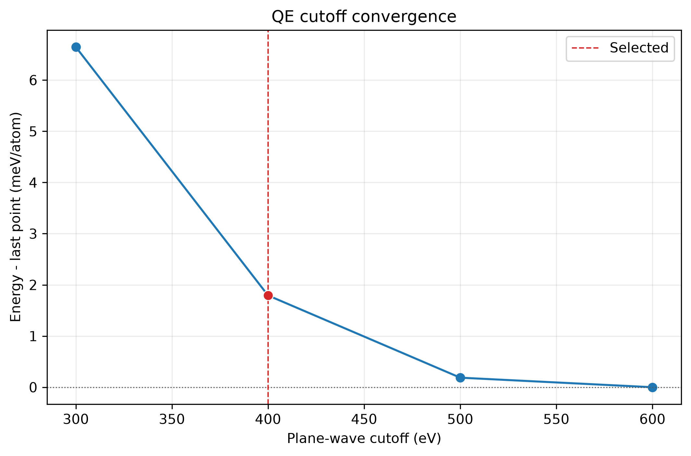
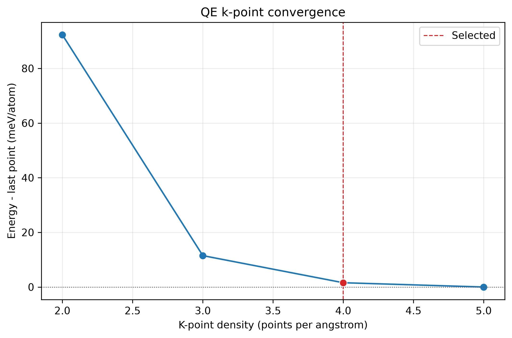

.. _tutorial-convergence:

Silicon: convergence (QE)
=========================

.. literalinclude:: ../../../nanoworks/examples/Convergence/Si-QE-convergence.py
   :language: python
   :lines: 5-
   :caption: Si-QE-convergence.py

:download:`Download Si-QE-convergence.py <../../../nanoworks/examples/Convergence/Si-QE-convergence.py>`.

Run
---

Requires QE and the managed pseudopotentials.

.. code-block:: bash

   cd ~/.nanoworks/examples/Convergence
   dftconverge -p 4 -i Si-QE-convergence.py -g Si.cif

Results
-------

.. note::

   This example is a qualitative demonstration. For reliable quantitative
   results, optimize the structure where appropriate and converge the
   numerical settings.

Results are in ``Si-QE-convergence-results/``. Read the cutoff and
k-sampling curves to see when energy changes fall below 0.01 eV/atom.
The k-point candidates are reciprocal-space densities, not 2 x 2 x 2 meshes.
The lattice scan uses the selected cutoff and sampling. If no candidate
passes, extend the scan before using a lattice minimum. A minimum at the
edge of the interval is not a reliable equilibrium fit.

   Recorded example output.

   Recorded example output.

:doc:`Detailed recorded results <../validation/silicon-convergence>`.
